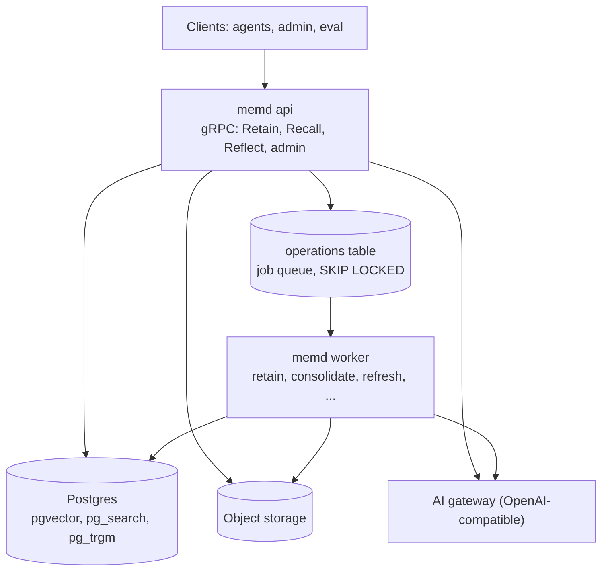

# memd

memd is a stateless Go gRPC agent-memory service — a Go clone of
[Hindsight](https://github.com/vectorize-io/hindsight)'s memory engine. Agents **retain** text, **recall**
it through four retrieval arms (semantic, BM25 keyword, graph, temporal) fused with RRF and a
cross-encoder, and **reflect** over it with a tool-calling loop. Background workers consolidate facts into
observations and keep mental models (synthesized pages) fresh. All state lives in Postgres (pgvector,
pg_search, pg_trgm) and object storage; LLMs, the reranker and the embedder sit behind an
OpenAI-compatible AI gateway.

> Status: integrated and through the final review (fix-ups WP-18..21 merged). `memd api`, `memd worker`
> and `memd all` run every engine; `make e2e` exercises the whole service against Postgres, MinIO and an
> emulated gateway. The behaviour is specified in `docs/SPEC.md`; `docs/rules.md` maps every behavioural rule
> to its tests; accepted gaps are listed in `docs/STATUS.md`.

## Architecture



The whole gRPC API is one file, [`api/memory/v1/memory.proto`](api/memory/v1/memory.proto): the shared
conventions first, then every service, then each service's messages.

## Quick start

From a clean checkout (Go, Docker, Python 3.12 and `grpcurl` installed):

```sh
make up        # Postgres (ParadeDB image) + MinIO via docker compose; creates the memd bucket
make migrate   # alembic upgrade head (builds the Alembic venv on first use)

# No AI gateway at hand? Run the deterministic emulator the e2e tests use (port 4000). It answers every
# prompt with schema-valid output and 768-dimension embeddings, so it is for trying memd out, not for
# real answers. To use a real OpenAI-compatible gateway instead, point MEMD_GATEWAY_URL at it and bind
# MEMD_MODEL (every LLM slot), MEMD_MODEL_RERANK and MEMD_EMBED_MODEL (768 dimensions) to its models.
go run ./test/e2e/gatewayemu/cmd/gatewayemu &

export MEMD_GATEWAY_URL=http://127.0.0.1:4000/v1 \
  MEMD_S3_ENDPOINT=http://localhost:59000 MEMD_S3_BUCKET=memd MEMD_S3_ACCESS_KEY=memd \
  MEMD_S3_SECRET_KEY=memd-secret MEMD_S3_PATH_STYLE=true \
  MEMD_MODEL_EXTRACT=emu-extract MEMD_MODEL_TIME_PARSE=emu-time_parse MEMD_MODEL_CONSOLIDATE=emu-consolidate \
  MEMD_MODEL_DEDUP_CHECK=emu-dedup_check MEMD_MODEL_REFLECT=emu-reflect \
  MEMD_MODEL_STRUCTURED_OUTPUT=emu-structured_output MEMD_MODEL_MENTAL_MODEL_DELTA=emu-mental_model_delta \
  MEMD_MODEL_SYNTHESIZE=emu-synthesize MEMD_MODEL_RERANK=emu-rerank

make run       # memd all (api + worker in one process) on :50051; MEMD_DSN comes from the Makefile
```

`memd <api|worker|all>` reads its settings from `MEMD_*` environment variables or the matching flags
(`MEMD_GRPC_ADDR` = `-grpc-addr`); run `go run ./cmd/memd` to list them all. At startup memd checks that the
gateway's embedding model returns 768 dimensions, that EXTRACT and REFLECT have a model, and that both S3
keys are set. A worker's id is `<MEMD_WORKER_ID or hostname>-<uuid>`, unique per process; set
`MEMD_WORKER_HEALTH_ADDR` to serve grpc.health from a worker. In production run `memd api` and `memd worker` as two
Deployments over the same Postgres and bucket.

## grpcurl examples

The server registers gRPC reflection, so grpcurl needs no proto files. Every call carries the tenant in the
`x-tenant-id` header.

```sh
grpcurl -plaintext -H 'x-tenant-id: acme' \
  -d '{"bank_id":"b1","items":[{"content":"Alice moved to Paris in May. Alice works as a nurse."}]}' \
  localhost:50051 memory.v1.MemoryService/Retain
grpcurl -plaintext -H 'x-tenant-id: acme' -d '{"bank_id":"b1","query":"Where does Alice live?"}' \
  localhost:50051 memory.v1.MemoryService/Recall
grpcurl -plaintext -H 'x-tenant-id: acme' -d '{"bank_id":"b1","query":"Summarize what we know about Alice"}' \
  localhost:50051 memory.v1.MemoryService/Reflect
grpcurl -plaintext -H 'x-tenant-id: acme' -d '{"bank_id":"b1"}' localhost:50051 memory.v1.BankService/GetBankStats
```

### Sync vs async retain

`Retain` is synchronous by default. It returns once the units are committed, and the extraction LLM calls
run inside the RPC. A call with no deadline of its own gets `MEMD_RPC_DEADLINE` (120s by default).

A sync retain that fails part-way, for example on a deadline or an LLM outage, can leave the document
partly replaced. Retrying it starts from scratch: an inline run never resumes (decision 801). So a document
whose extraction takes longer than the deadline can never complete synchronously.

For long documents, set `run_async: true`. The `retain_document` job resumes from its committed chunks
across retries and worker crashes. You can also give the call a longer client deadline.

## Tests

```sh
make test      # go test -race ./... (the Postgres contract suites use testcontainers)
make e2e       # compose stack + emulated gateway + memd api/worker processes: every scenario, crash and reclaim
```

## Benchmarks

`eval/` runs LoCoMo, LongMemEval and the golden fixtures against a running memd. It downloads the datasets,
writes a report per run, resumes interrupted runs and compares runs. LoCoMo is scored the way Hindsight's
published LoCoMo numbers are, so the two compare directly. [eval/README.md](eval/README.md) has the full flow
against a real AI gateway.

```sh
make bench BENCH=golden ARGS=-stub                  # smoke test, no server
make bench CONFIG=eval/configs/locomo.yaml          # LoCoMo against memd on :50051
make bench-compare A=eval-results/<run> B=eval-results/<run>
```

## Configuration and overrides

One `BankConfig` shape is used at every level and merged server < tenant < bank < strategy < request
(< item for retain). Scalars: set replaces unset; `models` merge per slot; other lists replace. Requests
that can't use a field reject it with `INVALID_ARGUMENT`. See "Per-request overrides" in `docs/SPEC.md`.

## Model routing

Every LLM-backed operation has its own slot (EXTRACT, TIME_PARSE, CONSOLIDATE, DEDUP_CHECK, REFLECT,
STRUCTURED_OUTPUT, SYNTHESIZE, MENTAL_MODEL_DELTA, RERANK). Embedding is server-wide:
nomic-embed-text-v1.5 at 768 dimensions. See "Model routing" in `docs/SPEC.md`.

## Datadog (optional)

memd can send traces, runtime metrics and (separately) profiles to a Datadog agent. It uses dd-trace-go v2
directly, with no OpenTelemetry. **It is off by default.** When off, no tracer starts, no instrumentation is
installed and no agent is contacted.

| Setting (env / flag) | Default | Effect |
|---|---|---|
| `MEMD_DATADOG_ENABLED` / `-datadog-enabled=true` | `false` | Turns on tracing, trace ids in logs, and runtime metrics. |
| `MEMD_DATADOG_PROFILER` / `-datadog-profiler=true` | `false` | Also starts the continuous profiler. Ignored unless Datadog is enabled. |

When enabled, the library reads the standard Datadog variables:

- **Agent address:** `DD_AGENT_HOST` / `DD_TRACE_AGENT_PORT`, or `DD_TRACE_AGENT_URL`. The default is `localhost:8126`.
- **Unified service tagging:** `DD_ENV`, `DD_VERSION`, and `DD_SERVICE` (default `memd`).
- **Tags:** `DD_TAGS`.
- **Sampling:** `DD_TRACE_SAMPLE_RATE` / `DD_TRACE_SAMPLING_RULES`.
- **Runtime metrics:** `DD_RUNTIME_METRICS_ENABLED` (default on with Datadog) and `DD_DOGSTATSD_PORT`.

An unreachable agent never fails startup or a request: payloads are dropped and the tracer keeps retrying.

What gets traced:

- **gRPC:** one `grpc.server` span per RPC, with resource = the full method. It is tagged `memd.tenant` and `memd.bank`.
- **Worker jobs:** one `memd.job` span per run, with resource = the kind. It carries the operation id, attempt and outcome.
- **Maintenance:** one `memd.maintenance.tick` span per tick.
- **Postgres:** one `postgres.query` span per statement, recorded only inside a request, job or tick.
- **AI gateway:** one `memd.gateway.call` span per call, tagged with model slot and name, with `http.request` spans under it.
- **S3:** one `S3.request` span per call.
- **Logs:** records logged with a span in context get `dd.trace_id` and `dd.span_id`.

Prompts, model output, memory content, request bodies, metadata and SQL parameters are never recorded. Span
errors carry only the error class. See [decision 2400](docs/decisions/2400-datadog-optional.md).

To run an agent next to the local stack, add this to `docker-compose.yml` or an override file:

```yaml
  datadog-agent:
    image: gcr.io/datadoghq/agent:7
    environment:
      DD_API_KEY: ${DD_API_KEY}
      DD_SITE: ${DD_SITE:-datadoghq.com}
      DD_APM_ENABLED: "true"
      DD_APM_NON_LOCAL_TRAFFIC: "true"
      DD_DOGSTATSD_NON_LOCAL_TRAFFIC: "true"
    ports: ["8126:8126", "8125:8125/udp"]
```

Then start memd:

```sh
MEMD_DATADOG_ENABLED=true DD_ENV=dev DD_VERSION=$(git rev-parse --short HEAD) go run ./cmd/memd all
```

In Kubernetes, set `DD_AGENT_HOST` from the node IP (`status.hostIP`) to reach the agent DaemonSet.

## Contributing

Read [AGENTS.md](AGENTS.md) first: layout, rules and the `make gen && make lint && make test` gate.

The API may change freely until the first release, so `make lint` runs `buf lint` only; after the first release,
`buf breaking` runs against that tag. Proto rules are in [api/AGENTS.md](api/AGENTS.md).
