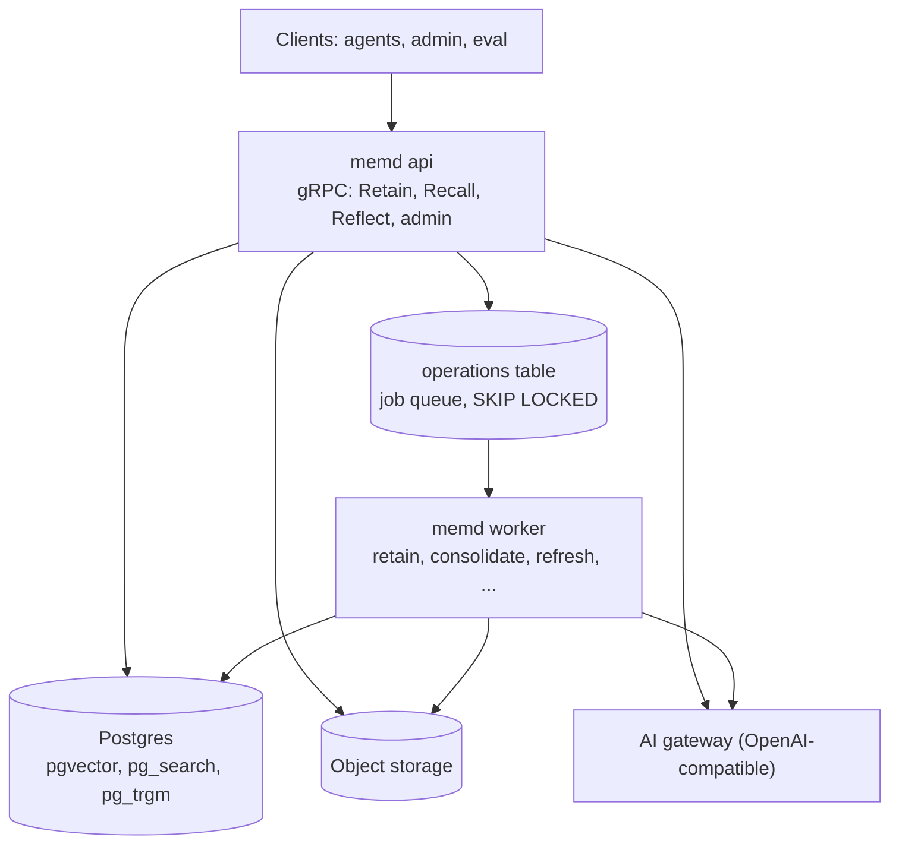

# memd

memd is a stateless Go gRPC agent-memory service — a Go clone of
[Hindsight](https://github.com/vectorize-io/hindsight)'s memory engine. Agents **retain** text, **recall**
it through four retrieval arms (semantic, BM25 keyword, graph, temporal) fused with RRF and a
cross-encoder, and **reflect** over it with a tool-calling loop. Background workers consolidate facts into
observations and keep mental models (synthesized pages) fresh. All state lives in Postgres (pgvector,
pg_search, pg_trgm) and object storage; LLMs, the reranker and the embedder sit behind an
OpenAI-compatible AI gateway.

> Status: integrated (WP-14b). `memd api`, `memd worker` and `memd all` run every engine; `make e2e`
> exercises the whole service against Postgres, MinIO and an emulated gateway. The behaviour is specified in
> `docs/SPEC.md`; `docs/rules.md` maps every behavioural rule to its tests.

## Architecture



## Quick start

From a clean checkout (Go, Docker, Python 3.12 and `grpcurl` installed):

```sh
make up        # Postgres (ParadeDB image) + MinIO via docker compose; creates the memd bucket
make migrate   # alembic upgrade head (builds the Alembic venv on first use)

# No AI gateway at hand? Run the deterministic emulator the e2e tests use (port 4000). It answers every
# prompt with schema-valid output and 768-dimension embeddings, so it is for trying memd out, not for
# real answers. To use a real OpenAI-compatible gateway instead, point MEMD_GATEWAY_URL at it and bind
# MEMD_MODEL (every LLM slot), MEMD_MODEL_RERANK and MEMD_EMBED_MODEL (768 dimensions) to its models.
go run ./test/e2e/gatewayemu/cmd/gatewayemu &

export MEMD_GATEWAY_URL=http://127.0.0.1:4000/v1 \
  MEMD_S3_ENDPOINT=http://localhost:59000 MEMD_S3_BUCKET=memd MEMD_S3_ACCESS_KEY=memd \
  MEMD_S3_SECRET_KEY=memd-secret MEMD_S3_PATH_STYLE=true \
  MEMD_MODEL_EXTRACT=emu-extract MEMD_MODEL_TIME_PARSE=emu-time_parse MEMD_MODEL_CONSOLIDATE=emu-consolidate \
  MEMD_MODEL_DEDUP_CHECK=emu-dedup_check MEMD_MODEL_REFLECT=emu-reflect \
  MEMD_MODEL_STRUCTURED_OUTPUT=emu-structured_output MEMD_MODEL_MENTAL_MODEL_DELTA=emu-mental_model_delta \
  MEMD_MODEL_SYNTHESIZE=emu-synthesize MEMD_MODEL_RERANK=emu-rerank

make run       # memd all (api + worker in one process) on :50051; MEMD_DSN comes from the Makefile
```

`memd <api|worker|all>` reads its settings from `MEMD_*` environment variables or the matching flags
(`MEMD_GRPC_ADDR` = `-grpc-addr`); run `go run ./cmd/memd` to list them all. At startup memd checks that the
gateway's embedding model returns 768 dimensions. In production run `memd api` and `memd worker` as two
Deployments over the same Postgres and bucket.

## grpcurl examples

The server registers gRPC reflection, so grpcurl needs no proto files. Every call carries the tenant in the
`x-tenant-id` header.

```sh
grpcurl -plaintext -H 'x-tenant-id: acme' \
  -d '{"bank_id":"b1","items":[{"content":"Alice moved to Paris in May. Alice works as a nurse."}]}' \
  localhost:50051 memory.v1.MemoryService/Retain
grpcurl -plaintext -H 'x-tenant-id: acme' -d '{"bank_id":"b1","query":"Where does Alice live?"}' \
  localhost:50051 memory.v1.MemoryService/Recall
grpcurl -plaintext -H 'x-tenant-id: acme' -d '{"bank_id":"b1","query":"Summarize what we know about Alice"}' \
  localhost:50051 memory.v1.MemoryService/Reflect
grpcurl -plaintext -H 'x-tenant-id: acme' -d '{"bank_id":"b1"}' localhost:50051 memory.v1.BankService/GetBankStats
```

## Tests

```sh
make test      # go test -race ./... (the Postgres contract suites use testcontainers)
make e2e       # compose stack + emulated gateway + memd api/worker processes: every scenario, crash and reclaim
```

## Configuration and overrides

One `BankConfig` shape is used at every level and merged server < tenant < bank < strategy < request
(< item for retain). Scalars: set replaces unset; `models` merge per slot; other lists replace. Requests
that can't use a field reject it with `INVALID_ARGUMENT`. See "Per-request overrides" in `docs/SPEC.md`.

## Model routing

Every LLM-backed operation has its own slot (EXTRACT, TIME_PARSE, CONSOLIDATE, DEDUP_CHECK, REFLECT,
STRUCTURED_OUTPUT, SYNTHESIZE, MENTAL_MODEL_DELTA, RERANK). Embedding is server-wide:
nomic-embed-text-v1.5 at 768 dimensions. See "Model routing" in `docs/SPEC.md`.

## Contributing

Read [AGENTS.md](AGENTS.md) first: layout, rules and the `make gen && make lint && make test` gate.
