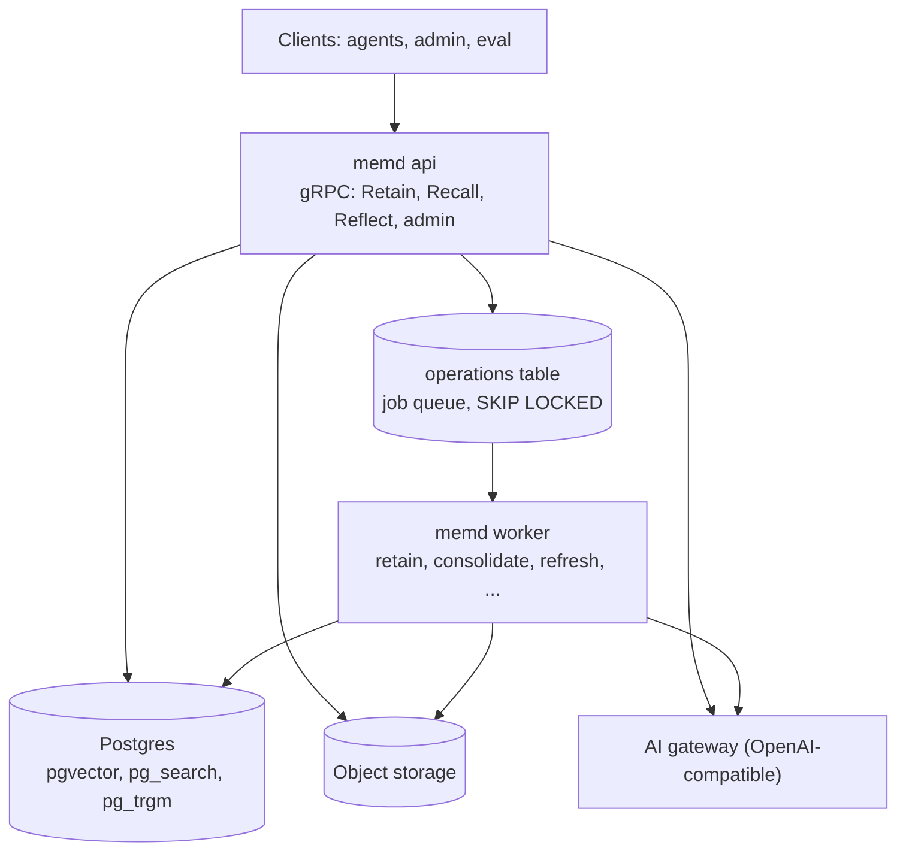

# memd

memd is a stateless Go gRPC agent-memory service — a Go clone of
[Hindsight](https://github.com/vectorize-io/hindsight)'s memory engine. Agents **retain** text, **recall**
it through four retrieval arms (semantic, BM25 keyword, graph, temporal) fused with RRF and a
cross-encoder, and **reflect** over it with a tool-calling loop. Background workers consolidate facts into
observations and keep mental models (synthesized pages) fresh. All state lives in Postgres (pgvector,
pg_search, pg_trgm) and object storage; LLMs, the reranker and the embedder sit behind an
OpenAI-compatible AI gateway.

> Status: scaffold (WP-00). The contracts, schema and test suites exist; the engines and the binary are
> built by later work packages. The full behaviour is specified in `docs/SPEC.md`.

## Architecture



## Quick start

```sh
make up        # Postgres (ParadeDB image) + MinIO via docker compose
make migrate   # alembic upgrade head, then dump schema/schema.sql
make run       # memd all (api + worker in one process)
```

## grpcurl examples

```sh
grpcurl -plaintext -H 'x-tenant-id: acme' -d '{"bank_id":"b1","items":[{"content":"Alice moved to Paris in May."}]}' \
  localhost:50051 memory.v1.MemoryService/Retain
grpcurl -plaintext -H 'x-tenant-id: acme' -d '{"bank_id":"b1","query":"Where does Alice live?"}' \
  localhost:50051 memory.v1.MemoryService/Recall
grpcurl -plaintext -H 'x-tenant-id: acme' -d '{"bank_id":"b1","query":"Summarize what we know about Alice"}' \
  localhost:50051 memory.v1.MemoryService/Reflect
```

## Configuration and overrides

One `BankConfig` shape is used at every level and merged server < tenant < bank < strategy < request
(< item for retain). Scalars: set replaces unset; `models` merge per slot; other lists replace. Requests
that can't use a field reject it with `INVALID_ARGUMENT`. See "Per-request overrides" in `docs/SPEC.md`.

## Model routing

Every LLM-backed operation has its own slot (EXTRACT, TIME_PARSE, CONSOLIDATE, DEDUP_CHECK, REFLECT,
STRUCTURED_OUTPUT, SYNTHESIZE, MENTAL_MODEL_DELTA, RERANK). Embedding is server-wide:
nomic-embed-text-v1.5 at 768 dimensions. See "Model routing" in `docs/SPEC.md`.

## Contributing

Read [AGENTS.md](AGENTS.md) first: layout, rules and the `make gen && make lint && make test` gate.
