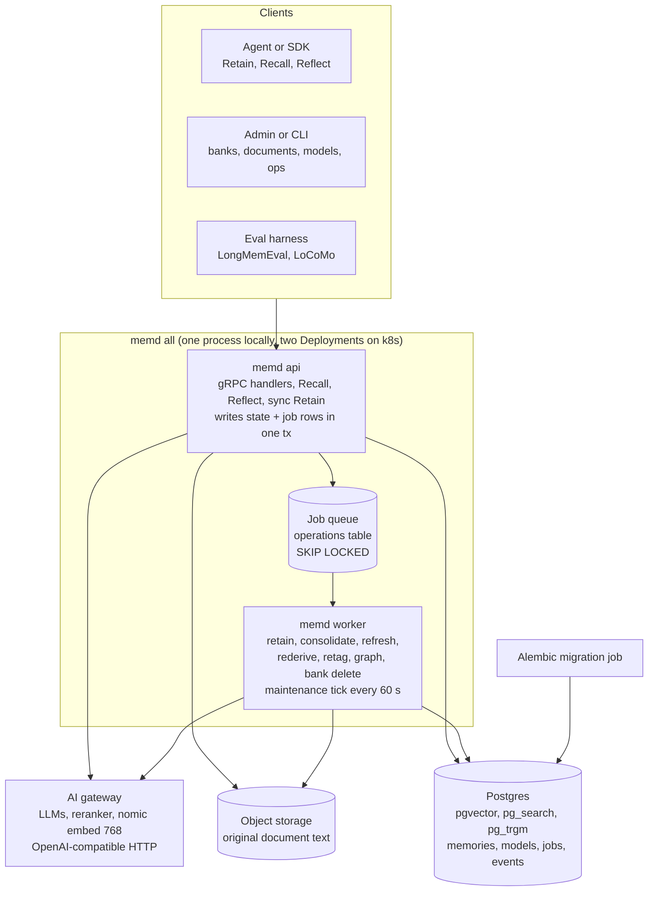
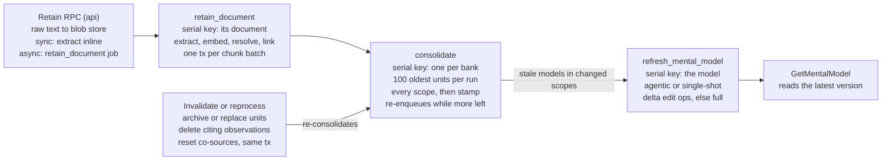
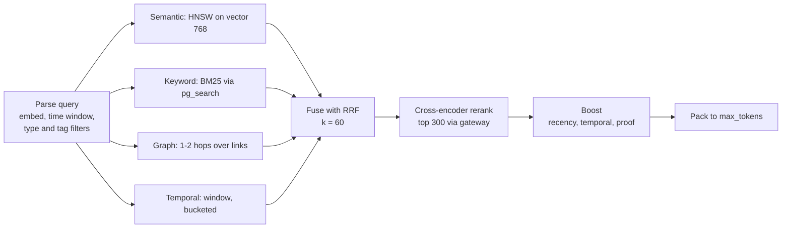

<!--
SPEC.md — memd (Hindsight clone) service specification
Exported 2026-10-10 from the doc "Hindsight Clone — Service Interfaces":
https://claude.ai/code/artifact/98467333-24d1-45a6-89ac-55114c248fff
This file is the source of truth for behaviour. AGENTS.md (listed below) is the source of truth for how to change code.
Diagrams were converted to Mermaid. The two proto blocks in "gRPC surface" are ONE file (split only for length);
it compiles with protoc and passes `buf lint` STANDARD as written.
-->

# Hindsight Clone — Service Interfaces


## Architecture

`memd` is a stateless gRPC service plus stateless workers, coordinated through a job queue; Postgres, object storage and your AI gateway hold everything else. Scaling on k8s is just replica counts.


*Both memd modes are stateless; all state, jobs included, lives in Postgres and S3.*

Only the api talks to clients and only the worker runs LLM-heavy background jobs, so the two scale on different signals.

## Process model

One Go binary, `memd`, with two runtime modes plus an Alembic migration step; every mode is stateless and all state lives in Postgres and object storage. Locally you run `memd all`; on k8s the same image runs as two Deployments.

| Mode | Runs | Local | k8s |
|---|---|---|---|
| `memd api` | gRPC server: Recall, Reflect, sync Retain (extraction inline), every admin, curation and mental-model RPC. Writes state and the jobs it causes in one transaction | Part of `memd all` | Deployment + Service, HPA on CPU / in-flight RPCs |
| `memd worker` | Job runner over the `operations` table (retain, consolidate, rederive, retag, refresh, graph maintenance, bank delete), heartbeats, and a 60 s maintenance tick | Part of `memd all` | Deployment, any replica count, HPA on pending jobs |
| `alembic upgrade head` | Alembic migrations from a small Python image, then exits | Run once before `memd all` (docker compose or a make target) | Job / Helm pre-upgrade hook |

- **Config:** env + flags only (DSN, blob endpoint, gateway URL, model names, budgets). No local disk state, so pods are disposable.
- **Health:** standard `grpc.health.v1` plus a readiness check on Postgres and the gateway.
- **Tenancy:** auth is out of scope; an interceptor reads the tenant from an x-tenant-id metadata header, never from the request body; every store call takes `(tenant, bank)`.

## Feature scope

v1 matches Hindsight's memory engine except agent tooling, mounts, security scanning, multimodal input, multilingual handling and ops tooling. There is no delete API for a single memory: invalidate archives one (reversibly), upsert and reprocess replace a document's units, and DeleteBank removes everything.

| Feature | In v1 | Where in the spec |
|---|---|---|
| Retain: sync or async, extraction modes, timeless content, entity hints, document upsert + reprocess, resume after a crash | Yes | RetainRequest, ExtractionStrategy, EntityResolver, Retainer |
| Missions, entity resolution, typed entity labels (value, multi, text, map), free-form toggle | Yes | BankConfig, LabelResolver |
| Recall: four arms (BM25 via pg_search), RRF, rerank, boosts, budgets, prefer_observations, tag_groups, min_scores, rich responses, trace | Yes | RecallRequest, recall engine |
| Observations: scope modes, dedup, caps, batch size, enable toggle, strategies + preview | Yes | ObservationScopes, Consolidator, StrategyMatcher |
| Reflect: disposition, directives, answer cap, token budget, include options, observation-search knobs, strict failure | Yes | ReflectRequest, ReflectConfig, Behavioural rules |
| Mental models + pages: full / delta, agentic or single-shot refresh, triggers, interval floor, scope filters, dry run, clear, history with failures, detail levels | Yes | MentalModelService, Synthesizer, RefreshRunner |
| Memory units: list / filter, fetch, observation history, edit / invalidate / restore | Yes | MemoryUnitService, Curator |
| Documents: list filters, retag | Yes | DocumentService, Retagger |
| Banks: stats, tag listing, config read / reset, prompt preview, templates | Yes | BankService, StatsReader, PromptPreviewer |
| Operations: cancel, retry, progress, parents, heartbeats, retention | Yes | OperationService, Claimer, OperationControl |
| Graph maintenance after unit removal | Yes | graph_maintenance job, GraphMaintainer |
| Per-operation model routing, per-request overrides, config hierarchy | Yes | Model routing, BankConfig, TenantService |
| Lifecycle events | Yes | lifecycle_events table, ListEvents |
| Hard delete of a single memory or document | No | Invalidate (reversible) or DeleteBank |
| Bank aliases, export / import / clone | No | Deferred |
| Append update mode, client operation ids, provider batch extraction, per-tenant rate limits | No | — |
| Security / PII, images, audio, files, multilingual, ops CLI, mount, MCP | No | — |

## Model routing

Every LLM-backed operation has its own slot, and each slot binds to any gateway model with its own parameters. Bindings merge per slot across server < tenant < bank < strategy < request: the most specific level that sets a slot wins, and setting one slot never clears the others.

| Slot | Used by | Request override |
|---|---|---|
| EXTRACT | Retain fact, entity and label extraction | RetainRequest |
| TIME_PARSE | Relative dates at retain; query time windows, only when a cue is found and rules fail | RetainRequest, RecallRequest |
| CONSOLIDATE | Create / update / none decisions per scope | Consolidate request, strategy |
| DEDUP_CHECK | Merge-or-keep check for near-duplicate observations | Consolidate request, strategy |
| REFLECT | Tool-calling turns of the reflect loop and of agentic refresh | ReflectRequest, RefreshMentalModel |
| STRUCTURED_OUTPUT | Second pass projecting prose into a JSON Schema | ReflectRequest |
| SYNTHESIZE | Single-shot mental-model refresh (full) | RefreshMentalModel, stored on the model |
| MENTAL_MODEL_DELTA | Edit ops for incremental page refresh | RefreshMentalModel, stored on the model |
| RERANK | Cross-encoder scores in recall | RecallRequest |
| EMBED | Units, observations, queries, page search | None: server-wide nomic-embed-text-v1.5, 768 dims |

- **Binding fields:** model name, temperature, max output tokens, reasoning effort, plus a free-form `extra` object passed through to the OpenAI-compatible request body.
- **Embedding is global:** one model for the deployment, nomic-embed-text-v1.5 at 768 dimensions, so `memory_units.embedding` is `vector(768)` with one HNSW index. The adapter adds nomic's `search_document:` / `search_query:` prefixes, which the model needs for good retrieval. Changing the model means re-embedding everything (not in v1).
- **Async slots** (consolidate, dedup) take overrides from a manual Consolidate call or the matching consolidation strategy, never from the retain that triggered them (see Per-request overrides).
- **Concurrency:** the gateway client holds a process-wide limit plus an optional per-slot limit (as Hindsight does), so adding worker replicas can't push the gateway into 429s. Per-tenant limits are deferred.
- **Usage accounting:** every LLM call records slot, model and tokens on the operation, so per-slot cost is visible.

## gRPC surface

Eight services in one package, `memory.v1`. Retain is synchronous by default, returning once units are committed (as in Hindsight); `run_async=true` makes it return operation ids instead. Recall, Reflect and mental-model reads are synchronous. No streaming in v1. The listing is split over two blocks only for length: it is one file, and as written it compiles with protoc and passes `buf lint` STANDARD.

```proto
syntax = "proto3";
package memory.v1;

import "google/protobuf/field_mask.proto";
import "google/protobuf/struct.proto";
import "google/protobuf/timestamp.proto";

// Every RPC has its own <Rpc>Request / <Rpc>Response (buf STANDARD). Every enum value carries its enum's
// prefix. Comments are abbreviated here; the real file has one on every element (buf COMMENTS).
// This file compiles with protoc and passes buf lint STANDARD as listed (checked 2026-10-10).

// ======================= services =======================

service MemoryService {
  rpc Retain(RetainRequest) returns (RetainResponse);      // sync by default; run_async=true enqueues
  rpc Recall(RecallRequest) returns (RecallResponse);      // unknown bank = NOT_FOUND
  rpc Reflect(ReflectRequest) returns (ReflectResponse);
}

service MemoryUnitService {
  rpc ListMemories(ListMemoriesRequest) returns (ListMemoriesResponse);
  rpc GetMemory(GetMemoryRequest) returns (GetMemoryResponse);
  rpc GetObservationHistory(GetObservationHistoryRequest) returns (GetObservationHistoryResponse);
  rpc UpdateMemory(UpdateMemoryRequest) returns (UpdateMemoryResponse); // edit, invalidate, restore
}

service TenantService {
  rpc GetTenantConfig(GetTenantConfigRequest) returns (GetTenantConfigResponse);
  rpc UpdateTenantConfig(UpdateTenantConfigRequest) returns (UpdateTenantConfigResponse);
}

service BankService {
  rpc CreateBank(CreateBankRequest) returns (CreateBankResponse);
  rpc GetBank(GetBankRequest) returns (GetBankResponse);
  rpc GetBankConfig(GetBankConfigRequest) returns (GetBankConfigResponse); // resolved + own overrides
  rpc UpdateBankConfig(UpdateBankConfigRequest) returns (UpdateBankConfigResponse); // FieldMask patch
  rpc ResetBankConfig(ResetBankConfigRequest) returns (ResetBankConfigResponse);
  rpc GetBankStats(GetBankStatsRequest) returns (GetBankStatsResponse);
  rpc ListTags(ListTagsRequest) returns (ListTagsResponse);
  rpc PreviewPrompt(PreviewPromptRequest) returns (PreviewPromptResponse); // renders, no LLM call
  rpc DeleteBank(DeleteBankRequest) returns (DeleteBankResponse);           // the only bulk hard delete
  rpc ExportBankTemplate(ExportBankTemplateRequest) returns (ExportBankTemplateResponse);
  rpc CreateBankFromTemplate(CreateBankFromTemplateRequest) returns (CreateBankFromTemplateResponse);
  rpc UpsertDirective(UpsertDirectiveRequest) returns (UpsertDirectiveResponse);
  rpc ListDirectives(ListDirectivesRequest) returns (ListDirectivesResponse);
  rpc DeleteDirective(DeleteDirectiveRequest) returns (DeleteDirectiveResponse);
}

service DocumentService {
  rpc ListDocuments(ListDocumentsRequest) returns (ListDocumentsResponse);
  rpc GetDocument(GetDocumentRequest) returns (GetDocumentResponse);
  rpc UpdateDocument(UpdateDocumentRequest) returns (UpdateDocumentResponse);       // retag; re-consolidates
  rpc ReprocessDocument(ReprocessDocumentRequest) returns (ReprocessDocumentResponse); // resets curation
}

service ObservationService {
  rpc Consolidate(ConsolidateRequest) returns (ConsolidateResponse);
  rpc ListScopes(ListScopesRequest) returns (ListScopesResponse);
  rpc ClearObservations(ClearObservationsRequest) returns (ClearObservationsResponse);
  rpc ClearMemoryObservations(ClearMemoryObservationsRequest) returns (ClearMemoryObservationsResponse);
  rpc PreviewConsolidationStrategies(PreviewConsolidationStrategiesRequest)
      returns (PreviewConsolidationStrategiesResponse);
}

service MentalModelService {
  rpc CreateMentalModel(CreateMentalModelRequest) returns (CreateMentalModelResponse); // first build async
  rpc GetMentalModel(GetMentalModelRequest) returns (GetMentalModelResponse);           // default DETAIL_FULL
  rpc ListMentalModels(ListMentalModelsRequest) returns (ListMentalModelsResponse);     // default DETAIL_METADATA
  rpc UpdateMentalModel(UpdateMentalModelRequest) returns (UpdateMentalModelResponse); // FieldMask patch
  rpc RefreshMentalModel(RefreshMentalModelRequest) returns (RefreshMentalModelResponse);
  rpc DryRunRefresh(DryRunRefreshRequest) returns (DryRunRefreshResponse);  // full pipeline, writes nothing
  rpc ClearMentalModel(ClearMentalModelRequest) returns (ClearMentalModelResponse); // next refresh is full
  rpc GetMentalModelHistory(GetMentalModelHistoryRequest) returns (GetMentalModelHistoryResponse);
  rpc DeleteMentalModel(DeleteMentalModelRequest) returns (DeleteMentalModelResponse);
  rpc DeleteFolder(DeleteFolderRequest) returns (DeleteFolderResponse);
  rpc SearchPages(SearchPagesRequest) returns (SearchPagesResponse);
}

service OperationService {
  rpc GetOperation(GetOperationRequest) returns (GetOperationResponse);
  rpc ListOperations(ListOperationsRequest) returns (ListOperationsResponse);
  rpc CancelOperation(CancelOperationRequest) returns (CancelOperationResponse); // cooperative
  rpc RetryOperation(RetryOperationRequest) returns (RetryOperationResponse);    // failed or cancelled only
  rpc ListEvents(ListEventsRequest) returns (ListEventsResponse);                // poll by sequence
}

// ======================= model routing =======================

enum ModelSlot {
  MODEL_SLOT_UNSPECIFIED = 0;
  MODEL_SLOT_EXTRACT = 1;
  MODEL_SLOT_TIME_PARSE = 2;
  MODEL_SLOT_CONSOLIDATE = 3;
  MODEL_SLOT_DEDUP_CHECK = 4;
  MODEL_SLOT_REFLECT = 5;
  MODEL_SLOT_STRUCTURED_OUTPUT = 6;
  MODEL_SLOT_MENTAL_MODEL_DELTA = 7;
  MODEL_SLOT_RERANK = 8;
  MODEL_SLOT_EMBED = 9;                        // usage accounting only; server-wide, never in BankConfig
  MODEL_SLOT_SYNTHESIZE = 10;                  // single-shot mental-model refresh
}
message ModelBinding {
  string model = 1;
  optional double temperature = 2;
  optional double top_p = 3;
  optional int32 max_output_tokens = 4;
  string reasoning_effort = 5;
  optional int32 timeout_ms = 6;
  optional int32 max_retries = 7;
  google.protobuf.Struct extra = 8;            // passed through to the request body untouched
}
message SlotBinding { ModelSlot slot = 1; ModelBinding binding = 2; }

// ======================= configuration =======================

enum ExtractionMode {
  EXTRACTION_MODE_UNSPECIFIED = 0; EXTRACTION_MODE_CONCISE = 1; EXTRACTION_MODE_VERBOSE = 2;
  EXTRACTION_MODE_VERBATIM = 3; EXTRACTION_MODE_CHUNKS = 4; EXTRACTION_MODE_CUSTOM = 5;
}
enum BudgetFunction { BUDGET_FUNCTION_UNSPECIFIED = 0; BUDGET_FUNCTION_FIXED = 1; BUDGET_FUNCTION_ADAPTIVE = 2; }
enum FactType {
  FACT_TYPE_UNSPECIFIED = 0; FACT_TYPE_WORLD = 1; FACT_TYPE_EXPERIENCE = 2; FACT_TYPE_OBSERVATION = 3;
}
enum Budget { BUDGET_UNSPECIFIED = 0; BUDGET_LOW = 1; BUDGET_MID = 2; BUDGET_HIGH = 3; }
enum TagsMatch {
  TAGS_MATCH_UNSPECIFIED = 0; TAGS_MATCH_ANY = 1; TAGS_MATCH_ALL = 2; TAGS_MATCH_EXACT = 3;
  TAGS_MATCH_ANY_STRICT = 4; TAGS_MATCH_ALL_STRICT = 5;
}
enum RefreshMode { REFRESH_MODE_UNSPECIFIED = 0; REFRESH_MODE_FULL = 1; REFRESH_MODE_DELTA = 2; }
enum RefreshStrategy {
  REFRESH_STRATEGY_UNSPECIFIED = 0;
  REFRESH_STRATEGY_AGENTIC = 1;                // reflect loop with tools (Hindsight's behaviour, default)
  REFRESH_STRATEGY_SINGLE_SHOT = 2;            // one recall, one SYNTHESIZE call; ~5-20x cheaper
}

// One shape at every level: server < tenant < bank < strategy < request (< item).
// Scalars: set replaces unset. models: merged per slot. Other lists: set replaces (no append).
// Patch RPCs take a FieldMask, which is also how a list is cleared.
message BankConfig {
  string retain_mission = 1;
  string observations_mission = 2;
  string reflect_mission = 3;
  Disposition disposition = 4;
  ExtractionMode extraction_mode = 5;
  string custom_extraction_prompt = 6;
  repeated EntityLabel entity_labels = 7;
  optional bool auto_consolidation = 8;
  optional double dedup_threshold = 9;         // default 0.97
  optional int32 max_observations_per_scope = 10;
  optional int32 consolidation_source_facts_max_tokens = 11;
  repeated ConsolidationStrategy consolidation_strategies = 12;
  RecallConfig recall = 13;
  repeated SlotBinding models = 14;            // merged per slot across levels
  RetainTuning retain = 15;
  ReflectConfig reflect = 16;
  MentalModelConfig mental_models = 17;
  ObservationScopes default_observation_scopes = 18;
  optional bool enable_observations = 19;      // false = no consolidation at all
  optional int32 consolidation_llm_batch_size = 20;    // facts per consolidation call, default 8
  optional int32 consolidation_source_facts_max_tokens_per_observation = 21; // default 256
  optional bool entities_allow_free_form = 22; // false = label entities only
  optional int32 consolidation_max_units_per_run = 23; // then the job re-enqueues itself, default 100
}
message Disposition { int32 skepticism = 1; int32 literalism = 2; int32 empathy = 3; } // 1-5, default 3

message EntityLabel {
  enum Type {
    TYPE_UNSPECIFIED = 0; TYPE_VALUE = 1; TYPE_MULTI_VALUES = 2; TYPE_TEXT = 3; TYPE_MULTI_TEXT = 4; TYPE_MAP = 5;
  }
  string key = 1;
  string description = 2;
  Type type = 3;                               // default TYPE_VALUE
  repeated LabelValue values = 4;              // VALUE / MULTI_VALUES only
  map<string, EntityLabel> fields = 5;         // MAP only; stored as key:field:value
  optional bool optional = 6;                  // default true
  bool write_to_tags = 7;
}
message LabelValue { string value = 1; string description = 2; }

message ScopePattern { repeated string tags = 1; TagsMatch tags_match = 2; }
message ConsolidationStrategy {
  string name = 1;
  repeated ScopePattern scopes = 2;
  string observations_mission = 3;
  optional int32 max_observations_per_scope = 4;
  optional int32 source_facts_max_tokens = 5;
  optional int32 source_facts_max_tokens_per_observation = 6;
  repeated SlotBinding models = 7;
}
message RetainTuning {
  optional int32 chunk_max_tokens = 1;
  optional int32 chunk_overlap_tokens = 2;
  optional double entity_match_threshold = 3;
  optional int32 temporal_link_window_hours = 4;
  optional int32 semantic_link_k = 5;          // also the semantic link cap per unit
  optional double semantic_link_min_similarity = 6;
  optional bool extract_causal_links = 7;
  optional int32 structured_chunk_max_tokens = 8; // keep a JSONL line / chat turn whole up to this
  optional int32 temporal_link_cap = 9;        // per unit, default 20
}
message RecallConfig {
  BudgetFunction budget_function = 1;
  optional int32 budget_low = 2;
  optional int32 budget_mid = 3;
  optional int32 budget_high = 4;
  map<string, double> strategy_boosts = 5;
  repeated string enabled_strategies = 6;
  optional int32 reranker_max_candidates = 7;
  optional bool rerank = 8;
  optional int32 rrf_k = 9;
  optional double recency_alpha = 10;
  optional double temporal_alpha = 11;
  optional double proof_alpha = 12;
  optional int32 recency_horizon_days = 13;
  optional int32 graph_max_hops = 14;
  optional int32 temporal_buckets = 15;
  optional double fuzzy_tag_min_similarity = 16;
  optional int32 budget_min = 17;              // adaptive clamp, default 20
  optional int32 budget_max = 18;              // adaptive clamp, default 2000
}
message ReflectConfig {
  optional int32 max_iterations = 1;           // at BUDGET_MID, default 10; LOW halves, HIGH doubles
  repeated string enabled_tools = 2;
  optional bool require_evidence = 3;
  Budget recall_budget = 4;
  optional int32 recall_max_tokens = 5;
  optional int32 search_observations_max_tokens = 6;     // default 5000
  optional bool search_observations_include_entities = 7; // default true
  optional int32 max_answer_tokens = 8;        // default 4096; final answer only
  optional int64 max_total_tokens = 9;         // whole-call token budget; exceeding it fails the call
}
message MentalModelConfig {                    // bank-level defaults; a model's RefreshTrigger wins
  RefreshMode default_mode = 1;
  optional double max_delta_ratio = 2;
  optional int32 refresh_debounce_seconds = 3; // default 30
  optional int32 max_content_tokens = 4;
  optional int32 min_refresh_interval_seconds = 5; // default 0 = no floor
  optional int32 history_max_entries = 6;      // per kind, default 50
  RefreshStrategy default_strategy = 7;        // default REFRESH_STRATEGY_AGENTIC
}

message Bank {
  string id = 1;
  string name = 2;
  BankConfig config = 3;                       // the bank's own overrides
  google.protobuf.Timestamp created_at = 4;
  bool deleting = 5;                           // tombstoned; writes fail FAILED_PRECONDITION
}
message CreateBankRequest { string bank_id = 1; string name = 2; BankConfig config = 3; }
message CreateBankResponse { Bank bank = 1; }
message GetBankRequest { string bank_id = 1; }
message GetBankResponse { Bank bank = 1; }
message GetBankConfigRequest { string bank_id = 1; }
message GetBankConfigResponse { BankConfig resolved = 1; BankConfig overrides = 2; }
message UpdateBankConfigRequest { string bank_id = 1; BankConfig config = 2; google.protobuf.FieldMask update_mask = 3; }
message UpdateBankConfigResponse { Bank bank = 1; }
message ResetBankConfigRequest { string bank_id = 1; repeated string paths = 2; } // empty = reset everything
message ResetBankConfigResponse { Bank bank = 1; }
message DeleteBankRequest { string bank_id = 1; }
message DeleteBankResponse { Operation operation = 1; }

message GetTenantConfigRequest {}
message GetTenantConfigResponse { BankConfig config = 1; }
message UpdateTenantConfigRequest { BankConfig config = 1; google.protobuf.FieldMask update_mask = 2; }
message UpdateTenantConfigResponse { BankConfig config = 1; }

message Directive { string id = 1; string name = 2; repeated string rules = 3; repeated string tags = 4; bool active = 5; }
message UpsertDirectiveRequest { string bank_id = 1; Directive directive = 2; } // empty id = create
message UpsertDirectiveResponse { Directive directive = 1; }
message ListDirectivesRequest { string bank_id = 1; repeated string tags = 2; bool active_only = 3; }
message ListDirectivesResponse { repeated Directive directives = 1; }
message DeleteDirectiveRequest { string bank_id = 1; string directive_id = 2; }
message DeleteDirectiveResponse {}

message BankTemplate { BankConfig config = 1; repeated Directive directives = 2; repeated MentalModelSpec mental_models = 3; }
message ExportBankTemplateRequest { string bank_id = 1; }
message ExportBankTemplateResponse { BankTemplate template = 1; }
message CreateBankFromTemplateRequest { string bank_id = 1; string name = 2; BankTemplate template = 3; }
message CreateBankFromTemplateResponse { Bank bank = 1; repeated Operation mental_model_builds = 2; }

message GetBankStatsRequest { string bank_id = 1; }
message GetBankStatsResponse { BankStats stats = 1; }
message BankStats {
  map<string, int64> units_by_fact_type = 1;
  int64 invalidated_units = 2;
  int64 documents = 3;
  int64 entities = 4;
  int64 mental_models = 5;
  map<string, int64> pending_operations_by_kind = 6; // eval barrier: poll until empty
  int64 unconsolidated_units = 7;
  google.protobuf.Timestamp last_memory_write_at = 8;
  int64 change_seq = 9;                        // bank's commit-ordered change counter
}
enum TagSource {
  TAG_SOURCE_UNSPECIFIED = 0; TAG_SOURCE_MEMORIES = 1; TAG_SOURCE_MENTAL_MODELS = 2; TAG_SOURCE_DOCUMENTS = 3;
}
message ListTagsRequest { string bank_id = 1; TagSource source = 2; string prefix = 3; int32 page_size = 4; string page_token = 5; }
message TagCount { string tag = 1; int64 count = 2; }
message ListTagsResponse { repeated TagCount tags = 1; string next_page_token = 2; }

enum PromptOperation {
  PROMPT_OPERATION_UNSPECIFIED = 0; PROMPT_OPERATION_RETAIN = 1; PROMPT_OPERATION_CONSOLIDATION = 2;
  PROMPT_OPERATION_REFLECT = 3; PROMPT_OPERATION_MENTAL_MODEL_DELTA = 4; PROMPT_OPERATION_SYNTHESIZE = 5;
}
enum PromptRole { PROMPT_ROLE_UNSPECIFIED = 0; PROMPT_ROLE_SYSTEM = 1; PROMPT_ROLE_USER = 2; }
enum PromptSource { PROMPT_SOURCE_UNSPECIFIED = 0; PROMPT_SOURCE_BUILTIN = 1; PROMPT_SOURCE_CONFIG = 2; }
message PreviewPromptRequest { string bank_id = 1; PromptOperation operation = 2; BankConfig overrides = 3; }
message PreviewPromptResponse { PromptPreview preview = 1; }
message PromptBlock {
  string text = 1;                             // empty when inactive
  PromptSource source = 2;
  string field = 3;                            // BankConfig field behind it, if any
  string section = 4;                          // e.g. disposition, directives
  bool active = 5;
}
message PromptMessage { PromptRole role = 1; repeated PromptBlock blocks = 2; }
message PromptPreview { repeated PromptMessage messages = 1; string response_schema_json = 2; string skipped_reason = 3; }

// (continued in the next block)
```

Same file, continued: scopes, the three data-plane calls, curation, documents, observations, mental models and operations.

```proto
// ======================= tag filters & scopes =======================

message TagSet { repeated string tags = 1; }
message ObservationScopes {
  enum Mode {
    MODE_UNSPECIFIED = 0; MODE_COMBINED = 1; MODE_SHARED = 2; MODE_PER_TAG = 3; MODE_ALL_COMBINATIONS = 4;
    MODE_CUSTOM = 5;
  }
  Mode mode = 1;
  repeated TagSet custom = 2;
  optional int32 max_combinations = 3;         // default 15; checked synchronously at Retain
}
message TagGroup {
  oneof node { TagLeaf leaf = 1; TagGroupList all_of = 2; TagGroupList any_of = 3; TagGroup none_of = 4; }
}
message TagGroupList { repeated TagGroup groups = 1; }
message TagLeaf {
  enum Resolve { RESOLVE_UNSPECIFIED = 0; RESOLVE_EXACT_NAMES = 1; RESOLVE_FUZZY = 2; }
  repeated string tags = 1;
  TagsMatch match = 2;                         // default TAGS_MATCH_ANY_STRICT
  Resolve resolve = 3;
}

// ======================= retain =======================

message EntityHint { string text = 1; string type = 2; }
message RetainItem {
  string content = 1;
  string context = 2;
  google.protobuf.Timestamp timestamp = 3;     // omitted = now
  bool timeless = 4;                           // wins over timestamp
  string document_id = 5;                      // upsert key (replace); generated when empty
  repeated string tags = 6;
  ObservationScopes observation_scopes = 7;
  map<string, string> metadata = 8;
  repeated EntityHint entities = 9;
  optional bool resolve_entities = 10;
  BankConfig overrides = 11;
  bool force_reextract = 12;                   // re-run even when content and overrides are unchanged
}
message RetainRequest {
  string bank_id = 1;
  repeated RetainItem items = 2;
  repeated string document_tags = 3;
  BankConfig overrides = 4;
  bool skip_consolidation = 5;
  bool run_async = 6;                          // false (default) = return after units commit
}
message RetainedDocument {
  string document_id = 1;
  int32 units_created = 2;
  bool unchanged = 3;                          // same content + overrides hash; nothing re-extracted
  string operation_id = 4;
}
message RetainResponse {
  repeated RetainedDocument documents = 1;     // sync: filled; async: operation ids only
  string parent_operation_id = 2;              // set when more than one document
}

// ======================= recall =======================

message MinScores { optional double semantic = 1; optional double keyword = 2; optional double reranker = 3; optional double final = 4; }
message RecallInclude {
  optional bool chunks = 1;
  optional int32 chunks_max_tokens = 2;
  optional bool source_facts = 3;
  optional int32 source_facts_max_tokens = 4;
  optional bool entities = 5;
}
message RecallRequest {
  string bank_id = 1;
  string query = 2;                            // max 500 tokens
  repeated FactType types = 3;
  repeated string tags = 4;                    // mutually exclusive with tag_groups
  TagsMatch tags_match = 5;
  repeated TagGroup tag_groups = 6;
  Budget budget = 7;
  int32 max_tokens = 8;
  google.protobuf.Timestamp query_time = 9;
  google.protobuf.Timestamp time_window_start = 10;
  google.protobuf.Timestamp time_window_end = 11;
  bool prefer_observations = 12;
  MinScores min_scores = 13;
  RecallInclude include = 14;
  bool trace = 15;
  BankConfig overrides = 16;
}
message Scores { double final = 1; optional double reranker = 2; optional double semantic = 3; optional double keyword = 4; }
message Memory {
  string id = 1;
  FactType type = 2;
  string text = 3;
  string context = 4;
  map<string, string> metadata = 5;
  repeated string tags = 6;
  repeated string entities = 7;
  google.protobuf.Timestamp occurred_start = 8;
  google.protobuf.Timestamp occurred_end = 9;
  google.protobuf.Timestamp mentioned_at = 10;
  string document_id = 11;
  string chunk_id = 12;
  int32 proof_count = 13;
  repeated string source_fact_ids = 14;
  Scores scores = 15;
  MemoryState state = 16;
  google.protobuf.Timestamp edited_at = 17;
  bool stale = 18;                             // observation with unconsolidated facts in its scope
}
message Chunk { string id = 1; string text = 2; int32 chunk_index = 3; bool truncated = 4; }
message EntityState { string entity_id = 1; string canonical_name = 2; repeated string observation_ids = 3; }
message RecallResponse {
  repeated Memory results = 1;
  map<string, Memory> source_facts = 2;
  bool source_facts_truncated = 3;
  map<string, Chunk> chunks = 4;
  map<string, EntityState> entities = 5;
  RecallTrace trace = 6;
}
message ArmTrace { string arm = 1; int32 candidates = 2; int64 duration_ms = 3; repeated string top_ids = 4; }
message RecallTrace {
  repeated ArmTrace arms = 1;                  // semantic, keyword, graph, temporal
  int32 fused = 2;
  int32 reranked = 3;
  int32 packed = 4;
  int32 token_budget = 5;
  int32 tokens_used = 6;
  google.protobuf.Timestamp time_window_start = 7; // what TIME_PARSE resolved, if anything
  google.protobuf.Timestamp time_window_end = 8;
  int64 duration_ms = 9;
}

// ======================= reflect =======================

message ReflectInclude {
  optional bool facts = 1;                     // based_on, default true
  bool tool_calls = 2;                         // trace
  optional bool tool_outputs = 3;              // default true when tool_calls
}
message ReflectRequest {
  string bank_id = 1;
  string query = 2;
  repeated string tags = 3;
  TagsMatch tags_match = 4;
  repeated TagGroup tag_groups = 5;
  Budget budget = 6;                           // default BUDGET_LOW
  optional int32 max_tokens = 7;               // final answer; overrides ReflectConfig.max_answer_tokens
  string response_schema_json = 8;
  bool apply_all_directives = 9;
  repeated Directive extra_directives = 10;
  ReflectInclude include = 11;
  google.protobuf.Timestamp query_time = 12;
  BankConfig overrides = 13;
}
message ReflectResponse {
  string text = 1;
  string structured_output_json = 2;
  string structured_output_error = 3;
  BasedOn based_on = 4;
  ReflectTrace trace = 5;
  repeated SlotUsage usage = 6;
}
message BasedOn { repeated Memory memories = 1; repeated string mental_model_ids = 2; repeated string directive_ids = 3; }
message SlotUsage { ModelSlot slot = 1; string model = 2; int64 input_tokens = 3; int64 output_tokens = 4; }
message ToolCallTrace {
  int32 iteration = 1;
  string tool = 2;                             // recall | search_observations | search_mental_models | ...
  string arguments_json = 3;
  string output_json = 4;                      // empty unless include.tool_outputs
  string error = 5;
  int64 duration_ms = 6;
}
message ReflectTrace {
  repeated ToolCallTrace tool_calls = 1;
  int32 iterations = 2;
  string stop_reason = 3;                      // answered | max_iterations | context_full
  repeated string directive_ids = 4;
  int64 duration_ms = 5;
}

// ======================= memory units & curation =======================

enum MemoryState { MEMORY_STATE_UNSPECIFIED = 0; MEMORY_STATE_VALID = 1; MEMORY_STATE_INVALIDATED = 2; }
enum TimeField {
  TIME_FIELD_UNSPECIFIED = 0; TIME_FIELD_CREATED_AT = 1; TIME_FIELD_UPDATED_AT = 2; TIME_FIELD_MENTIONED_AT = 3;
  TIME_FIELD_OCCURRED_START = 4; TIME_FIELD_OCCURRED_END = 5;
}
message ListMemoriesRequest {
  string bank_id = 1;
  repeated FactType types = 2;
  string q = 3;
  string document_id = 4;
  string entity_id = 5;
  MemoryState state = 6;
  google.protobuf.Timestamp start = 7;
  google.protobuf.Timestamp end = 8;
  TimeField time_field = 9;
  repeated string tags = 10;
  TagsMatch tags_match = 11;
  int32 page_size = 12;
  string page_token = 13;
}
message ListMemoriesResponse { repeated Memory items = 1; string next_page_token = 2; }
message GetMemoryRequest { string bank_id = 1; string memory_id = 2; }
message GetMemoryResponse { Memory memory = 1; }
message GetObservationHistoryRequest { string bank_id = 1; string observation_id = 2; }
message ObservationVersion { int64 version = 1; string text = 2; repeated string source_ids = 3; google.protobuf.Timestamp at = 4; }
message GetObservationHistoryResponse { repeated ObservationVersion versions = 1; }
message EntityList { repeated string names = 1; }
message UpdateMemoryRequest {
  string bank_id = 1;
  string memory_id = 2;
  optional string text = 3;
  optional string context = 4;
  optional google.protobuf.Timestamp occurred_start = 5;
  optional google.protobuf.Timestamp occurred_end = 6;
  bool clear_occurred = 7;
  FactType fact_type = 8;
  EntityList entities = 9;
  optional bool resolve_entities = 10;
  MemoryState state = 11;
  string reason = 12;
  BankConfig overrides = 13;                   // kept on the rederive operation
}
message UpdateMemoryResponse { Memory memory = 1; string operation_id = 2; }

// ======================= documents =======================

enum DocTimeField { DOC_TIME_FIELD_UNSPECIFIED = 0; DOC_TIME_FIELD_CREATED_AT = 1; DOC_TIME_FIELD_UPDATED_AT = 2; }
message Document {
  string id = 1;
  string content_hash = 2;
  repeated string tags = 3;
  int64 memory_unit_count = 4;
  map<string, int64> units_by_fact_type = 5;
  BankConfig stored_overrides = 6;
  google.protobuf.Timestamp created_at = 7;
  google.protobuf.Timestamp updated_at = 8;
  string original_text = 9;                    // GetDocument only, read from blob
  google.protobuf.Timestamp extracted_at = 10; // unset while a retain is in flight or failed
}
message ListDocumentsRequest {
  string bank_id = 1;
  string q = 2;                                // case-insensitive id substring
  repeated string tags = 3;
  TagsMatch tags_match = 4;                    // default TAGS_MATCH_ANY_STRICT
  google.protobuf.Timestamp start = 5;
  google.protobuf.Timestamp end = 6;
  DocTimeField time_field = 7;
  int32 page_size = 8;
  string page_token = 9;
}
message ListDocumentsResponse { repeated Document documents = 1; string next_page_token = 2; }
message GetDocumentRequest { string bank_id = 1; string document_id = 2; bool include_text = 3; }
message GetDocumentResponse { Document document = 1; }
message UpdateDocumentRequest { string bank_id = 1; string document_id = 2; TagSet tags = 3; } // replaces tag set
message UpdateDocumentResponse { Operation operation = 1; }
message ReprocessDocumentRequest { string bank_id = 1; string document_id = 2; BankConfig overrides = 3; }
message ReprocessDocumentResponse { Operation operation = 1; }

// ======================= observations =======================

message ConsolidateRequest { string bank_id = 1; repeated TagSet scopes = 2; BankConfig overrides = 3; }
message ConsolidateResponse { Operation operation = 1; }
message ScopeInfo { TagSet scope = 1; int64 observations = 2; int64 unconsolidated_units = 3; }
message ListScopesRequest { string bank_id = 1; int32 page_size = 2; string page_token = 3; }
message ListScopesResponse { repeated ScopeInfo scopes = 1; string next_page_token = 2; }
message ClearObservationsRequest { string bank_id = 1; repeated TagSet scopes = 2; bool reconsolidate = 3; } // empty = all
message ClearObservationsResponse { int64 deleted = 1; Operation operation = 2; } // operation set when reconsolidating
message ClearMemoryObservationsRequest { string bank_id = 1; string memory_id = 2; bool reconsolidate = 3; }
message ClearMemoryObservationsResponse { int64 deleted = 1; Operation operation = 2; }
message PreviewConsolidationStrategiesRequest { string bank_id = 1; repeated ConsolidationStrategy strategies = 2; }
message StrategyMatch { string strategy = 1; repeated string matched_scopes = 2; repeated string shadowed_scopes = 3; }
message PreviewConsolidationStrategiesResponse { repeated StrategyMatch matches = 1; bool complete = 2; }

// ======================= mental models / pages =======================

enum Detail { DETAIL_UNSPECIFIED = 0; DETAIL_METADATA = 1; DETAIL_CONTENT = 2; DETAIL_FULL = 3; }
message RefreshTrigger {
  RefreshMode mode = 1;                        // unset = MentalModelConfig.default_mode
  RefreshStrategy strategy = 18;               // unset = MentalModelConfig.default_strategy
  bool refresh_after_consolidation = 2;        // exclusive with refresh_cron
  string refresh_cron = 3;                     // UTC, 5 fields
  optional int32 min_refresh_interval_seconds = 4; // unset = MentalModelConfig value
  TagsMatch tags_match = 5;                    // default TAGS_MATCH_ALL_STRICT when the model is tagged
  repeated TagGroup tag_groups = 6;            // overrides tags + tags_match
  repeated FactType fact_types = 7;            // empty = all
  bool exclude_mental_models = 8;
  repeated string exclude_mental_model_ids = 9;
  optional bool include_chunks = 10;
  optional int32 recall_max_tokens = 11;
  optional int32 recall_chunks_max_tokens = 12;
  optional int32 search_observations_max_tokens = 13;
  optional bool search_observations_include_entities = 14;
  Budget budget = 15;                          // default BUDGET_MID
  string response_schema_json = 16;
  bool keep_trace = 17;
}
message MentalModelSpec {                      // the writable part of a model
  string id = 1;                               // lowercase alnum + hyphens; unique per (tenant, bank)
  string name = 2;
  string source_query = 3;
  string folder_path = 4;
  repeated string tags = 5;
  optional int32 max_tokens = 6;               // overrides MentalModelConfig.max_content_tokens
  RefreshTrigger trigger = 7;
  BankConfig overrides = 8;                    // applied to every refresh
}
message MentalModel {
  MentalModelSpec spec = 1;
  string bank_id = 2;
  string content_md = 3;
  string structured_output_json = 4;
  int64 version = 5;
  bool is_stale = 6;
  google.protobuf.Timestamp last_refreshed_at = 7;     // wall clock, every completed refresh
  int64 last_seq_seen = 8;                     // bank change_seq the last successful refresh read up to
  google.protobuf.Timestamp last_refresh_failed_at = 9;
  bool auto_refresh_paused = 10;               // set by a failed refresh; cleared only by a manual success
  repeated string source_ids = 11;             // cumulative based_on; pruned on full refresh and invalidate
  RefreshTrace last_trace = 12;                // when keep_trace; DETAIL_FULL only
  google.protobuf.Timestamp created_at = 13;
}
message CreateMentalModelRequest { string bank_id = 1; MentalModelSpec spec = 2; }
message CreateMentalModelResponse { MentalModel mental_model = 1; Operation build = 2; }
message GetMentalModelRequest { string bank_id = 1; string mental_model_id = 2; Detail detail = 3; }
message GetMentalModelResponse { MentalModel mental_model = 1; }
message ListMentalModelsRequest {
  string bank_id = 1; string folder_prefix = 2; Detail detail = 3; repeated string tags = 4; TagsMatch tags_match = 5;
  int32 page_size = 6; string page_token = 7;
}
message ListMentalModelsResponse { repeated MentalModel mental_models = 1; string next_page_token = 2; }
message UpdateMentalModelRequest {
  string bank_id = 1; string mental_model_id = 2; MentalModelSpec spec = 3; google.protobuf.FieldMask update_mask = 4;
}
message UpdateMentalModelResponse { MentalModel mental_model = 1; }
message RefreshMentalModelRequest {
  string bank_id = 1; string mental_model_id = 2; bool force_full = 3; BankConfig overrides = 4;
  RefreshStrategy strategy = 5;                // per-call override of the trigger's strategy
}
message RefreshMentalModelResponse { Operation operation = 1; bool joined_queued = 2; } // true = upgraded a queued one
message DryRunRefreshRequest { string bank_id = 1; string mental_model_id = 2; RefreshStrategy strategy = 3; }
message DeltaOp {
  enum Kind {
    KIND_UNSPECIFIED = 0; KIND_ADD_SECTION = 1; KIND_REMOVE_SECTION = 2; KIND_RENAME_SECTION = 3;
    KIND_REPLACE_SECTION_BLOCKS = 4; KIND_APPEND_BLOCK = 5; KIND_INSERT_BLOCK = 6; KIND_REPLACE_BLOCK = 7;
    KIND_REMOVE_BLOCK = 8;
  }
  Kind kind = 1;
  string section_id = 2;
  string block_id = 3;
  string after_block_id = 4;
  string heading = 5;
  repeated string blocks_md = 6;
  bool applied = 7;
  string skip_reason = 8;
}
enum RefreshOutcome {
  REFRESH_OUTCOME_UNSPECIFIED = 0; REFRESH_OUTCOME_CONTENT_WRITTEN = 1; REFRESH_OUTCOME_NO_NEW_FACTS = 2;
  REFRESH_OUTCOME_FAILED = 3;
}
message RefreshTrace {
  RefreshMode effective_mode = 1;
  string mode_fallback_reason = 2;             // no_baseline_content | source_query_changed | ...
  RefreshOutcome outcome = 3;
  repeated ToolCallTrace tool_calls = 4;       // REFRESH_STRATEGY_AGENTIC only
  repeated DeltaOp delta_operations = 5;
  repeated SlotUsage usage = 6;
  google.protobuf.Timestamp recorded_at = 7;
  int64 duration_ms = 8;
  repeated string warnings = 9;
  RefreshStrategy effective_strategy = 10;
}
message ResolvedScope { repeated string tags = 1; TagsMatch tags_match = 2; repeated TagGroup tag_groups = 3; repeated FactType fact_types = 4; }
message DryRunRefreshResponse {
  RefreshMode requested_mode = 1;
  RefreshTrace trace = 2;
  ResolvedScope resolved_scope = 3;
  int64 window_after_seq = 4;
  int64 window_before_seq = 5;
  int32 facts_retrieved = 6;
  int32 facts_used = 7;
  string diff = 8;                             // unified diff vs stored content
  bool would_persist = 9;
}
enum HistoryKind { HISTORY_KIND_UNSPECIFIED = 0; HISTORY_KIND_VERSION = 1; HISTORY_KIND_REFRESH_FAILED = 2; }
message MentalModelHistoryEntry {
  HistoryKind kind = 1;
  string previous_content = 2;
  google.protobuf.Timestamp changed_at = 3;
  RefreshOutcome outcome = 4;
  string failure_reason = 5;
  string error_message = 6;
}
message ClearMentalModelRequest { string bank_id = 1; string mental_model_id = 2; }
message ClearMentalModelResponse { MentalModel mental_model = 1; }
message GetMentalModelHistoryRequest { string bank_id = 1; string mental_model_id = 2; HistoryKind kind = 3; int32 page_size = 4; string page_token = 5; }
message GetMentalModelHistoryResponse { repeated MentalModelHistoryEntry entries = 1; string next_page_token = 2; }
message DeleteMentalModelRequest { string bank_id = 1; string mental_model_id = 2; }
message DeleteMentalModelResponse {}
message DeleteFolderRequest { string bank_id = 1; string folder_path = 2; } // recursive
message DeleteFolderResponse { int32 deleted = 1; }
message SearchPagesRequest { string bank_id = 1; string query = 2; string folder_prefix = 3; int32 limit = 4; }
message PageHit { string mental_model_id = 1; string folder_path = 2; string name = 3; string snippet = 4; double score = 5; }
message SearchPagesResponse { repeated PageHit hits = 1; }

// ======================= operations & events =======================

enum OperationStatus {
  OPERATION_STATUS_UNSPECIFIED = 0; OPERATION_STATUS_PENDING = 1; OPERATION_STATUS_PROCESSING = 2;
  OPERATION_STATUS_COMPLETED = 3; OPERATION_STATUS_FAILED = 4; OPERATION_STATUS_CANCELLED = 5;
}
enum OperationKind {
  OPERATION_KIND_UNSPECIFIED = 0; OPERATION_KIND_RETAIN_BATCH = 1; OPERATION_KIND_RETAIN_DOCUMENT = 2;
  OPERATION_KIND_CONSOLIDATE = 3; OPERATION_KIND_REDERIVE_MEMORY = 4; OPERATION_KIND_RETAG_DOCUMENT = 5;
  OPERATION_KIND_REFRESH_MENTAL_MODEL = 6; OPERATION_KIND_GRAPH_MAINTENANCE = 7; OPERATION_KIND_DELETE_BANK = 8;
}
message Progress { string stage = 1; google.protobuf.Timestamp at = 2; int64 processed = 3; int64 total = 4; }
message Operation {
  string id = 1;
  OperationKind kind = 2;
  OperationStatus status = 3;
  string error = 4;
  google.protobuf.Struct result = 5;           // kind-specific summary, informational only
  repeated SlotUsage usage = 6;
  BankConfig effective_overrides = 7;
  string parent_id = 8;
  Progress progress = 9;
  google.protobuf.Timestamp created_at = 10;
  google.protobuf.Timestamp updated_at = 11;
  google.protobuf.Timestamp next_run_at = 12;  // parked: backoff, debounce or refresh interval floor
  int32 attempts = 13;
  google.protobuf.Timestamp heartbeat_at = 14; // worker liveness while PROCESSING
}
message GetOperationRequest { string bank_id = 1; string operation_id = 2; }
message GetOperationResponse { Operation operation = 1; }
message ListOperationsRequest {
  string bank_id = 1;
  OperationStatus status = 2;
  OperationKind kind = 3;
  bool exclude_parents = 4;
  int32 page_size = 5;
  string page_token = 6;
}
message ListOperationsResponse { repeated Operation operations = 1; string next_page_token = 2; }
message CancelOperationRequest { string bank_id = 1; string operation_id = 2; }
message CancelOperationResponse { Operation operation = 1; }
message RetryOperationRequest { string bank_id = 1; string operation_id = 2; }
message RetryOperationResponse { Operation operation = 1; }

enum EventType {
  EVENT_TYPE_UNSPECIFIED = 0; EVENT_TYPE_RETAIN_COMPLETED = 1; EVENT_TYPE_CONSOLIDATION_COMPLETED = 2;
  EVENT_TYPE_MENTAL_MODEL_REFRESHED = 3; EVENT_TYPE_MENTAL_MODEL_REFRESH_FAILED = 4;
  EVENT_TYPE_MEMORY_CURATED = 5; EVENT_TYPE_OPERATION_FAILED = 6;
}
message LifecycleEvent {                       // lifecycle_events table, written in the state change's tx
  int64 seq = 1;                               // the bank's change_seq: commit-ordered within the bank
  EventType type = 2;
  string bank_id = 3;
  google.protobuf.Timestamp at = 4;
  string operation_id = 5;
  string subject_id = 6;                       // document, memory or mental model id
}
message ListEventsRequest { string bank_id = 1; int64 after_seq = 2; int32 limit = 3; repeated EventType types = 4; }
message ListEventsResponse { repeated LifecycleEvent events = 1; int64 last_seq = 2; }
```

**Per-request overrides.** Every request that does work takes a full `BankConfig overrides`, merged as server < tenant < bank < strategy < request (< item, for retain). Fields the RPC can't use are rejected with `INVALID_ARGUMENT`, never silently ignored. A request can never change the embedding model (server-wide) or remove the bank's stored directives (a reflect call can add `extra_directiv``es`).

| Request | What the override reaches | Where it is kept |
|---|---|---|
| Retain (request + per item) | extraction mode and prompt, retain mission, labels, retain tuning, EXTRACT / TIME_PARSE models | Stored on the document (its hash is part of the no-op check), so ReprocessDocument replays it unless given new overrides |
| Recall | every RecallConfig field, TIME_PARSE / RERANK models, explicit time window | Request only |
| Reflect | missions, disposition, ReflectConfig, nested recall config, REFLECT / STRUCTURED_OUTPUT / RERANK models, extra directives | Request only |
| Consolidate | observations mission, caps, dedup threshold, strategies, CONSOLIDATE / DEDUP_CHECK models | On its operation row; applies to that run only |
| ReprocessDocument | same as retain | Replaces the document's stored overrides |
| UpdateMemory | entity resolution, EXTRACT / TIME_PARSE models used when re-deriving | On the rederive operation row |
| RefreshMentalModel / MentalModelSpec.overrides | reflect and mental-model config, refresh strategy, REFLECT / SYNTHESIZE / MENTAL_MODEL_DELTA / STRUCTURED_OUTPUT models | Per call (on the operation), or stored on the model for every refresh |

Automatic consolidation after a retain does not inherit that retain's overrides: a bank's consolidation mixes facts from many requests, so it uses bank config plus any matching strategy. Use `skip_consolidation` and a manual Consolidate call when a batch needs its own settings. A job that carries overrides is never merged into another queued job: it runs as its own pass, after the bank's running consolidation finishes. Every operation records `effective_overrides`, so you can see what a run actually used.

Every RPC's request and response is defined above; list RPCs page with `page_size` + `page``_``token`, and patch RPCs take a `FieldMask`.

## File structure

Hexagonal: gRPC handlers and job handlers call engines, engines depend only on port interfaces, adapters implement ports. Engines never import pgx, the gateway client, gRPC or generated proto types, which keeps them unit-testable with fakes.

```text
memd/
├── AGENTS.md                         # rules for coding agents: boundaries, gates, how to test
├── CLAUDE.md -> AGENTS.md            # symlink so Claude Code reads the same rules
├── README.md                         # what memd is, quick start, links into this spec
├── Makefile                          # gen, lint, test, migrate, up, run
├── go.mod / go.sum                   # module memd
├── .golangci.yml                     # gates from Code standards
├── .mockery.yaml                     # mocks for every interface → internal/mocks
├── buf.yaml / buf.gen.yaml           # lint STANDARD + COMMENTS, breaking vs main
├── docker-compose.yml                # postgres (pgvector + pg_search), minio; gateway is external
├── api/
│   ├── AGENTS.md                     # proto rules: comment everything, never reuse field numbers
│   └── memory/v1/
│       ├── common.proto              # enums, Memory, Chunk, traces, SlotUsage
│       ├── models.proto              # ModelSlot, ModelBinding, SlotBinding
│       ├── config.proto              # BankConfig, RecallConfig, EntityLabel, ConsolidationStrategy
│       ├── memory.proto              # MemoryService: Retain, Recall, Reflect
│       ├── tenant.proto              # TenantService
│       ├── bank.proto                # BankService, Bank, Directive, BankTemplate
│       ├── document.proto            # DocumentService
│       ├── observation.proto         # ObservationService, strategy preview
│       ├── mental_model.proto        # MentalModelService, pages, search
│       ├── operation.proto           # OperationService
│       ├── memories.proto            # MemoryUnitService, curation, TagGroup, MinScores
│       └── events.proto              # LifecycleEvent, ListEvents
├── gen/memory/v1/                    # buf generate output, committed
├── cmd/memd/
│   ├── main.go                       # flags, mode switch: api | worker | all
│   ├── config.go                     # env + flag config
│   └── wire.go                       # the only composition root
├── migrations/
│   ├── AGENTS.md                     # raw SQL via op.execute, one concern per revision
│   ├── README.md                     # how to add a revision, regenerate schema.sql
│   ├── pyproject.toml                # alembic + ruff (120 cols, C901 15, D rules)
│   ├── alembic.ini
│   ├── env.py
│   └── versions/
│       ├── 0001_extensions.py        # vector, pg_trgm, pg_search
│       ├── 0002_core.py              # tenants, banks (change_seq, deleting_at), documents, chunks,
│       │                             # memory_units (embedding vector(768), seq)
│       ├── 0003_graph.py             # entities, unit_entities, cooccurrence, memory_links,
│       │                             # graph_dirty, entity_maintenance
│       ├── 0004_observations.py      # evidence, scopes
│       ├── 0005_mental_models.py     # models, versions, folders
│       ├── 0006_directives.py
│       ├── 0007_ops.py               # operations (the job queue), lifecycle_events
│       ├── 0008_indexes.py           # HNSW (vector_cosine_ops), BM25 (pg_search), trigram,
│       │                             # partial unconsolidated, partial pending-claim,
│       │                             # unique (tenant, bank, serial_key) WHERE processing
│       └── 0009_curation.py          # memory_units_archive, parked links, audit, observation_versions
├── schema/schema.sql                 # pg_dump after upgrade; sqlc input
├── internal/
│   ├── domain/                       # plain types, no internal imports
│   │   ├── doc.go  bank.go  config.go  unit.go  entity.go  link.go
│   │   ├── scope.go  mentalmodel.go  directive.go  template.go  errors.go
│   ├── port/                         # interfaces only
│   │   ├── doc.go  ids.go  store.go  repos.go  models.go  blob.go  jobs.go  clock.go
│   ├── config/                       # server defaults + level merge
│   │   ├── doc.go  defaults.go  merge.go  resolver.go
│   ├── engine/
│   │   ├── AGENTS.md                 # ports only, no adapters; test through interfaces with fakes
│   │   ├── routing/   doc.go  router.go
│   │   ├── timex/     doc.go  normalizer.go  rules.go
│   │   ├── retain/    doc.go  ingestor.go  retainer.go  chunker.go  extractor.go  modes.go
│   │   │              resolver.go  labels.go  linker.go
│   │   ├── recall/    doc.go  recaller.go  parse.go  semantic.go  keyword.go  graph.go
│   │   │              temporal.go  fuse.go  score.go  pack.go  budget.go
│   │   │              tags.go  gate.go  prefer.go  include.go
│   │   ├── consolidate/ doc.go  consolidator.go  actions.go  dedup.go  strategy.go  invalidate.go  scopes.go
│   │   ├── reflect/   doc.go  reflector.go  tools.go  prompt.go  citations.go  structured.go
│   │   ├── mentalmodel/ doc.go  refresher.go  detect.go  agentic.go  single_shot.go
│   │   │                edits.go  pages.go  scheduler.go  dryrun.go
│   │   ├── bank/      doc.go  templates.go  directives.go  deleter.go  stats.go  preview.go
│   │   ├── curate/    doc.go  lister.go  curator.go  rederiver.go
│   │   ├── docs/      doc.go  retagger.go
│   │   └── maintenance/ doc.go  graph.go
│   ├── adapter/
│   │   ├── AGENTS.md                 # every adapter passes its porttest suite
│   │   ├── postgres/  doc.go  store.go  tx.go  seq.go  search.go  queue.go  claim.go
│   │   │              sqlc.yaml  queries/*.sql  db/
│   │   ├── s3/        doc.go  blob.go
│   │   └── gateway/   doc.go  client.go  chat.go  embeddings.go  rerank.go  schema.go  limits.go
│   ├── server/        doc.go  server.go  interceptors.go  errors.go  convert.go
│   │                  memory.go  tenant.go  bank.go  document.go  observation.go
│   │                  mentalmodel.go  operation.go  memories.go
│   ├── worker/        doc.go  runner.go  handlers.go  maintenance.go  checkpoint.go  control.go
│   ├── prompts/       doc.go  prompts.go  templates/*.tmpl
│   ├── porttest/      doc.go  store_suite.go  blob_suite.go  queue_suite.go  seq_suite.go
│   ├── fake/          doc.go  store.go  queue.go  llm.go  embedder.go  reranker.go  blob.go  clock.go
│   └── mocks/                        # mockery output, never hand-edited
├── eval/
│   ├── README.md                     # datasets, how to run, how to read the report
│   ├── cmd/eval/main.go
│   ├── longmemeval/  locomo/  judge/
│   └── golden/*.yaml                 # retain→recall fixtures run in CI
└── test/e2e/                         # docker-compose stack + real gateway, opt-in
```

Every package has a `doc.go` with its package comment; every `_test.go` sits next to the file it tests.

Alembic owns the schema; Go never migrates. Write revisions as raw SQL through `op.execute()` rather than SQLAlchemy models, since the Go side is the only consumer. A CI step runs `alembic upgrade head` against a throwaway Postgres, dumps `schema.sql`, and fails if `sqlc generate` produces a diff.

## Code standards

Every component is an interface owned by its package, every implementation proves it satisfies one at compile time, and CI rejects anything over McCabe 15, over 120 columns, or missing a doc comment.

**Strict interfaces**

- Every port, engine, repo and handler dependency is an interface; consumers depend on the interface only, never on a concrete type from another package.
- Each implementation carries a compile-time assertion, e.g. `var _ port.Store = (*Store)(nil)`.
- Constructors take interfaces. Engine constructors return their package's interface. Adapters return concrete types, because one Postgres `Store` implements several ports (`port.Store`, `port.Claimer`); `cmd/memd/wire.go`, the only composition root, narrows each to the port it is used as.
- Import boundaries are enforced by `depguard`: `engine/` cannot import `adapter/`, `server/`, `worker/`, `gen/`, pgx, net/http or the AWS SDK; `server/` cannot import `adapter/`; `domain/` imports nothing internal. A package that needs another engine declares the small interface it consumes (mentalmodel declares the `Reflector` it calls), so engines never import each other in a cycle.
- Every port has one shared contract test suite. The Postgres adapter runs it against a real Postgres (testcontainers), and the in-memory fake must pass it too, so fakes can't drift.
- Mocks for every interface are generated with mockery; hand-written mocks are not allowed.

**Go lint gates** (golangci-lint, fail on any finding)

```yaml
version: "2"
linters:
  default: standard
  enable: [gocyclo, lll, revive, godot, depguard, errorlint, wrapcheck, contextcheck, gosec]
  settings:
    gocyclo:
      min-complexity: 15        # McCabe: anything above 15 fails
    lll:
      line-length: 120
    revive:
      rules:
        - name: exported        # doc comment on every exported identifier
        - name: package-comments
        - name: unused-parameter
    wrapcheck:
      ignore-package-globs: ["memd/internal/port"]   # errors crossing a port are already typed
    depguard:
      rules:
        engines:
          files: ["**/internal/engine/**"]
          deny:
            - pkg: "memd/internal/adapter"
              desc: engines depend on ports only
            - pkg: "memd/internal/server"
              desc: engines don't know about gRPC
            - pkg: "memd/internal/worker"
              desc: engines don't know about job plumbing
            - pkg: "memd/gen"
              desc: no proto types in engines; use domain
            - pkg: "github.com/jackc/pgx"
              desc: use port.Store
            - pkg: "net/http"
              desc: use port.LLM / port.Embedder / port.Reranker
            - pkg: "github.com/aws"
              desc: use port.Blob
        server:
          files: ["**/internal/server/**"]
          deny:
            - pkg: "memd/internal/adapter"
              desc: handlers call engines
        domain:
          files: ["**/internal/domain/**"]
          deny:
            - pkg: "memd/internal"
              desc: domain imports nothing internal
formatters:
  enable: [gofumpt, goimports]
```

- **Docstrings everywhere:** `revive` enforces doc comments on exported identifiers and packages. It skips interface methods, so a small go/analysis check in `make lint` covers those. Unexported functions over ~10 lines get one too, checked in review. The listings below abbreviate comments; the real files carry one on every method.
- **Proto:** `buf lint` with the STANDARD and COMMENTS categories, so every service, RPC, message, field and enum value needs a comment; `buf breaking` against main blocks wire-incompatible changes.
- **Python (Alembic only):** ruff with `line-length = 120`, `C901` max complexity 15, and pydocstyle (`D`) rules.
- **Tests:** `go test -race` in CI; engines tested only through their interfaces with fakes and an injected Clock.

## Ports

Ports are the only things engines see of the outside world. Each has one production adapter and one in-memory fake for tests.

```go
package port

// ---------- identity & scoping ----------

// BankRef names a bank. Every repo call, job and handler carries one; ids are unique only within it.
type BankRef struct{ Tenant, Bank string }

// ScopeKey identifies one observation scope: a canonical tag set. Empty Tags = the shared scope.
type ScopeKey struct {
	BankRef
	Tags []string // normalized by domain.NormalizeTags: NFC, trimmed, lowercased, deduplicated, sorted
}

// String is a length-prefixed encoding ("3:foo,5:bar,b"), so no tag content can make two scopes collide.
func (s ScopeKey) String() string

// ---------- persistence ----------

// Store opens transactions. No LLM, embedding or rerank call ever runs inside one.
type Store interface {
	InTx(ctx context.Context, fn func(Tx) error) error
	Read() Reader // read-only, used by the stateless API path
}

// Tx is one Postgres transaction; a state change and the jobs it causes commit together.
type Tx interface {
	Reader
	// Seq locks the bank row and returns this transaction's change sequence (one bump per tx).
	// Units, observations and events written in the tx carry it, so within a bank seq order is
	// commit order. Every tx that changes memory content calls it.
	Seq(ctx context.Context, b BankRef) (int64, error)
	Banks() BankRepo
	Documents() DocumentRepo
	Chunks() ChunkRepo
	Units() UnitRepo
	Entities() EntityRepo
	Links() LinkRepo
	Evidence() EvidenceRepo
	MentalModels() MentalModelRepo
	Queue() Queue   // job rows; visible to workers only after commit
	Events() EventRepo
}

// Reader holds every query the API path needs; Postgres serves all four recall arms.
type Reader interface {
	SearchVector(ctx context.Context, q VectorQuery) ([]Hit, error)     // HNSW, iterative scan
	SearchText(ctx context.Context, q TextQuery) ([]Hit, error)         // pg_search BM25
	SearchTemporal(ctx context.Context, q TemporalQuery) ([]Hit, error)
	ExpandGraph(ctx context.Context, q GraphQuery) ([]Hit, error)       // recursive CTE over memory_links
	GetUnits(ctx context.Context, b BankRef, ids []UnitID) ([]domain.Unit, error)
	BankSeq(ctx context.Context, b BankRef) (int64, error)              // latest committed change_seq
}

// UnitRepo stores facts and observations. Live units only; invalidated ones sit in the archive.
type UnitRepo interface {
	Insert(ctx context.Context, us []domain.Unit) error
	UpsertObservation(ctx context.Context, o domain.Unit) error
	// Unconsolidated returns the bank's oldest units with consolidated_at and consolidation_failed_at
	// unset, optionally only those whose tags contain one of scopes.
	Unconsolidated(ctx context.Context, b BankRef, scopes []ScopeKey, limit int) ([]domain.Unit, error)
	// MarkConsolidated stamps units once every scope they belong to has been decided.
	MarkConsolidated(ctx context.Context, ids []UnitID, at time.Time) error
	// MarkConsolidationFailed parks a unit that fails even in a batch of one, so it can't block the bank.
	MarkConsolidationFailed(ctx context.Context, ids []UnitID, at time.Time) error
	// DeleteByDocument removes a document's units and records their link neighbours in graph_dirty.
	DeleteByDocument(ctx context.Context, b BankRef, doc DocumentID) ([]UnitID, error)
	// Archive moves a unit to memory_units_archive with snapshots of its entities and causal links.
	// Nothing references the archive by foreign key; the unit's links and entity rows are deleted.
	Archive(ctx context.Context, b BankRef, id UnitID, reason string) error
	Restore(ctx context.Context, b BankRef, id UnitID) error // embedding is recomputed by rederive
}

// DocumentRepo tracks documents and whether their last retain finished.
type DocumentRepo interface {
	Get(ctx context.Context, b BankRef, id DocumentID) (domain.Document, error)
	Upsert(ctx context.Context, d domain.Document) error // clears extracted_at
	// Complete stamps content_hash, overrides_hash and extracted_at after the last chunk commits.
	Complete(ctx context.Context, b BankRef, id DocumentID, contentHash, overridesHash string) error
	SetTags(ctx context.Context, b BankRef, id DocumentID, tags []string) error
}

// ChunkRepo stores chunks with their own content hash, so an interrupted retain resumes.
type ChunkRepo interface {
	Committed(ctx context.Context, b BankRef, doc DocumentID) (map[int]string, error) // index -> hash
	Insert(ctx context.Context, cs []domain.Chunk) error
}

// EntityRepo resolves and stores entities.
type EntityRepo interface {
	Candidates(ctx context.Context, b BankRef, name string, limit int) ([]domain.EntityCandidate, error)
	Cooccurrence(ctx context.Context, b BankRef, entity EntityID, others []EntityID) (int, error)
	Upsert(ctx context.Context, e domain.Entity) (EntityID, error)
	Attach(ctx context.Context, unit UnitID, ents []EntityID) error
}

// LinkRepo stores temporal, semantic and causal edges.
type LinkRepo interface {
	Insert(ctx context.Context, ls []domain.Link) error
}

// EvidenceRepo links observations to the facts they rest on.
type EvidenceRepo interface {
	Add(ctx context.Context, obs UnitID, ev []domain.Evidence) error // unique (observation, unit)
	// Cites reports whether an observation in scope s already cites unit; a replayed run skips it.
	Cites(ctx context.Context, s ScopeKey, unit UnitID) (bool, error)
	// DeleteCiting deletes observations citing any of ids and resets consolidated_at on their
	// other sources. It returns both sets so callers can queue consolidation and refreshes.
	DeleteCiting(ctx context.Context, b BankRef, ids []UnitID) (deleted, reset []UnitID, err error)
}

// EventRepo appends lifecycle events in the caller's tx; ListEvents reads them by seq.
type EventRepo interface {
	Append(ctx context.Context, e domain.LifecycleEvent) error // seq = the tx's change seq
	List(ctx context.Context, b BankRef, afterSeq int64, limit int) ([]domain.LifecycleEvent, error)
}

// ---------- jobs (Postgres queue, no broker) ----------

// Job is one row of the operations table: the operation id is the job id.
type Job struct {
	ID        OperationID
	Bank      BankRef
	Kind      JobKind
	SerialKey string             // at most one PROCESSING job per (bank, serial key)
	Payload   json.RawMessage    // kind-specific: document id, unit id, model id, scopes, flags
	Overrides *domain.BankConfig // nil = none; jobs with overrides are never deduplicated
	ParentID  OperationID
	RunAt     time.Time          // debounce, interval floor, backoff
	Dedupe    DedupePolicy       // None | Pending | PendingOrRunning, on (bank, kind, serial key)
	Attempt   int
}

// Queue is the producer side; it writes inside the caller's transaction.
type Queue interface {
	// Enqueue inserts j, or returns the matching row (joined=true) when j.Dedupe finds one.
	Enqueue(ctx context.Context, j Job) (id OperationID, joined bool, err error)
	// Upgrade merges flags into a pending job (refresh: force_full OR-ed, overrides replaced).
	Upgrade(ctx context.Context, id OperationID, payload json.RawMessage, o *domain.BankConfig) error
	Reschedule(ctx context.Context, id OperationID, at time.Time) error // release or park a job
	CancelBank(ctx context.Context, b BankRef) (int, error)              // every pending job of b
}

// Claimer is the worker side; each call is its own short transaction.
type Claimer interface {
	// Claim takes up to n due jobs of kinds with FOR UPDATE SKIP LOCKED, skipping a job whose
	// serial key has a PROCESSING row or an older PENDING row, and skipping deleting banks
	// (except their delete_bank job).
	Claim(ctx context.Context, worker string, kinds []JobKind, n int) ([]Job, error)
	Heartbeat(ctx context.Context, worker string, ids []OperationID) error
	Progress(ctx context.Context, id OperationID, p domain.Progress) error
	Alive(ctx context.Context, id OperationID) (bool, error) // false once cancelled or bank deleted
	Complete(ctx context.Context, id OperationID, result json.RawMessage, usage []Usage) error
	Fail(ctx context.Context, id OperationID, cause error, retryAt *time.Time) error // nil = terminal
	// ReclaimStale returns PROCESSING jobs whose heartbeat is older than ttl to PENDING
	// (attempt+1), or fails them past their kind's max attempts.
	ReclaimStale(ctx context.Context, ttl time.Duration) (int, error)
}

// ---------- blobs ----------

// Blob stores original document text under {tenant}/{bank}/docs/{document_id}/{content_hash}.
type Blob interface {
	Put(ctx context.Context, key string, r io.Reader, size int64, contentType string) error
	Get(ctx context.Context, key string) (io.ReadCloser, error)
	Delete(ctx context.Context, key string) error
	DeletePrefix(ctx context.Context, prefix string) (int, error) // bank delete: "{tenant}/{bank}/"
}

// ---------- models (AI gateway, OpenAI-compatible HTTP) ----------

// LLM calls chat completions. The adapter holds a process-wide semaphore plus one per slot.
type LLM interface {
	// POST /v1/chat/completions with response_format json_schema;
	// the adapter validates against Schema and retries on invalid output.
	Structured(ctx context.Context, req StructuredRequest, out any) (Usage, error)
	// POST /v1/chat/completions with tools: one turn of the reflect loop.
	Chat(ctx context.Context, req ChatRequest) (ChatResponse, error)
}

// StructuredRequest is one schema-constrained call.
type StructuredRequest struct {
	Slot    ModelSlot    // for usage accounting and the per-slot semaphore
	Binding ModelBinding // resolved by ModelRouter for that slot
	System  string
	User    string
	Schema  json.RawMessage
	MaxOut  int
}

// Embedder uses the one server-wide model, nomic-embed-text-v1.5 (768 dims, domain.EmbeddingDim).
// It adds nomic's task prefixes: "search_document: " for stored text, "search_query: " for queries.
type Embedder interface {
	EmbedDocuments(ctx context.Context, texts []string) ([][]float32, error) // batched
	EmbedQuery(ctx context.Context, text string) ([]float32, error)
}

// Reranker calls the gateway's rerank route (Cohere/Jina-style body, not part of the OpenAI spec).
type Reranker interface {
	// Scores pass through when all are in [0,1]; otherwise the adapter applies a sigmoid
	// (Hindsight's rule), so raw cross-encoder logits and normalized scores both work.
	Rerank(ctx context.Context, b ModelBinding, query string, docs []string) ([]float32, error)
}

// ---------- model routing & config ----------

// ModelRouter picks a slot's binding from an already-merged config.
type ModelRouter interface {
	Resolve(cfg domain.BankConfig, slot ModelSlot) (ModelBinding, error)
}

// ConfigResolver merges server < tenant < bank < strategy < request into the effective view.
type ConfigResolver interface {
	// Effective merges server, tenant and bank config, then each override in order.
	Effective(ctx context.Context, b BankRef, overrides ...domain.BankConfig) (domain.BankConfig, error)
	// ForScope also slots the scope's matching consolidation strategy in below the request level.
	ForScope(ctx context.Context, s ScopeKey, request *domain.BankConfig) (domain.BankConfig, error)
}

// Clock is injected; it makes recency and temporal tests deterministic.
type Clock interface{ Now() time.Time }
```

## Engines

Each engine is a small interface with a constructor that takes ports; the gRPC handlers and job handlers are thin wrappers around these. Recall is a dependency of consolidation and mental models, so it is built first.

```go
// ---------- retain ----------

type Extractor interface {
	// One LLM call per chunk; mission + speaker context injected.
	Extract(ctx context.Context, in ExtractInput) ([]ExtractedFact, error)
}

type ExtractedFact struct {
	Text          string
	Type          domain.FactType // World | Experience
	OccurredStart *time.Time
	OccurredEnd   *time.Time
	Entities      []Mention       // name + kind
	Causes        []int           // indexes into the same batch
}

type TimeNormalizer interface {
	Normalize(ctx context.Context, f *ExtractedFact, ref time.Time) error
	// Query side: "last spring" -> window. The LLM runs only when a temporal cue is detected
	// and the rules can't resolve it; no cue means no window and no call.
	QueryWindow(ctx context.Context, query string, ref time.Time) (*domain.TimeWindow, error)
}

type EntityResolver interface {
	// Score = name similarity + co-occurrence overlap + temporal proximity.
	Resolve(ctx context.Context, tx port.Tx, b port.BankRef, in ResolveInput) ([]port.EntityID, error)
}

type Linker interface {
	// Temporal + semantic (kNN >= threshold) + causal edges for freshly inserted units.
	Link(ctx context.Context, tx port.Tx, b port.BankRef, units []domain.Unit, causes CauseMap) error
}

type Retainer interface {
	// chunk -> extract -> normalize -> embed -> resolve -> link -> commit, one tx per chunk batch.
	// Unchanged content + overrides hash with extracted_at set = no-op (unless force_reextract).
	// A changed document replaces its old units in the first batch's tx; a retried job skips
	// chunks already committed with a matching hash. Runs inline for sync Retain, else as a job.
	ProcessDocument(ctx context.Context, j port.Job) (RetainResult, error)
}

// ---------- recall ----------

type Retriever interface {
	Name() string // semantic | keyword | graph | temporal
	Retrieve(ctx context.Context, q *ParsedQuery) ([]Candidate, error)
}

type ParsedQuery struct {
	Bank      port.BankRef
	Text      string
	Embedding []float32 // EmbedQuery, 768 dims
	Window    *domain.TimeWindow
	Types     []domain.FactType
	Tags      domain.TagFilter
	Limit     int // from budget: 100 / 300 / 1000
	At        time.Time
}

type Fuser interface  { Fuse(lists map[string][]Candidate, k int) []Candidate }                    // RRF, k=60
// Scorer applies the cross-encoder, then recency, temporal and proof boosts.
type Scorer interface { Score(ctx context.Context, q *ParsedQuery, cs []Candidate) ([]Candidate, error) }
type Packer interface { Pack(cs []Candidate, maxTokens int) []Candidate }

type Recaller interface {
	Recall(ctx context.Context, req RecallRequest) (RecallResult, error)
}

// ---------- consolidation ----------

type Consolidator interface {
	// Takes up to consolidation_max_units_per_run of the bank's oldest unconsolidated units
	// (only the job's scopes, for a manual run). Each unit is decided in every scope it belongs to,
	// then stamped in the same tx as its last scope's writes; a scope that already cites the unit
	// is skipped, so a replayed run is safe. A failing LLM batch is halved and retried; a unit
	// that fails alone is parked with consolidation_failed_at. More=true means re-enqueue.
	Run(ctx context.Context, j port.Job) (ConsolidationResult, error)
}

type ConsolidationAction struct {
	Kind          ActionKind        // Create | Update | None
	ObservationID port.UnitID       // for Update
	Text          string
	Evidence      []domain.Evidence // source unit + exact quote
}

type Deduper interface {
	// Cosine >= dedup_threshold within scope, then an LLM merge-or-keep check (DEDUP_CHECK).
	Reconcile(ctx context.Context, tx port.Tx, s port.ScopeKey, changed []port.UnitID) ([]port.UnitID, error)
}

type ConsolidationResult struct {
	Processed int
	Changed   []port.ScopeKey // drives mental-model refresh triggers
	More      bool
}

// ---------- reflect ----------

type Tool interface {
	Name() string // search_mental_models | read_mental_models | search_observations | recall | expand | done
	Schema() json.RawMessage
	Call(ctx context.Context, st *AgentState, args json.RawMessage) (ToolResult, error)
}

type PromptBuilder interface {
	// reflect_mission + disposition rendered as instructions + directives matching the request tags.
	// Takes the effective config, so request overrides reach the prompt.
	System(cfg domain.BankConfig, directives []domain.Directive) string
}

type Reflector interface {
	// Up to max_iterations (default 10 at MID); must retrieve before done; drops citations it never
	// retrieved; stops with an error past max_total_tokens; optional structured-output pass.
	Reflect(ctx context.Context, req ReflectRequest) (ReflectResult, error)
}

// ---------- mental models ----------

type ChangeDetector interface {
	// Stale if an in-scope unit or observation has seq > m.LastSeqSeen, or a source was retracted.
	NeedsRefresh(ctx context.Context, m domain.MentalModel) (stale bool, upTo int64, err error)
}

// Synthesizer drafts a model's content. Two implementations, picked by RefreshStrategy:
//   agentic:     the reflect loop, answering as a document (Hindsight's behaviour);
//   single-shot: one recall over the scope, then one SYNTHESIZE (full) or MENTAL_MODEL_DELTA call.
type Synthesizer interface {
	Strategy() domain.RefreshStrategy
	// Full writes the document from everything in scope with seq <= upTo.
	Full(ctx context.Context, m domain.MentalModel, cfg domain.BankConfig, upTo int64) (Draft, error)
	// Delta returns edit ops for what changed in scope with LastSeqSeen < seq <= upTo.
	Delta(ctx context.Context, m domain.MentalModel, cfg domain.BankConfig, upTo int64) ([]EditOp, error)
}
```

Interfaces for the extended feature set:

```go
// ---------- extraction modes & labels ----------

// ExtractionStrategy produces facts for one mode; Extractor picks one per document.
type ExtractionStrategy interface {
	Mode() domain.ExtractionMode // concise | verbose | verbatim | chunks | custom
	// NeedsLLM is false for chunks mode, which stores chunks as units with no call.
	NeedsLLM() bool
	Prompt(cfg domain.BankConfig, in ExtractInput) (system, user string, schema json.RawMessage)
}

// LabelResolver maps extracted key:value labels to exact-match label entities.
type LabelResolver interface {
	Resolve(ctx context.Context, tx port.Tx, b port.BankRef, labels []domain.Label) ([]port.EntityID, []string, error)
}

// ---------- consolidation strategies ----------

// StrategyMatcher picks the first strategy whose patterns match a scope.
type StrategyMatcher interface {
	Match(strategies []domain.ConsolidationStrategy, s port.ScopeKey) (*domain.ConsolidationStrategy, bool)
	// Preview evaluates draft strategies against existing scopes without saving.
	Preview(ctx context.Context, b port.BankRef, draft []domain.ConsolidationStrategy) (StrategyPreview, error)
}

// Invalidator clears derived observations and resets their sources for re-consolidation.
type Invalidator interface {
	ClearForMemory(ctx context.Context, tx port.Tx, b port.BankRef, unit port.UnitID) ([]port.ScopeKey, error)
	ClearScopes(ctx context.Context, tx port.Tx, b port.BankRef, scopes []port.ScopeKey) error
	ClearDocumentUnits(ctx context.Context, tx port.Tx, b port.BankRef, doc port.DocumentID) ([]port.ScopeKey, error)
}

// ---------- knowledge pages ----------

// PageSearcher ranks whole pages by fused full-text and semantic scores, no rerank.
type PageSearcher interface {
	Search(ctx context.Context, req SearchPagesRequest) ([]PageHit, error)
}

// StructuredProjector extracts a JSON object matching a schema from a finished document.
type StructuredProjector interface {
	Project(ctx context.Context, req ProjectRequest) (json.RawMessage, error) // bank, schema, doc, overrides
}

// ---------- banks & templates ----------

// TemplateCodec exports a bank's config, directives and model specs, and creates banks from them.
type TemplateCodec interface {
	Export(ctx context.Context, b port.BankRef) (domain.BankTemplate, error)
	Create(ctx context.Context, b port.BankRef, t domain.BankTemplate) (domain.Bank, error)
}

// DirectiveSelector returns active directives matching the request tags (untagged = global).
type DirectiveSelector interface {
	Select(ctx context.Context, b port.BankRef, tags []string, all bool) ([]domain.Directive, error)
}
```

Interfaces for scopes, recall filters, response enrichment and curation:

```go
// ---------- observation scopes ----------

// ScopeExpander turns a unit's tags and scope mode into the scopes it consolidates under.
type ScopeExpander interface {
	// ALL_COMBINATIONS beyond max_combinations returns ErrTooManyScopes; the Ingestor calls Expand
	// before storing anything, so Retain fails with INVALID_ARGUMENT instead of a job failing later.
	Expand(b port.BankRef, tags []string, s domain.ObservationScopes) ([]port.ScopeKey, error)
}

// ---------- recall filters & gates ----------

// TagFilterCompiler turns flat tags or tag groups into one SQL predicate shared by all four arms.
type TagFilterCompiler interface {
	// Fuzzy leaves resolve against the bank's tags by trigram similarity before compiling.
	Compile(ctx context.Context, b port.BankRef, f domain.TagFilter) (port.SQLPredicate, error)
}

// ScoreGate applies min_scores: arm floors go into retrieval, result floors after scoring.
type ScoreGate interface {
	ArmFloor(arm string, m domain.MinScores) (float64, bool)
	Keep(c Candidate, m domain.MinScores) bool
}

// ObservationPreference drops raw facts covered by a returned observation and backfills.
type ObservationPreference interface {
	Apply(ranked []Candidate, maxTokens int, count TokenCounter) []Candidate
}

// Includer attaches chunks, source facts and entity state within their own token budgets.
type Includer interface {
	Enrich(ctx context.Context, b port.BankRef, results []Candidate, inc domain.RecallInclude) (Enrichment, error)
}

// ---------- memory units & curation ----------

// MemoryLister lists live and archived units with filters and keyset pagination.
type MemoryLister interface {
	List(ctx context.Context, req ListMemoriesRequest) (ListMemoriesPage, error)
	Get(ctx context.Context, b port.BankRef, id port.UnitID) (domain.Unit, error)
	ObservationHistory(ctx context.Context, b port.BankRef, id port.UnitID) ([]domain.ObservationVersion, error)
}

// Curator commits edits, invalidations and restores; see the Curation table for what each does in-tx.
type Curator interface {
	// Rejects observations; writes an audit row; returns the rederive operation id (empty for invalidate).
	Update(ctx context.Context, req UpdateMemoryRequest) (domain.Unit, port.OperationID, error)
}

// Rederiver is the rederive_memory job: re-embed, re-resolve, re-link, enqueue consolidation.
type Rederiver interface {
	Rederive(ctx context.Context, j port.Job) error
}
```

Interfaces for bank tooling, mental-model diagnostics, maintenance and operation control:

```go
// ---------- banks & documents ----------

// StatsReader answers bank stats and tag listings with indexed COUNT queries (no counter tables in v1).
type StatsReader interface {
	Stats(ctx context.Context, b port.BankRef) (domain.BankStats, error)
	Tags(ctx context.Context, req ListTagsRequest) (TagPage, error)
}

// PromptPreviewer renders the exact messages an operation would send, with no LLM call.
type PromptPreviewer interface {
	Preview(
		ctx context.Context, b port.BankRef, op domain.PromptOperation, o domain.BankConfig,
	) (domain.PromptPreview, error)
}

// Retagger replaces a document's tags and re-consolidates what depended on the old ones.
type Retagger interface {
	Retag(ctx context.Context, b port.BankRef, doc port.DocumentID, tags []string) (port.OperationID, error)
}

// GraphMaintainer drains graph_dirty (link top-ups) and entity_maintenance (orphan pruning) in batches.
type GraphMaintainer interface {
	Run(ctx context.Context, b port.BankRef, budget time.Duration) (done bool, err error)
}

// ---------- mental models ----------

// RefreshRunner is the one pipeline behind refresh and dry run; DryRun writes nothing at all.
// It picks the Synthesizer from the effective RefreshStrategy.
type RefreshRunner interface {
	Run(ctx context.Context, b port.BankRef, id port.MentalModelID, opts RefreshOptions) (RefreshOutcome, error)
}

// RefreshScheduler decides whether an automatic trigger runs now, parks, or is skipped.
type RefreshScheduler interface {
	Decide(ctx context.Context, m domain.MentalModel, now time.Time) (RefreshDecision, error)
}

// ---------- operations ----------

// Checkpoint lets a handler report progress and learn whether it was cancelled.
type Checkpoint interface {
	// Report writes progress via Claimer; returns ErrCancelled once the row is cancelled or the bank is gone.
	Report(ctx context.Context, p domain.Progress) error
}

// OperationControl implements cancel and retry on top of the operations table.
type OperationControl interface {
	Cancel(ctx context.Context, b port.BankRef, id port.OperationID) (domain.Operation, error)
	Retry(ctx context.Context, b port.BankRef, id port.OperationID) (domain.Operation, error)
}
```

## Function signatures

Constructors and the key functions in each file. Every constructor takes interfaces and returns the package's interface; unexported helpers are listed where they carry a contract worth testing on its own.

```go
// ===================== cmd/memd =====================
// main.go
func main()
func run(ctx context.Context, args []string, env func(string) string) error
// config.go
func LoadConfig(args []string, env func(string) string) (Config, error)
func (c Config) Validate() error // includes: gateway embedding returns domain.EmbeddingDim (768)
// wire.go
func buildDeps(ctx context.Context, cfg Config) (*deps, func(), error) // returns a closer
func runAPI(ctx context.Context, d *deps) error
func runWorker(ctx context.Context, d *deps) error

// ===================== internal/config =====================
func ServerDefaults(env func(string) string) (domain.BankConfig, error)
// Merge: later levels win field by field; models merge per slot; other lists replace.
func Merge(levels ...domain.BankConfig) domain.BankConfig
func NewResolver(r port.Reader, m StrategyMatcher, server domain.BankConfig) port.ConfigResolver
// ValidateOverrides rejects fields the RPC can't use (INVALID_ARGUMENT), e.g. retain_mission on Recall.
func ValidateOverrides(rpc string, o domain.BankConfig) error

// ===================== internal/engine/routing =====================
func NewRouter() port.ModelRouter

// ===================== internal/engine/timex =====================
func NewNormalizer(llm port.LLM, router port.ModelRouter, clock port.Clock) TimeNormalizer
func parseRules(expr string, ref time.Time) (*domain.TimeWindow, bool)
func hasTemporalCue(query string) bool // gate for the LLM fallback

// ===================== internal/engine/retain =====================
// ingestor.go: the api-side half of Retain
func NewIngestor(s port.Store, b port.Blob, cfg port.ConfigResolver, rt Retainer) Ingestor
// Ingest validates (scope fan-out, overrides), stores blobs, then runs inline or enqueues.
func (i *ingestor) Ingest(ctx context.Context, req IngestRequest) (IngestResult, error)
// retainer.go: also the retain_document job handler
func NewRetainer(d RetainerDeps) Retainer
func (r *retainer) ProcessDocument(ctx context.Context, j port.Job) (RetainResult, error)
// chunker.go
func Chunk(text string, maxTokens, overlap int, count TokenCounter) []domain.Chunk
// extractor.go, modes.go
func NewExtractor(llm port.LLM, router port.ModelRouter, modes ...ExtractionStrategy) Extractor
func Concise() ExtractionStrategy
func Verbose() ExtractionStrategy
func Verbatim() ExtractionStrategy
func Chunks() ExtractionStrategy
func Custom() ExtractionStrategy
// resolver.go, labels.go, linker.go
func NewEntityResolver(cfg ResolverConfig) EntityResolver
func scoreCandidate(c domain.EntityCandidate, in ResolveInput) float64
func NewLabelResolver() LabelResolver
func NewLinker(r port.Reader) Linker

// ===================== internal/engine/recall =====================
func NewRecaller(d RecallerDeps) Recaller
func (r *recaller) Recall(ctx context.Context, req RecallRequest) (RecallResult, error)
func parse(ctx context.Context, req RecallRequest, d parseDeps) (*ParsedQuery, error)
func NewSemantic(r port.Reader) Retriever
func NewKeyword(r port.Reader) Retriever
func NewGraph(r port.Reader) Retriever
func NewTemporal(r port.Reader) Retriever
func NewRRF() Fuser
func NewScorer(rr port.Reranker, router port.ModelRouter, clock port.Clock) Scorer
func boost(c Candidate, q *ParsedQuery, cfg domain.RecallConfig) float64
func NewPacker(count TokenCounter) Packer
func BudgetLimit(cfg domain.RecallConfig, b domain.Budget, maxTokens int) int

// ===================== internal/engine/consolidate =====================
func NewConsolidator(d ConsolidatorDeps) Consolidator
func (c *consolidator) Run(ctx context.Context, j port.Job) (ConsolidationResult, error)
// LLM call first, outside any tx; then one short tx applies the actions and stamps finished units.
func decide(ctx context.Context, llm port.LLM, in decideInput) ([]ConsolidationAction, error)
func apply(ctx context.Context, tx port.Tx, actions []ConsolidationAction, done []port.UnitID) error
func NewDeduper(llm port.LLM, router port.ModelRouter, rc Recaller) Deduper
func NewStrategyMatcher(r port.Reader) StrategyMatcher
func NewInvalidator() Invalidator // enqueues through tx.Queue()

// ===================== internal/engine/reflect =====================
func NewReflector(d ReflectorDeps) Reflector
func (r *reflector) Reflect(ctx context.Context, req ReflectRequest) (ReflectResult, error)
func DefaultTools(rc recall.Recaller, pages PageReader, r port.Reader) []Tool
func NewPromptBuilder() PromptBuilder
func validCitations(st *AgentState, cited []string) []string
func NewStructuredProjector(llm port.LLM, router port.ModelRouter) StructuredProjector

// ===================== internal/engine/mentalmodel =====================
func NewChangeDetector(r port.Reader) ChangeDetector
func NewAgenticSynthesizer(rf Reflector) Synthesizer // reflect.Reflector, declared here as a consumer interface
func NewSingleShotSynthesizer(rc Recaller, llm port.LLM, router port.ModelRouter) Synthesizer
func ApplyEdits(doc string, ops []EditOp) (string, error) // all ops rejected => error, document kept
func NewPageSearcher(r port.Reader, emb port.Embedder) PageSearcher

// ===================== internal/engine/bank =====================
func NewTemplateCodec(s port.Store) TemplateCodec
func NewDirectiveSelector(r port.Reader) DirectiveSelector
// BankDeleter: tombstone + cancel pending jobs + enqueue delete_bank (api side); batched deletes (job).
func NewBankDeleter(s port.Store, b port.Blob) BankDeleter

// ===================== internal/adapter =====================
// Adapters return concrete types; cmd/memd/wire.go narrows them to port interfaces.
// postgres: one Store implements port.Store and port.Claimer
func Open(ctx context.Context, dsn string, opts ...Option) (*Store, error)
func (s *Store) InTx(ctx context.Context, fn func(port.Tx) error) error
func (s *Store) Read() port.Reader // sets hnsw.ef_search=200, hnsw.iterative_scan=strict_order
func (s *Store) Claim(ctx context.Context, worker string, kinds []port.JobKind, n int) ([]port.Job, error)
func (s *Store) ReclaimStale(ctx context.Context, ttl time.Duration) (int, error)
func (s *Store) Close()
// s3
func NewBlob(ctx context.Context, cfg S3Config) (*Blob, error)
func (b *Blob) DeletePrefix(ctx context.Context, prefix string) (int, error)
// gateway (one client implements LLM, Embedder and Reranker)
func NewClient(cfg GatewayConfig, hc *http.Client) *Client // limits: global + per-slot concurrency
func (c *Client) Structured(ctx context.Context, req port.StructuredRequest, out any) (port.Usage, error)
func (c *Client) Chat(ctx context.Context, req port.ChatRequest) (port.ChatResponse, error)
func (c *Client) EmbedDocuments(ctx context.Context, texts []string) ([][]float32, error)
func (c *Client) EmbedQuery(ctx context.Context, text string) ([]float32, error)
func (c *Client) Rerank(ctx context.Context, b port.ModelBinding, q string, docs []string) ([]float32, error)

// ===================== internal/server =====================
func New(d Deps, opts ...grpc.ServerOption) *grpc.Server // registers all services + health
func TenantInterceptor() grpc.UnaryServerInterceptor     // x-tenant-id header
func DeadlineInterceptor(def time.Duration) grpc.UnaryServerInterceptor
func toStatus(err error) error                            // domain errors -> gRPC codes
func NewMemoryServer(in retain.Ingestor, rc recall.Recaller, rf reflect.Reflector) memoryv1.MemoryServiceServer
// one New<Service>Server per remaining service, same pattern

// ===================== internal/worker =====================
// Handler runs one job kind. Return ErrRetryAt to reschedule, ErrPermanent to fail with no retry.
type Handler func(ctx context.Context, j port.Job) error
func NewRunner(c port.Claimer, cfg RunnerConfig) *Runner // slots (default 10, 2 reserved: consolidate)
func (r *Runner) Handle(kind port.JobKind, h Handler)
func (r *Runner) Run(ctx context.Context) error          // poll 500ms, heartbeat 15s, dispatch
func Register(r *Runner, h Handlers)
func (h Handlers) retain(ctx context.Context, j port.Job) error
func (h Handlers) consolidate(ctx context.Context, j port.Job) error // re-enqueues when More
func (h Handlers) refresh(ctx context.Context, j port.Job) error
func (h Handlers) deleteBank(ctx context.Context, j port.Job) error
// RunMaintenance ticks every 60s in every worker: reclaim stale jobs, cron refreshes, consolidation
// reconcile, prune terminal ops and events. No leader: each step is idempotent.
func RunMaintenance(ctx context.Context, d MaintenanceDeps) error

// ===================== internal/prompts =====================
func Render(name string, data any) (string, error)
func Version(name string) string // content hash, recorded on every LLM call
```

Signatures for scopes, recall filters and curation:

```go
// ===================== internal/engine/consolidate =====================
// scopes.go
func NewScopeExpander() ScopeExpander
func combinations(tags []string, limit int) ([][]string, error) // non-empty subsets, sorted, capped

// ===================== internal/engine/retain =====================
// resolver.go (hints)
func mergeHints(extracted []Mention, hints []domain.EntityHint) []Mention
func resolveLiteral(ctx context.Context, tx port.Tx, b port.BankRef, names []string) ([]port.EntityID, error)

// ===================== internal/engine/recall =====================
// tags.go
func NewTagFilterCompiler(r port.Reader) TagFilterCompiler
func compileGroup(g domain.TagGroup, resolved map[string][]string) (port.SQLPredicate, error)
// gate.go
func NewScoreGate() ScoreGate
// prefer.go
func NewObservationPreference() ObservationPreference
// include.go
func NewIncluder(r port.Reader, count TokenCounter) Includer

// ===================== internal/engine/curate =====================
func NewMemoryLister(r port.Reader) MemoryLister
func NewCurator(s port.Store, c port.Clock) Curator // enqueues and appends events through the Tx
func (c *curator) edit(ctx context.Context, tx port.Tx, req UpdateMemoryRequest) (domain.Unit, error)
func (c *curator) invalidate(ctx context.Context, tx port.Tx, b port.BankRef, id port.UnitID, why string) error
func (c *curator) restore(ctx context.Context, tx port.Tx, b port.BankRef, id port.UnitID, why string) error
func NewRederiver(d RederiverDeps) Rederiver

// ===================== internal/server =====================
func NewMemoryUnitServer(l curate.MemoryLister, c curate.Curator) memoryv1.MemoryUnitServiceServer

// ===================== internal/worker =====================
func (h Handlers) rederive(ctx context.Context, j port.Job) error
```

Signatures for bank tooling, diagnostics, maintenance and operation control:

```go
// ===================== internal/engine/bank =====================
func NewStatsReader(r port.Reader) StatsReader
func NewPromptPreviewer(cfg port.ConfigResolver, dirs DirectiveSelector) PromptPreviewer // uses prompts.Render

// ===================== internal/engine/docs =====================
func NewRetagger(s port.Store, inv Invalidator) Retagger // consolidate.Invalidator, consumer-declared
func sameTagSet(a, b []string) bool // order-insensitive; equal sets are a no-op

// ===================== internal/engine/maintenance =====================
func NewGraphMaintainer(s port.Store, linker retain.Linker, clock port.Clock) GraphMaintainer
func (g *graphMaintainer) topUpLinks(ctx context.Context, tx port.Tx, b port.BankRef, limit int) (int, error)
func (g *graphMaintainer) pruneEntities(ctx context.Context, tx port.Tx, b port.BankRef, limit int) (int, error)

// ===================== internal/engine/mentalmodel =====================
func NewRefreshRunner(d RefreshRunnerDeps) RefreshRunner
func NewRefreshScheduler(r port.Reader) RefreshScheduler
func isStale(m domain.MentalModel, newestInScopeSeq int64, retracted bool) bool
func diffMarkdown(before, after string) string // unified diff for dry run

// ===================== internal/worker =====================
func NewCheckpoint(c port.Claimer, op port.OperationID) Checkpoint
func NewOperationControl(s port.Store) OperationControl
func (h Handlers) retag(ctx context.Context, j port.Job) error
func (h Handlers) graph(ctx context.Context, j port.Job) error // re-enqueues when the budget runs out
func PruneOperations(ctx context.Context, s port.Store, olderThan time.Duration) (int, error)
```

## AGENTS.md and READMEs

One root AGENTS.md carries the rules every coding agent must follow; four scoped AGENTS.md files add rules for their directory, and READMEs are for humans. Symlink `CLAUDE.md` to the root AGENTS.md so Claude Code picks up the same rules.

```markdown
# AGENTS.md — memd

memd is a Go gRPC memory service: retain, recall, reflect, observations, mental models.
The spec is the source of truth for behaviour; this file is the source of truth for how to change code.

## Layout
- api/memory/v1: proto, the contract. Run `make gen` after any change.
- internal/domain: plain types. internal/port: interfaces only.
- internal/engine/*: business logic, depends on port only.
- internal/adapter/*: Postgres (store + job queue), S3, gateway.
- cmd/memd/wire.go: the only place concrete types meet.
- migrations/: Alembic owns the schema. Never write DDL in Go.

## Rules
- Every component is an interface; put `var _ Iface = (*impl)(nil)` next to each implementation.
- Engines never import adapters, server, worker, gen, pgx, net/http or the S3 SDK (depguard enforces this).
- Doc comment on every exported identifier, every method in an interface and every package (doc.go).
- McCabe complexity <= 15 and lines <= 120. Split the function; don't suppress the linter.
- No `//nolint` without a reason comment.
- Prompts live in internal/prompts/templates. Never inline prompt text in Go.
- New behaviour knobs go in BankConfig and must be overridable per request unless the spec says otherwise.
- No per-memory delete API. Invalidate archives a unit; upsert and reprocess replace a document's units.
- Job handlers are idempotent and re-read state from Postgres; a job can run twice after a reclaim.
- Never call an LLM, embedder or reranker inside Store.InTx. Call first, then write in a short tx.
- Any tx that changes memory content calls tx.Seq(bank) and stamps the rows it writes with it.

## Commands
- make gen      # buf generate, sqlc, mockery
- make lint     # golangci-lint, buf lint + breaking, ruff
- make test     # go test -race ./...
- make up       # docker compose: postgres, minio
- make migrate  # alembic upgrade head, then dump schema/schema.sql
- make run      # memd all

## Before you finish
- make gen && make lint && make test pass, with no diff left in gen/, schema/ or internal/mocks/.
- A new port gets a contract suite in internal/porttest and a fake in internal/fake.
- A proto change passes buf breaking and comments every new element.
```

| File | Audience | Contents |
|---|---|---|
| `README.md` | Humans | What memd is, architecture diagram, quick start (`make up`, `make migrate`, `make run`), grpcurl examples for Retain / Recall / Reflect, config levels and overrides, model routing, link to AGENTS.md |
| `api/AGENTS.md` | Agents | Comment every service, RPC, message, field and enum value; never renumber or reuse fields; new config goes in `BankConfig` |
| `internal/engine/AGENTS.md` | Agents | Ports only; inject `Clock`; LLM calls go through `ModelRouter` with a slot; test through interfaces with fakes |
| `internal/adapter/AGENTS.md` | Agents | Every adapter passes its porttest suite; no business logic; map errors to domain errors |
| `migrations/AGENTS.md` | Agents | Raw SQL via `op.execute`; one concern per revision; always write `downgrade()`; regenerate schema.sql |
| `migrations/README.md` | Humans | Adding a revision, running locally, how sqlc consumes the dump |
| `eval/README.md` | Humans | Datasets, running LongMemEval / LoCoMo against memd and stock Hindsight, reading the per-category report |

## Jobs

There is no broker. Every background job is a row in `operations`, inserted in the same transaction as the state change that causes it, so a job exists exactly when its cause committed. Workers claim due rows with `FOR UPDATE SKIP LOCKED`, the design Hindsight uses for its `async_operations` table. The operation id is the job id, so status, progress, cancel, retry, overrides and the owning bank all live on one row, and every handler receives that row.


*Jobs commit with their cause; one runs at a time per serial key.*

| Kind | Serial key | Deduplicated | Enqueued by | Does |
|---|---|---|---|---|
| retain_document | `doc:{document_id}` | No | Retain (async), ReprocessDocument | Extract, embed, resolve, link; one tx per chunk batch; resumes by chunk hash; enqueues consolidate |
| retain_batch | none | No | Retain with more than one document | Parent only; its status aggregates its children |
| consolidate | `consolidate` (one per bank) | Pending, unless it carries overrides or scopes | retain_document, rederive, retag, clears, invalidate, manual Consolidate, maintenance tick | Up to 100 oldest units, every scope of each; re-enqueues while units remain; triggers refreshes of stale models |
| rederive_memory | `doc:{unit's document}` | No | UpdateMemory (edit, restore) | Re-embed, re-resolve entities, rebuild links; enqueues consolidate |
| retag_document | `doc:{document_id}` | Pending | UpdateDocument | Rewrite tags on the document's units, clear their observations, enqueue consolidate |
| refresh_mental_model | `mm:{model_id}` | Pending; a new request upgrades the queued one | consolidate, cron tick, invalidate, CreateMentalModel, manual Refresh | Agentic or single-shot synthesis, delta or full; writes a version |
| graph_maintenance | `graph` (one per bank) | Pending or running | anything that removes units | Drains `graph_dirty` and `entity_maintenance` within 240 s, re-enqueues if work is left |
| delete_bank | `bank` | Pending or running | DeleteBank | Batched deletes, blob prefix, then the bank row |

The claim, in the Postgres adapter, has the same shape as Hindsight's. A unique partial index on `(tenant_id, bank_id, serial_key) WHERE status = 'processing'` backs it up: if two claims ever race, the loser's update fails and it claims again.

```sql
SELECT o.* FROM operations o
JOIN banks b ON (b.tenant_id, b.id) = (o.tenant_id, o.bank_id)
WHERE o.status = 'pending' AND o.run_at <= now() AND o.kind = ANY($1)
  AND (b.deleting_at IS NULL OR o.kind = 'delete_bank')
  AND NOT EXISTS (
    SELECT 1 FROM operations p
    WHERE (p.tenant_id, p.bank_id, p.serial_key) = (o.tenant_id, o.bank_id, o.serial_key)
      AND (p.status = 'processing'
           OR (p.status = 'pending' AND p.run_at <= now()
               AND (p.created_at, p.id) < (o.created_at, o.id))))
ORDER BY o.created_at
LIMIT $2
FOR UPDATE OF o SKIP LOCKED;
-- then: UPDATE operations SET status = 'processing', worker_id = $3, heartbeat_at = now() WHERE id = ANY(...)
```

- **One at a time per key:** at most one `PROCESSING` job per (tenant, bank, serial key). Retains of different documents run in parallel; consolidation and graph maintenance run one at a time per bank, as in Hindsight.
- **No model calls inside a transaction:** handlers read, call the gateway, then write in short transactions. Nothing holds a lock while it waits on an LLM.
- **Heartbeats and reclaim:** the runner heartbeats its jobs every 15 s, and the maintenance tick returns `PROCESSING` rows whose heartbeat is over 2 minutes old to `PENDING`, or fails them past their max attempts. Hindsight only reclaims a worker's own rows when that worker restarts; this also recovers the jobs of a worker that never comes back.
- **Retries:** transient errors reschedule with backoff (60 s × attempt, 3 attempts). Consolidation retries indefinitely with capped exponential backoff, skipping the retry if another consolidation is already pending for the bank. Deterministic errors (schema violation, integrity error) fail at once. There is no dead-letter queue: a failed job stays `FAILED` with its error, and RetryOperation re-queues it.
- **Bounded runs:** consolidation stops after `consolidation_max_units_per_run`, graph maintenance after 240 s, bank delete after a batch budget; each re-enqueues itself if work is left, so no job holds a worker for long.
- **Slots:** each worker runs 10 jobs at once by default, with 2 slots reserved for consolidation so a retain backlog can't starve it.
- **Maintenance tick (every worker, every 60 s):** reclaim stale jobs, enqueue cron refreshes for stale models, enqueue consolidation for banks with unconsolidated units and none pending, prune terminal operations and old events. There is no leader: each step is idempotent through enqueue dedup and SKIP LOCKED, as in Hindsight.
- **Debounce and parking:** a refresh is enqueued with `run_at = now + refresh_debounce_seconds` (or the end of the interval floor), so a burst of consolidations joins one queued refresh. Reschedule releases a parked job early.
- **Events:** lifecycle events are rows in `lifecycle_events`, written in the same transaction as the change and numbered by the bank's change sequence. Consumers poll `ListEvents(after_seq)`.

## Curation

Curation fixes or retires one raw fact without a hard delete; observations are never curated directly, they re-derive from their sources. Everything that would leave recall inconsistent happens in the RPC's own transaction, and only re-embedding and re-linking wait for a job. This copies Hindsight, whose invalidate also deletes dependent observations synchronously.

| Action | Committed in the RPC | Done by the rederive_memory job |
|---|---|---|
| Edit (text, context, dates, fact type, entities) | New values, `edited_at`, audit row with reason; embedding cleared, so the unit leaves semantic search until rederive; citing observations deleted and their co-sources reset; rederive enqueued | Re-embed; re-resolve entities (or take names literally when `resolve_entities=false`); rebuild temporal and semantic links; enqueue consolidation |
| Invalidate | Move to `memory_units_archive` with entity and causal snapshots; delete its links and entity rows; delete citing observations and reset their co-sources; record neighbours in `graph_dirty`; enqueue consolidate, graph_maintenance, and a refresh of every model whose `source_ids` include the unit or a deleted observation | Nothing; no job needed |
| Restore | Move back; reattach entities and causal links from the snapshot | Same as edit |

- Recall and consolidation never see invalidated units: they live in a separate table, so no query needs a state filter, and nothing references the archive by foreign key.
- Every curation calls `tx.Seq`, so models in scope go stale through the normal check; removals also queue refreshes directly, and stale `source_ids` are pruned on the next full refresh.
- `ListMemories` reads both tables; `state` selects one, and `entity_id` only matches live units.
- Reprocessing a document resets curation of its units, since extraction reruns from the original text. Audit and archive rows of replaced units are kept and tagged with the reprocess operation id. Fix systematic problems through missions and reprocess; curate the residue.
- Observation history comes from an `observation_versions` table written on every create and update.

## Behavioural rules

These rules change no signatures but decide correctness, so tests assert each one.

**Banks and documents**

- A write to an unknown bank creates it with tenant defaults; every read of an unknown bank returns `NOT_FOUND`, never an empty result.
- **DeleteBank** sets `deleting_at`, cancels the bank's pending jobs and enqueues `delete_bank`, in one transaction. From then on writes return `FAILED_PRECONDITION`, reads return `NOT_FOUND`, claims skip the bank's other jobs, and a running job stops at its next checkpoint. `delete_bank` removes rows in batches, deletes the blob prefix `{tenant}/{bank}/`, then the bank row; a write after that creates a new, empty bank.
- **Retain idempotency:** a document whose content hash and overrides hash both match its last completed retain is a no-op (`unchanged=true`) unless `force_reextract` is set. Otherwise the first batch transaction replaces the old units, deleting their observations and resetting co-sources, and an interrupted retain resumes, skipping chunks already committed with a matching hash. `ALL_COMBINATIONS` fan-out over `max_combinations` is rejected synchronously with `INVALID_ARGUMENT`.
- UpdateDocument replaces the tag set. A set-equal update (same tags, any order) is a no-op; a real change clears the document's observations, resets their co-sources and queues re-consolidation under the new tags.
- After an upsert, reprocess or invalidate removes units, `graph_maintenance` refills temporal and semantic links for the neighbours recorded in `graph_dirty` that fell below their caps (`temporal_link_cap`, `semantic_link_k`), and prunes entities and co-occurrences no live unit references. It works in committed batches and resumes where it stopped.
- **Change sequence:** each bank row has `change_seq`. A transaction that writes memory content calls `tx.Seq`, which runs `UPDATE banks SET change_seq = change_seq + 1 ... RETURNING change_seq` and stamps the units, observations and events it writes. The row lock is held until commit, so within a bank seq order is commit order: a reader that sees seq S has also seen everything at or below S. Writes to one bank serialize only for the length of their short, LLM-free transactions.
- Stats and tag counts come from indexed `COUNT` queries in v1 (no counter tables), and `ListMemories` returns no total.

**Reflect**

- **Strict, by decision:** if a retrieval tool errors (database, embedder, reranker), reflect fails with `UNAVAILABLE`; it never answers from evidence it could not gather. A retrieval that returns nothing is not a failure.
- An empty final answer, or a model that cannot drive tool calls, also fails. A context-window overflow does not: the agent synthesises from what it has.
- Going past `max_total_tokens` fails the call with `RESOURCE_EXHAUSTED`.
- A malformed tool call from the model goes back to the model as an error to fix, not to the caller.

**Mental models**

- `refresh_after_consolidation` and `refresh_cron` are mutually exclusive.
- **Two strategies:** `REFRESH_STRATEGY_AGENTIC` (default, Hindsight's behaviour) runs the reflect loop answering as a document. `REFRESH_STRATEGY_SINGLE_SHOT` runs one recall over the model's scope, observations first, then one SYNTHESIZE call, or one MENTAL_MODEL_DELTA call in delta mode. Both honour full / delta, the scope filters and the failure rules below. Set the strategy per bank, per model, or per refresh call.
- **Staleness:** a model is stale if a unit or observation with seq above `last_seq_seen` matches its own scope (tags, tag groups, fact types), or if one of its `source_ids` was invalidated or replaced. Untagged writes never make a tagged model stale, even when its refresh reads untagged memories.
- **Watermark:** a refresh reads `BankSeq` = S first, then works on a snapshot holding everything at or below S; on success `last_seq_seen` = S. A writer that commits late can't be skipped, because its rows carry a seq above S.
- A delta refresh reads only what changed in scope since `last_seq_seen`; `source_ids` accumulates across delta refreshes and is pruned on a full refresh.
- A delta refresh never replaces the document with a partial one: if its edits can't be applied, or every op is rejected (after one retry showing the model the valid ids), the refresh fails and the document stays.
- If nothing is in scope or in the window, the refresh completes with no LLM call and only advances `last_refreshed_at`.
- **Paused by failure, by decision:** a failed refresh (after job retries) sets `auto_refresh_paused`; automatic triggers skip the model until a manual RefreshMentalModel succeeds. There is no automatic resume. Failures are written to history as `HISTORY_KIND_REFRESH_FAILED` entries, capped separately from versions.
- `min_refresh_interval_seconds` parks a triggered refresh (its `run_at` is the end of the window); later triggers join it. Manual refreshes ignore the floor and release a parked one.
- A model has at most one queued refresh: a new request joins it and upgrades it (`force_full` OR-ed, overrides and strategy replaced) and gets `joined_queued=true`. Refreshes of one model never overlap (serial key `mm:{id}`).
- DryRunRefresh runs the same pipeline synchronously within the RPC deadline and writes nothing, not even usage.

**Operations**

- Cancel works on `PENDING` and `PROCESSING`. Handlers check `Alive` at checkpoints (between chunks, LLM batches, scopes) and stop there; committed work stays. Workers never overwrite `CANCELLED`.
- Retry works on `FAILED` and `CANCELLED`: it resets the row to `PENDING` with `run_at = now()`.
- Handlers write `progress` at each checkpoint and the runner heartbeats, so a stalled job is visible and gets reclaimed.
- Deterministic failures skip retries; transient ones reschedule with backoff (see Jobs).
- Large retains create a `retain_batch` parent with one `retain_document` child per document; the parent's status aggregates its children. Consolidation and refresh jobs are shared per bank or per model, so they are not children of a retain. For an eval barrier, use sync Retain and poll `BankStats.pending_operations_by_kind` until it is empty.
- Terminal operations are pruned after a configurable retention period; pending and processing ones never are.

## Recall pipeline

The Recaller runs the four retrievers concurrently, then passes the merged lists through fusion, scoring and packing. Each arm is its own query, with no shared snapshot: a write that lands mid-recall can appear in one arm and not another, which fusion tolerates. The semantic arm sets `hnsw.ef_search = 200` and `hnsw.iterative_scan = strict_order` (pgvector 0.8+, as Hindsight does), so small banks on the shared index still get enough hits. The keyword arm is BM25 through pg_search.


*Four retrievers (each capped at 100 / 300 / 1000 by budget) vote by rank; the cross-encoder makes the final call.*

It runs on the api path, so its latency budget is the RPC deadline. Consolidation and mental-model synthesis call the same Recaller with type filters.

## Decisions

- **Embedding:** one global model, nomic-embed-text-v1.5 at 768 dims: one `vector(768)` column, one HNSW index.
- **Job transport:** no Kafka. Jobs are Postgres rows claimed with SKIP LOCKED, and serialization comes from the claim predicate.
- **Coalescing:** automatic jobs dedupe on (bank, kind, serial key); jobs carrying overrides are never merged.
- **Mental-model refresh:** both strategies, agentic by default.
- **Keyword search:** BM25 through the pg_search extension. Hindsight supports it alongside vchord_bm25 and pg_textsearch; its default is native `ts_rank_cd`.
- **Reflect:** strict; a failed dependency fails the call.
- **Paused auto-refresh:** stays paused until a manual refresh succeeds.
- **Graph:** plain tables and recursive CTEs, no graph extension.
- **Tenancy:** a `tenant_id` column on every table (Hindsight uses a schema per tenant).
- **Deferred:** per-bank partial HNSW indexes (Hindsight builds them; add them if one shared index gets slow), per-tenant rate limits, counter tables for stats.
