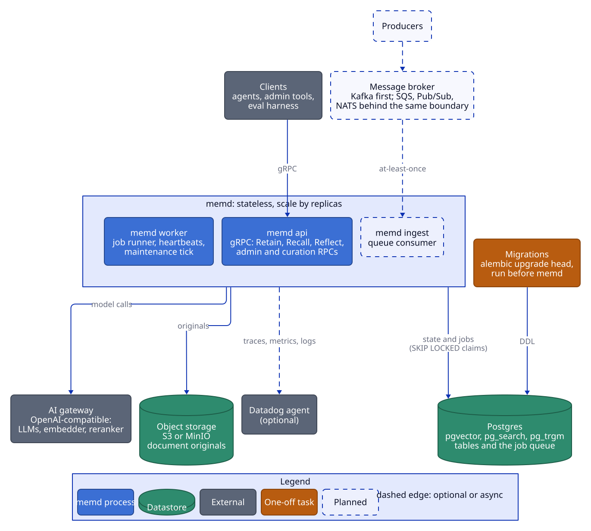
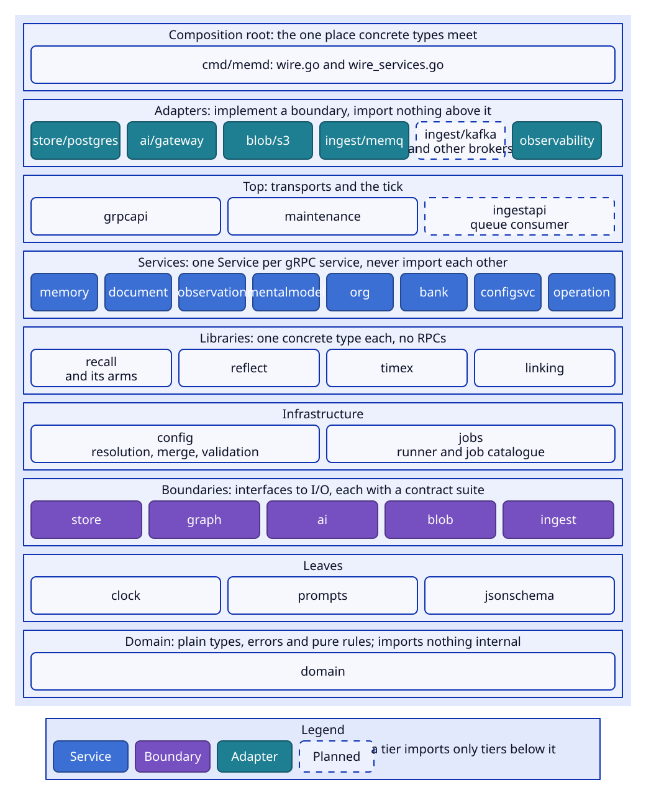
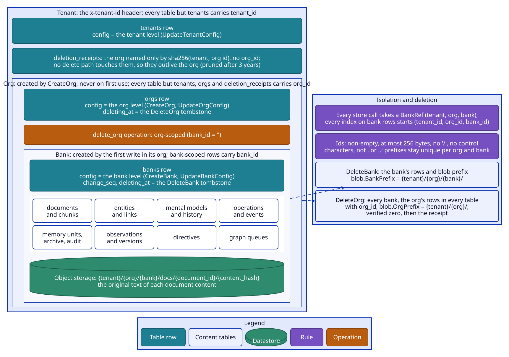
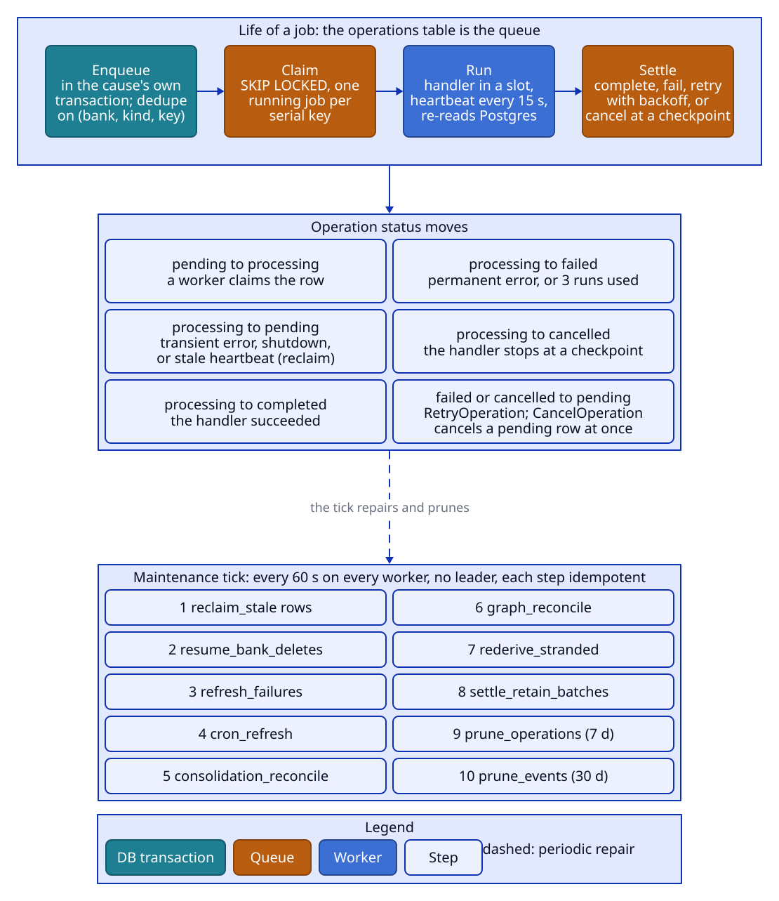

# Architecture

memd is an agent-memory service. Clients retain text; memd extracts facts, links them, consolidates them into
observations and mental models, and serves recall and reflect over them. This document covers the process
model, the package layout, the boundaries, transactions, the job queue, the maintenance tick, the model gateway
and observability. Feature behaviour lives in the other design documents (see [README.md](README.md)).

## Process model

One Go binary, `memd`, runs in one of four modes. Every mode is stateless: all state, jobs included, lives in
Postgres and object storage, so processes are disposable and scale by replica count.

| Mode | Runs |
|---|---|
| `memd api` | The gRPC server: Recall, Reflect, sync Retain (extraction inline), RetainBatch and every admin, curation and mental-model RPC. It writes state and the jobs that state causes in one transaction. |
| `memd worker` | The job runner over the `operations` table, its heartbeats, and the maintenance tick. |
| `memd ingest` | The queue consumer (`internal/ingestapi`): it reads the broker `MEMD_INGEST_PROVIDER` names (Kafka) and retains each message through RetainBatch's path. It makes no model call and takes no worker slot. See [retain.md](retain.md#queue-ingestion). |
| `memd all` | The api and the worker in one process, plus the queue consumer when `MEMD_INGEST_PROVIDER` is set (not `none`), under one error group: if one fails, all stop. |

In production `memd api` and `memd worker` run as separate deployments over the same Postgres, bucket and
server config file. Only the api talks to clients and only the worker runs the LLM-heavy background jobs, so the
two scale on different signals: the api on CPU or in-flight RPCs, the worker on pending jobs (the
`memd.queue.depth` metric). `memd ingest` is a third deployment when a broker feeds documents in; it scales with
the topic's partitions (one consumer-group member reads a partition) and needs Postgres and object storage but no
gateway. Schema migrations are a separate step (`alembic upgrade head`, see
[storage.md](storage.md#migrations)) that runs before memd; memd never runs DDL.

- **Startup.** memd reads its environment and flags (deployment, infrastructure and secrets only) and the server
  config file (models, behaviour defaults, operator settings), validates both, and refuses to start when the
  EXTRACT or REFLECT step has no model, the blob storage is incomplete, the queue consumer's settings are
  incomplete or a tenant or org pin is malformed, an operator setting is out of range, or the embedding model
  does not return 768 dimensions. See [configuration.md](configuration.md).
- **Health.** The api serves `grpc.health.v1`. `Check` runs the readiness probes (a Postgres ping, and a plain
  GET of the gateway base URL where any HTTP status counts as up, cached for 10 s) and ignores the service name.
  `Watch` and `List` are grpc-go's standard implementation and run no probe: `Watch("")` streams SERVING once, a
  liveness signal. Health probes never spend tokens. A worker serves the same health service only when
  `MEMD_WORKER_HEALTH_ADDR` is set, and `memd ingest` (probing Postgres only) when `MEMD_INGEST_HEALTH_ADDR` is set. gRPC server reflection is registered, so grpcurl works without proto files.
- **Shutdown.** SIGINT or SIGTERM stops the api with a 20 s grace for in-flight RPCs. The worker stops claiming,
  gives running handlers 20 s to finish, then cancels the rest and settles them (up to 30 s more). A Kubernetes
  worker therefore needs `terminationGracePeriodSeconds` of at least 50 s (60 s recommended). `memd ingest` stops
  receiving, retains and settles the messages it already holds within `ingest.consumer.shutdown_grace` (20 s), then
  closes the source; anything still unsettled is redelivered.

## Design decisions

The choices the rest of the design builds on:

- **No message broker.** Jobs are Postgres rows claimed with `FOR UPDATE SKIP LOCKED` (the design Hindsight uses
  for its `async_operations` table), inserted in the same transaction as their cause, and serialized by the claim's
  serial-key predicate. There is no Kafka, Redis or separate queue to keep consistent with the database. (Queue ingestion is a different thing: an optional external broker feeding documents in, behind the `ingest` boundary; see [Ingest boundary](#ingest-boundary).)
- **Tenancy is a column.** Every table carries `tenant_id` and every store call takes `(tenant, bank)`; Hindsight
  uses a schema per tenant instead. Authentication is out of scope: the tenant comes from a header an auth layer in
  front of memd can set.
- **One embedding model per deployment.** nomic-embed-text-v1.5 at 768 dimensions: one `vector(768)` column and one
  shared HNSW index for all banks. Per-bank partial indexes are not built; add them if one shared index gets slow.
- **Keyword search is BM25 through pg_search.** Hindsight supports it beside vchord_bm25 and pg_textsearch; its
  default is native `ts_rank_cd`.
- **The graph is plain tables and recursive CTEs**, no graph extension, behind a boundary that lets a graph database
  serve the graph arm later ([Graph boundary](#graph-boundary)).
- **Coalescing:** automatic jobs dedupe on (bank, kind, serial key); jobs carrying overrides are never merged.
- **Reflect is strict:** a failed retrieval dependency fails the call rather than answering from partial evidence.
- **Mental models refresh agentically by default** (Hindsight's behaviour), with a cheaper single-shot strategy per
  bank, model or call. **A model paused by a failed refresh stays paused** until a manual refresh succeeds.
- **No hard delete of a single memory.** Invalidate archives one reversibly; upsert and reprocess replace a
  document's memories; DeleteBank removes everything.

## Layering

memd is a flat set of packages under `internal/`, arranged in tiers. A package imports only packages in lower
tiers, and depguard (in `.golangci.yml`) enforces it.

| Tier | Packages | Holds |
|---|---|---|
| Domain | `domain` | Plain types and pure rules shared by everything: banks, units, documents, config, operations, tags and tag filters, scopes (`ExpandScopes`), directive selection (`SelectDirectives`), refresh due time (`RefreshDueAt`), paging bounds, error classes. Imports nothing internal. |
| Leaves | `clock`, `prompts`, `jsonschema` | The injected clock, the prompt templates, the JSON Schema subset. |
| Boundaries | `store`, `graph`, `ai`, `blob`, `ingest` | The interfaces to I/O (below). |
| Infrastructure | `config`, `jobs` | Config resolution, merge, defaults, validation and patches; the job runner and the job catalogue. |
| Libraries | `timex`, `linking`, `recall` (with `recall/arms`), `reflect` | One concrete main type each and no RPCs: `timex.Normalizer`, `linking.Linker` / `Resolver` / `LabelResolver`, `recall.Engine`, `reflect.Agent`. |
| Services | `memory`, `document`, `observation`, `mentalmodel`, `org`, `bank`, `configsvc`, `operation` | One package per gRPC service, each exporting one `Service` built by `New(Deps)`; each owns its RPC logic, its job handlers (`RunXJob`) and its maintenance sweeps. |
| Top | `maintenance`, `grpcapi`, `ingestapi` | The 60 s tick and the graph_maintenance job; the thin gRPC handlers, interceptors, conversion and error mapping; the queue consumer (decode the envelope, call RetainBatch, settle each message). |
| Adapters | `store/postgres`, `ai/gateway`, `blob/s3`, `ingest/memq`, `ingest/kafka`, `observability` | The concrete Postgres, gateway, S3, Kafka and Datadog code. |
| Composition root | `cmd/memd` | Wiring only: the one place concrete types meet. |

Rules that keep the tiers honest:

- **Services never import each other**; libraries never import services. A service affects another service's
  data by enqueueing that service's job with a `jobs.Enqueue*` helper inside its own transaction. Rules two
  services share live in `domain`.
- **Interfaces exist only at I/O boundaries** (`store`, `graph`, `ai`, `blob`, `ingest`, `clock`, `jobs.Claimer`,
  `grpcapi.ReadinessProbe`) and for polymorphism inside one package (recall arms, reflect's tools, retain's
  extraction modes, the mental-model synthesizers). Everything else is concrete and passed as a pointer.
- Services, libraries and infrastructure never import adapters, `grpcapi`, `maintenance`, generated proto code,
  pgx, net/http, the S3 SDK or the Datadog SDK. They never see SQL: tag filters reach the store as a
  backend-neutral predicate tree (`domain.TagPredicate`).
- Logic never calls `time.Now`; it takes an injected `clock.Clock`. Database time (`now()`) is used only where the
  queue's semantics need it (claims, due-ness, heartbeats).
- Prompt text lives only in the prompt templates, never in Go (see [Prompts](#prompts)).
- Every domain enum is a lowercase string matching the database CHECK values and the proto value name without
  its prefix (`world`, `retain_document`), so JSON configs and logs stay readable.

## Boundaries and adapters

| Boundary | Interfaces | Adapter | Notes |
|---|---|---|---|
| `store` | `DB`, `Tx`, `Reader` (= `Search` + `Catalog` + `Freshness`), the repositories, `Queue`, `Claimer`, `Maintenance` | `store/postgres` (`postgres.DB` implements all of them and `jobs.Claimer`) | The interface comments are the specification; the adapter is tested on real Postgres. |
| `graph` | `Reader` (Expand, Degree), `Writer` (AddLinks, DeleteUnitLinks), `Tx` | `store/postgres` (`Tx.Graph()` writes in the caller's transaction; `postgres.DB.Graph()` serves the recall graph arm) | See [Graph boundary](#graph-boundary). |
| `ai` | `LLM`, `Embedder`, `Reranker`; `Router` and `Tokenizer` are concrete | `ai/gateway` (one client implements all three) | See [Model gateway](#model-gateway). |
| `blob` | `Store` (Put, Get, List, DeletePrefix), `Key`, `BankPrefix` | `blob/s3`, chosen by `MEMD_BLOB_PROVIDER` (`s3`, the only value today) | See [storage.md](storage.md#blob-storage). |
| `clock` | `Clock`; `System` and `Manual` | — | Tests use `clock.Manual`. |
| `ingest` | `Source` (Receive, Ack, Nack, DeadLetter), `Message` | `ingest/memq` (in memory, for tests), `ingest/kafka` (a Kafka consumer group), chosen by `MEMD_INGEST_PROVIDER` | See [Ingest boundary](#ingest-boundary). |

Errors crossing a boundary are already domain error classes (`domain.ErrNotFound`, `ErrUnavailable`, ...), so
callers test them with `errors.Is`.

### Ingest boundary

`internal/ingest` is the boundary to a message queue that carries documents to retain. A `Source` is one consumer's
subscription with at-least-once delivery: `Receive` hands out messages, and each ends in an `Ack`, a `Nack` (redelivery
no sooner than a delay) or a `DeadLetter`. An unsettled message comes back, so consumers must be idempotent, and
memd's retain is: a redelivered document is unchanged, joins the retain in flight, or is stale. Messages with the same
key arrive in publish order. `internal/ingest/ingesttest` is the contract suite every adapter runs and
`internal/ingest/memq` the in-memory source that tests it; `internal/ingest/doc.go` has the contract and the recipe for
an SQS, Pub/Sub or NATS adapter. `internal/ingestapi` is the consumer that feeds these messages into retain through
RetainBatch's path; `memd ingest` runs it ([retain.md](retain.md#queue-ingestion), with the diagram).

`internal/ingest/kafka` is the first broker adapter: a consumer group on a topic, with the pure-Go franz-go client.
Kafka commits one offset per partition, so the adapter commits only past records that are settled contiguously; a
later record's Ack waits for every earlier record of its partition. Kafka has no negative acknowledgement, so Nack
is local: the record is redelivered by the same consumer after the delay, and only the later records of its key wait
for it; the other keys of the partition keep flowing. The price is the head of line: a record that keeps failing
holds back its partition's commit (a crash or rebalance meanwhile redelivers the later, already acked records), and
once the partition buffers too many records behind it, fetching that partition pauses. The consumer bounds this by
dead-lettering after its maximum attempts (`ingest.consumer.max_attempts`, 10). DeadLetter produces the record to a dead-letter topic with failure
headers (reason, source position, attempt) and settles it once the produce is acknowledged. The package comment has
the full semantics and the operational notes (partitioning by document id, dead-letter retention, lag).

### Graph boundary

The memory graph (the weighted temporal, semantic and causal links between units) sits behind `internal/graph`
so that a graph database can be adopted later as an adapter plus a sync job, without a redesign.

- Links are written through `store.Tx.Graph()` in the same transaction as the units they join, so atomicity,
  the change-sequence stamping, archive and restore, and bank deletion all stay Postgres transactions.
- The recall graph arm reads through `graph.Reader`. Filters in a `graph.Query` (types, tags, seq range) are
  hints an adapter may apply; recall re-checks every hit against the store (`GetUnits` plus the request filters),
  so the graph may be eventually consistent. Postgres applies the filters natively, so the re-check removes
  nothing there.
- Entities are not part of the boundary yet; they stay in `store.EntityRepo`.
- `internal/graph/doc.go` gives the recipe for a graph-database adapter (an outbox written by `Tx.Graph`, a sync
  job, a `Reader` over the graph database), and `internal/graph/graphtest` is the contract suite every adapter
  runs.

## Tenancy and ids

- The tenant comes from the `x-tenant-id` gRPC metadata header, never from a request body. Exactly one non-empty
  value is required; anything else is INVALID_ARGUMENT naming `x-tenant-id`. Health methods need no tenant.
- Orgs group a tenant's banks: every bank belongs to exactly one org, bank ids are unique within their org, and
  every bank-scoped request names `org_id` and `bank_id`. Orgs are created explicitly (OrgService.CreateOrg) and
  never on first use, so a typo'd org id fails (NOT_FOUND, `ORG_NOT_FOUND`) instead of scattering data outside
  the org; banks are still created by the first write, inside an existing org.
- Tenant, org and bank ids must be non-empty, at most 256 bytes, contain no `/` and no control characters, and
  not be `.` or `..`. These rules keep the blob prefixes `{tenant}/{org}/` and `{tenant}/{org}/{bank}/` unique per
  org and per bank: a `/` in an id would let one bank's delete remove another bank's blobs.
- Every table but `tenants` carries `tenant_id`, and every table but `tenants` and `orgs` carries `org_id`; every
  store call takes a `domain.BankRef` (tenant, org, bank), built with `domain.NewBankRef`, and the store refuses
  one without an org. Ids of one bank never leak to another tenant, org or bank.
- Client-chosen ids (org, bank, document, mental model) are text: org ids unique per tenant, the others unique per
  bank (bank ids per org). Server ids (units, chunks,
  entities, operations, directives) are UUIDs; operation ids are UUIDv7.

## Transactions and the change sequence

These invariants keep memory consistent under concurrency. Every write path follows them.

1. **No model call inside a transaction.** Code reads, calls the LLM, embedder or reranker (or recall, reflect
   and timex, which call them), then writes in a short transaction. Nothing holds a lock while it waits on a
   model. `tools/txcheck` (run by `make lint`) flags a model call written inside an `InTx` closure.
2. **Transactions run at READ COMMITTED and may run more than once.** The store re-runs a transaction body (up
   to 3 attempts in all) when it fails with a deadlock (40P01), a serialization failure (40001) or a lost entity
   race (an entity pruned between resolve and attach). A transaction body therefore resets its captured outputs
   at the top and has no side effects outside the database. After the last attempt the error is a conflict
   (ABORTED for a sync RPC; a job retries).
3. **The change sequence.** Each bank row has `change_seq`. A transaction that writes memory content first calls
   `tx.Seq(bank)`, which increments `change_seq` (and stamps `last_memory_write_at`) under the bank row lock and
   returns the new value; the transaction stamps every unit, observation and event it writes with it. Calling it
   twice in one transaction returns the same value. The row lock is held until commit, so within a bank seq
   order is commit order: a reader that sees seq S has seen everything at or below S. Mental-model watermarks
   and staleness rely on this.
4. **Seq first.** A transaction that re-reads state it is about to change takes `tx.Seq` before the re-read, so
   the read and the write happen under the bank lock, and before any enqueue, so locks are always taken in the
   same order (bank row, then operation rows). This serializes every read-modify-write of a bank's content, its
   mental-model rows and its config. The `jobs.Enqueue*` helpers never call `tx.Seq` themselves; `txcheck`
   flags an enqueue written before `tx.Seq` in the same closure.
5. **Unknown and deleting banks.** `tx.Seq` on an unknown bank is NOT_FOUND and on a tombstoned bank
   FAILED_PRECONDITION (`BANK_DELETING`), so no write (and no queued job) can resurrect a deleted bank. Write
   paths that may create a bank call `Banks().Ensure` (insert-if-absent, never waits on the bank lock) before
   `Seq`. Ensure first takes `FOR KEY SHARE` on the org row: an unknown org is NOT_FOUND (`ORG_NOT_FOUND`), a
   tombstoned one FAILED_PRECONDITION (`ORG_DELETING`). An org delete locks the org row `FOR UPDATE` before it
   tombstones the org's banks, so a bank created concurrently either commits first (and is tombstoned with the
   others) or waits and then fails. Org config writes (an advisory lock and a plain update) never block it, and
   `tx.Seq` needs no org lock: it row-locks the bank, which an org delete's bank tombstoning also locks.
6. **What does not take Seq.** Non-content writes skip it so they never make mental models stale: graph
   maintenance (links, entity pruning), bank tombstoning, job continuations, and the maintenance tick's
   automatic enqueues. Bank config writes do take it (for the lock; tenant config writes take a per-tenant
   advisory lock instead); staleness looks at unit seqs, not at `change_seq`, so a config write stales nothing.
7. **A job commits with its cause.** Every background job is an `operations` row inserted in the same
   transaction as the state change that causes it.

Reads outside a transaction (`DB.Read()`) run each call as its own statement and never block on an open
transaction. Reads that need transaction-local settings (the vector search) open a short read-only transaction.

## Job queue

There is no broker. Jobs are rows of `operations`, claimed with `FOR UPDATE SKIP LOCKED`. The operation id is
the job id, so status, progress, cancel, retry, overrides, usage and the owning bank all live on one row, and
every handler receives that row. `internal/jobs/kinds.go` is the catalogue: every kind's payload type, serial
key, dedupe policy and Enqueue helper is decided there once.

### Kinds

| Kind | Handler | Serial key | Dedupe | Enqueued by | Does |
|---|---|---|---|---|---|
| retain_document | `memory` | `doc:{document}` | none | async Retain, RetainBatch (and the queue consumer), ReprocessDocument | Extract, embed, resolve, link; one transaction per batch of chunks; resumes; enqueues consolidate |
| retain_batch | none | none | none | async Retain of 2+ changed documents | Parent only, never claimed; the tick settles it from its children |
| consolidate | `observation` | `consolidate` | pending (automatic); pending or running (tick); none with scopes or overrides | retain, rederive, the retag job, invalidate, ClearObservations with `reconsolidate`, Consolidate, the tick, its own continuation | Up to `observations.max_units_per_run` oldest facts, every scope of each; continues itself; triggers refreshes |
| rederive_memory | `memory` | `doc:{unit's document}` (or `unit:{id}`) | none | UpdateMemory, RestoreMemory, the tick | Re-embed, relink, enqueue consolidate |
| retag_document | `document` | `doc:{document}` | pending | RetagDocument | Clear the observations of the document's units, reset their stamps, enqueue consolidate |
| refresh_mental_model | `mentalmodel` | `mm:{model}` | always pending; a joiner upgrades the queued row | consolidation, cron, invalidate and edit, CreateMentalModel, CreateBank from a template, RefreshMentalModel | Synthesize a new page version |
| graph_maintenance | `maintenance` | `graph` | pending or running | every unit removal, rederive, the tick | Link top-ups and orphan-entity pruning within 240 s |
| delete_bank | `bank` | `bank` | pending or running | DeleteBank, delete_org, the tick | Batched row deletes, blobs, then the bank row |
| delete_org | `org` | `org` (org-scoped: empty bank id) | pending or running | DeleteOrg, the tick | Fan out to delete_bank, sweep the org's rows, delete its blobs, verify, complete the receipt ([storage.md](storage.md#deleting-an-org)) |

### Enqueue and dedupe

- A row is **joinable** only when it was enqueued under a dedupe policy without overrides; refresh rows are
  always joinable. Dedupe matches (bank, kind, serial key) among joinable rows only. The effective policy: no
  serial key never dedupes; `refresh_mental_model` always dedupes as *pending*; a job with overrides never
  dedupes; otherwise the requested policy applies. *Pending* joins a queued (pending, including parked) row;
  *pending or running* also joins a processing one.
- Concurrent enqueuers need no leader: the enqueue takes `FOR KEY SHARE` on the bank row, then a
  transaction-scoped advisory lock on hash(tenant/bank/kind/serial key) in its own statement, then looks up the
  oldest joinable match `FOR UPDATE`, then inserts only if there is none. A transaction that enqueues several
  dedupe keys should do so in sorted key order; otherwise a deadlock is possible, and the transaction re-run
  resolves it.
- **Upgrade** (refresh joins): payloads are JSON objects merged shallowly under the row lock; a present key
  replaces, an absent key is kept, and `force_full` is OR-ed. Non-nil overrides replace the queued ones. Upgrade
  and Reschedule act on PENDING rows only.
- Enqueue on a tombstoned bank fails with FAILED_PRECONDITION (`BANK_DELETING`), except `delete_bank`.
- `created_at` uses `clock_timestamp()`, so jobs enqueued in one transaction keep their insertion order; the
  UUIDv7 id breaks ties.

### Claim and serial keys

The claim selects pending, due rows of the kinds the worker handles, skips rows of tombstoned banks (except
`delete_bank`), and skips a row when another row with the same (tenant, org, bank, serial key) is processing or is
an older due pending row; oldest first, `FOR UPDATE SKIP LOCKED`, then marks them processing with the worker id
and a heartbeat. A unique partial index on `(tenant_id, org_id, bank_id, serial_key) WHERE status = 'processing'`
enforces
**at most one processing job per key**; a lost race (unique violation or deadlock) retries the whole claim up to
5 times and then returns an empty batch, never an error. Retains of different documents run in parallel;
consolidation, graph maintenance and bank deletion run one at a time per bank; refreshes one at a time per model.
A parked row (future `run_at`) does not block newer due rows.

### Heartbeats, fencing and reclaim

- The runner heartbeats all its running jobs every 15 s (`worker.heartbeat_interval`). The heartbeat reports
  jobs the worker no longer holds (cancel requested, reclaimed, claimed elsewhere); the runner stops those
  handlers.
- **Self-fencing:** a run whose last successful heartbeat is older than 3/4 of `worker.stale_after` (default
  2 min) is stopped as lost, so a hung or partitioned worker stops before another worker can reclaim the job.
- `Progress`, `Complete` and `Fail` act only on a PROCESSING row; on any other status they change nothing. A lost
  run is never re-queued by its runner; before writing its terminal state the runner checks `Alive` and writes
  nothing if the row is processing under another run.
- `Alive` is true only for a PROCESSING row without a cancel request whose bank is not being deleted
  (`delete_bank` stays alive on its tombstoned bank). Handlers check it, through `jobs.Run.Report` and
  `jobs.Run.Alive`, at their checkpoints.
- **Reclaim** (maintenance tick): PROCESSING rows whose heartbeat is older than `worker.stale_after` (database
  time) go back to PENDING with `attempts + 1` and `run_at` unchanged, or become FAILED once past the kind's
  attempt cap, with one `OPERATION_FAILED` event (none on a tombstoned bank). A cancel-requested stale row
  becomes CANCELLED. Each row is handled in its own transaction; one row's failure never aborts the sweep.
- Each worker process uses the id `<MEMD_WORKER_ID or hostname>-<uuid>`, so two processes never share an id.

### Retries

| Error | Outcome |
|---|---|
| Transient (unavailable, conflict, panic, anything unclassified) | Retry at `now + 60 s × (attempt + 1)`; after 3 runs, FAILED |
| `consolidate` transient | Unbounded retries, backoff `60 s × 2^attempt` capped at 30 min |
| `delete_bank` transient at its last capped attempt | The handler first enqueues a continuation with the same capped exponential backoff, then fails; the delete goes on in the new row |
| Permanent (invalid argument, unbound model slot, `jobs.ErrPermanent`) | FAILED at once |
| Cancelled at a checkpoint | CANCELLED |

- `attempts` counts earlier failed or reclaimed runs (0 on the first run). The runner owns the cap: at
  `attempt + 1 >= 3` it fails the job for good, writing FAILED plus one `OPERATION_FAILED` event under a fresh
  change seq.
- **Consolidate skip.** When an *automatic* consolidate (no overrides, no scopes) fails and another automatic
  consolidate of the bank is pending and due, the failing one ends FAILED instead of retrying; the pending job
  covers the same unstamped facts. A manual consolidate always retries.
- **Shutdown release.** A handler cut off by shutdown is released with retry time *now* and runs again at once
  elsewhere. The release charges an attempt.
- There is no dead-letter queue: a FAILED job keeps its error, and RetryOperation re-queues it.

### Cancel and retry

- **Cancel** of a PENDING row makes it CANCELLED at once. Cancel of a PROCESSING row records
  `cancel_requested_at` and clears `joinable`; the row stays PROCESSING (so it keeps its serial key) until its
  handler stops at a checkpoint and its terminal write moves it to CANCELLED (committed work and any result and
  usage stay). Reclaim moves a stale cancel-requested row to CANCELLED. Re-cancelling is idempotent. Cancelling a
  terminal operation, or any `delete_bank`, is FAILED_PRECONDITION (`OPERATION_NOT_CANCELLABLE`).
- **Retry** works on FAILED and CANCELLED rows: it resets the row to PENDING with `run_at = now()` and
  `attempts = 0`, and clears the error, `finished_at`, `cancel_requested_at`, the worker and the heartbeat. A retried refresh row is joinable again;
  other retried rows stay non-joinable. Any other status is FAILED_PRECONDITION (`OPERATION_NOT_RETRYABLE`).
  On a bank being deleted only `delete_bank` may be retried (the manual recovery path); anything else is
  `BANK_DELETING`.
- Workers never overwrite CANCELLED.

### Runner

- Defaults: 10 slots per worker (`MEMD_WORKER_SLOTS`), 2 reserved for `consolidate` (other kinds may hold at
  most slots − 2; consolidate may use any free slot), a 500 ms poll (`worker.poll_interval`), a 15 s heartbeat.
  Only kinds with a registered handler are claimed; `retain_batch` has none.
- Every run is tracked by its own token: if a claim returns an id this runner is still running (reclaimed and
  claimed back), the older run is cancelled as lost and the newer one replaces it.
- Each job runs in its own goroutine under a context only the runner cancels; a panic becomes a retryable error.
- Terminal writes run detached from the run's context and are retried with backoff (50 ms to 2 s) within 30 s,
  except a Fail whose retry time is within those 30 s, which is tried once (a lost ack must not reset a row
  another worker already claimed). If settling fails, the row stays PROCESSING without heartbeats and reclaim
  re-queues it; handlers are idempotent.
- A handler takes the `*jobs.Run` it runs under: it reports progress with `Run.Report` (which returns
  `domain.ErrCancelled` once the job is cancelled or its bank deleted), checks `Run.Alive` before an irreversible
  step, and records its result summary and per-slot usage with `Run.SetResult`. The result is shown as
  `Operation.debug_summary`. Refresh, rederive and retag handlers write one start checkpoint, which is also their
  cancel check before any model call.
- **Handlers are idempotent and re-read state from Postgres:** a job can run twice after a reclaim.

### Bounded runs and continuations

No job holds a worker for long. Consolidation stops after `observations.max_units_per_run`, graph maintenance
after 240 s, bank deletion after 100 batches; each enqueues its own continuation (same kind and payload, dedupe
*pending*, no `tx.Seq`) while work remains. The continuation is a new row behind the still-processing one, which
the serial key holds back until it completes.

## Maintenance tick

Every worker runs the tick once at start and then every `worker.maintenance_interval` (60 s). There is no leader:
every step is idempotent through enqueue dedupe and SKIP LOCKED, and concurrent ticks insert at most one job per
bank. A failing step is logged and the rest still run.

| # | Step | Owner | Does |
|---|---|---|---|
| 1 | reclaim_stale | jobs | Re-queue or fail stale PROCESSING rows (see [Heartbeats, fencing and reclaim](#heartbeats-fencing-and-reclaim)) |
| 2 | resume_bank_deletes | bank | For each tombstoned bank with no pending or processing `delete_bank`, enqueue one |
| 3 | resume_org_deletes | org | For each tombstoned org with no pending or processing `delete_org`, enqueue one (with the org's open receipt) |
| 4 | refresh_failures | mentalmodel | Pause mental models whose latest terminal refresh failed and record the failure (see [reflect-and-mental-models.md](reflect-and-mental-models.md#failures-and-pause)) |
| 5 | cron_refresh | mentalmodel | Enqueue due cron refreshes |
| 6 | consolidation_reconcile | observation | For each live bank with an unconsolidated fact older than its `observations.reconcile_grace_seconds` (default 600), whose effective config has `observations.auto_consolidation` and `observations.enabled` on, enqueue the automatic consolidate with *pending or running* dedupe |
| 7 | graph_reconcile | maintenance | For each live bank with queued `graph_dirty` or `entity_maintenance` rows, enqueue `graph_maintenance` |
| 8 | rederive_stranded | memory | Re-enqueue `rederive_memory` (up to 100 per tick) for live facts with no embedding whose last rederive ended FAILED or CANCELLED more than 10 min ago and none is pending or running |
| 9 | settle_retain_batches | memory | End every pending `retain_batch` whose children are all terminal: FAILED ("k of n documents failed") if any failed, else CANCELLED if any was cancelled, else COMPLETED |
| 10 | prune_operations | jobs | Delete terminal operations finished longer than `retention.operations` ago (default 7 days) |
| 11 | prune_events | jobs | Delete lifecycle events older than `retention.events` (default 30 days) |
| 12 | prune_deletion_receipts | org | Delete receipts of org deletes completed longer than `retention.deletion_receipts` ago (default 3 years) |

Steps 2, 3, 6, 7 and 8 take no `tx.Seq`: nothing they write is memory content, and Seq refuses a tombstoned bank,
which the delete resume must still reach. Step 5 takes `tx.Seq` before joining or inserting each model's refresh.

- The consolidation reconcile joins a *running* consolidate, not only a pending one; otherwise a tick during a
  slow, failing run would queue a fresh job, the failing run would skip its retry and end FAILED, and backoff
  would reset on every failure. The grace lets a `skip_consolidation` retain be followed by a manual Consolidate
  with its own overrides before the tick consolidates the facts with the bank's settings.
- Operation retention must stay far above the tick interval, so the refresh-failure reconcile sees every FAILED
  refresh before pruning removes it and the stranded-fact sweep (which starts from operation rows) keeps finding
  them. Pending and processing operations are never pruned.

## Lifecycle events

Events are rows of `lifecycle_events`, written in the same transaction as the change and numbered by the bank's
change seq (events of one transaction share a seq). Types: RETAIN_COMPLETED, CONSOLIDATION_COMPLETED,
MENTAL_MODEL_REFRESHED, MENTAL_MODEL_REFRESH_FAILED, MEMORY_CURATED, OPERATION_FAILED. The type column has no
CHECK, so a new type needs no migration.

Consumers poll `OperationService.ListEvents` with `after_seq`. A page never splits a seq group (`page_size` is a
soft limit), and `next_after_seq` is the highest seq scanned, filtered-out events included, so a type filter that
matches nothing still advances the poll. The page and `next_after_seq` are computed in one statement.

## Model gateway

All model traffic goes to one OpenAI-compatible HTTP gateway: `{base}/chat/completions`, `{base}/embeddings`
and `{base}/rerank` (Cohere/Jina style). The base URL (`MEMD_GATEWAY_URL`) includes the version
(`http://gw:4000/v1`); `MEMD_GATEWAY_API_KEY` is sent as a bearer token.

- **Routing.** Every model-backed step has a slot, and the effective config binds each slot to a model and its
  parameters (see [configuration.md](configuration.md#model-routing)). Code never picks a model itself: it asks
  `ai.Router` for its slot's binding from the merged config. A slot with no binding is FAILED_PRECONDITION
  (`MODEL_UNBOUND`), and a job on it fails at once. Embedding is server-wide: `defaults.models.embed`
  (nomic-embed-text-v1.5 by default), 768 dimensions; the adapter adds nomic's `search_document:` /
  `search_query:` prefixes. Changing the embedding model means re-embedding everything.
- **Requests.** Structured calls send `response_format: json_schema` without strict mode (user-supplied schemas
  rarely meet strict rules) and validate the output locally. The schema name is the prompt template name
  sanitized to `[a-zA-Z0-9_-]{1,64}`. `max_tokens` is the request's cap, else the binding's `max_output_tokens`;
  temperature, top_p and reasoning effort are sent only when set; the binding's `extra` object is copied onto
  the body last, so it can add or override any field. Tool-call arguments pass through raw, even when malformed,
  so a malformed call can be shown back to the model.
- **Structured output validation** uses a built-in JSON Schema subset (`internal/jsonschema`): type (including
  lists), enum, const, properties, required, additionalProperties, items, min/max items and length,
  minimum/maximum, allOf/anyOf/oneOf, boolean schemas and local `$ref`. Unknown keywords are ignored, so
  validation is never stricter than the schema. The first mismatch is reported with its JSON path.
- **Retries.** One budget per call: `1 + max_retries` attempts (the binding's value, default 2). Invalid output
  (bad JSON, schema mismatch, undecodable), attempt timeouts, transport errors, 408, 429, 5xx and empty responses
  retry; other 4xx do not. After invalid output the next attempt appends the invalid reply and the validator's
  error as messages. Backoff doubles from 500 ms, capped at 8 s, with no jitter. Each attempt is bounded by the
  binding's `timeout_ms`, else `gateway.timeout` (120 s).
- **Errors.** Gateway failures are UNAVAILABLE (an attempt timeout also wraps deadline-exceeded). A 400 or 413
  whose body carries a context-overflow marker (`context_length_exceeded`, `maximum context length`, `prompt is
  too long`, `input is too long`, `context length exceeded`, `prompt_too_long`, `context window`) is a typed
  context-overflow error (UNAVAILABLE, reason `CONTEXT_OVERFLOW`), which is not retried. The caller's own
  cancellation is returned as is and never retried. A missing or malformed schema is INVALID_ARGUMENT with no
  call.
- **Concurrency.** Every HTTP call (chat, embeddings, rerank) takes a permit from the slot's semaphore when
  `gateway.slot_concurrency` caps the slot, then from the process-wide one (`gateway.max_concurrent`, default 32).
  Permits are held for one attempt only and released before backoff, and a saturated slot never holds global
  capacity while it waits. This keeps added worker replicas from pushing the gateway into 429s.
- **Usage.** Structured and chat calls return token usage summed over every attempt, failed ones included, with
  the model the gateway reported. Services attach it per slot and model to the operation (or to the sync Retain,
  Reflect or refresh trace). Embedding and rerank calls carry no usage to operations; with Datadog metrics on,
  every successful HTTP call of any kind feeds the token counters.
- **Rerank** sends `top_n = len(docs)`. Raw scores pass through when all lie in [0, 1], otherwise every score
  goes through a sigmoid; a document left unscored or scored NaN gets 0.

### Prompts

- Each prompt message is one `text/template` file in `internal/prompts/templates` (missing keys are errors); a
  pair is `<op>_system` + `<op>_user`. Response schemas sit next to the system template
  (`<system>.schema.json`); tool declarations are JSON files mapping 1:1 to tool specs. Go code never builds
  prompt text inline.
- Most templates are ported from Hindsight (MIT, notice kept in `templates/NOTICE`); each template's header names
  its source or says it is new. Extraction keeps Hindsight's `world | assistant` fact labels (`assistant` maps to
  experience).
- `ConfigService.PreviewPrompt` renders any operation's messages exactly as they would be sent, with no model call
  (see [curation-and-operations.md](curation-and-operations.md#prompt-preview)).

### Tokens

One tokenizer serves chunking, recall packing and include budgets, and consolidation budgets: tiktoken
`cl100k_base` with embedded tables (nothing is downloaded). Reflect's mental-model page budgets use an estimate of
one token per four bytes.

## Observability

Datadog is optional and off by default. memd uses Datadog's own clients directly (dd-trace-go v2 for traces and
profiles, datadog-go v5 DogStatsD for metrics), with no OpenTelemetry SDK. The README's "Datadog" section is the
operator guide; this section is the design.

- **Switches.** `MEMD_DATADOG_ENABLED=true` starts the tracer, memd's metrics, runtime metrics, JSON logs on
  stdout and trace correlation in logs. `MEMD_DATADOG_METRICS=false` keeps tracing but skips memd's own metrics.
  `MEMD_DATADOG_PROFILER=true` also starts the profiler. `MEMD_LOG_FORMAT` picks text or JSON logs (unset: JSON
  with Datadog, text otherwise). `observability.metrics_interval` (server config file, 15 s) is the gauge
  sampling period. The agent address, env, version, tags and sampling come from the standard `DD_*` variables;
  `DD_SERVICE` defaults to `memd`.
- **Failure isolation.** Observability never fails startup or requests: tracer, profiler and DogStatsD start
  errors are logged and memd runs without that part. When disabled, every hook is nil and behaviour is identical.
- **One importer.** Only `internal/observability` imports the Datadog SDK, and only `cmd/memd` imports it. The job
  runner (`jobs.Config.TraceJob`), the tick (`maintenance.Deps.TraceTick`), the gateway (`TraceCall`, `OnUsage`),
  the S3 adapter (`APIOptions`) and the queue consumer (`ingestapi.Hooks`) expose vendor-free hooks that the
  composition root fills.

### Traces

| Span | Resource | Tags |
|---|---|---|
| `grpc.server` | full method | `memd.tenant`, `memd.org`, `memd.bank` (health and reflection are not traced) |
| `memd.job` | job kind | operation id, tenant, org, bank, attempt, outcome (completed, retry, failed, released, lost) |
| `memd.maintenance.tick` | `maintenance` | — |
| `postgres.query` | SQL text | `db.system`, row count; only under an existing span (claim polls and heartbeats are not traced) |
| `memd.gateway.call` (with `http.request` per attempt) | route | model slot, model name |
| `memd.ingest.batch` | `retain_batch` | tenant, org, bank, message count (one span per consumer RetainBatch call) |
| `S3.request` | `S3.<Operation>` | bucket |

### Metrics

Every metric starts with `memd.`: `grpc.requests` and `grpc.latency` (method, code); `job.started`,
`job.completed` / `retried` / `failed` / `released` / `lost` and `job.duration` (kind, outcome);
`gateway.calls`, `gateway.latency` and `gateway.errors` (slot, model, route, error class);
`gateway.tokens.input` / `output` (slot, model); the queue consumer's `ingest.received`, `ingest.acked`,
`ingest.nacked`, `ingest.dead_lettered` and `ingest.dropped` (reason: a domain reason code or one of the consumer's
own, such as `UNDECODABLE` or `MAX_ATTEMPTS`) and `ingest.batch.latency` (error class); the gauges `queue.depth` (kind, status) and
`queue.oldest_pending_age_seconds` (kind), sampled in worker and all modes only; and the Postgres pool gauges and
acquire counters. Tags are bounded on purpose: a metric never carries a tenant, bank, document or operation id,
query text or content; spans carry the ids instead. The README lists every metric.

### Logs

Logs are `log/slog`. With Datadog enabled they are JSON on stdout with Datadog's reserved attributes
(`timestamp`, `status`, `message`, `logger.name`) plus `dd.service`, `dd.env`, `dd.version`, and `dd.trace_id` /
`dd.span_id` on lines logged inside a request, job or tick. The agent collects them from the container's output;
memd ships no logs itself.

### What is never recorded

Request and response bodies, gRPC metadata, prompts, messages, tool arguments, model output, memory or document
content, SQL bind parameters and HTTP headers. memd's own span errors carry only the error class; the gRPC span
carries only the status code (the client still gets the full message). Logs keep the full error with the trace
id.
