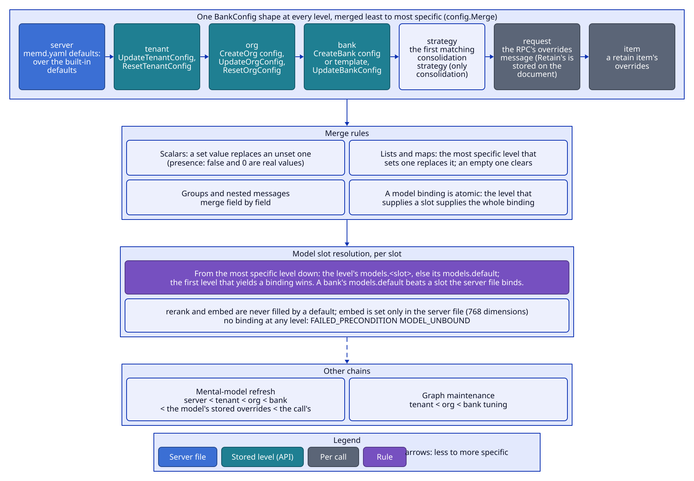

# Configuration

memd has three kinds of settings:

- **BankConfig**: every memory-behaviour knob and the model bindings. One shape at every level of a hierarchy,
  stored as JSON on the tenant, org, bank, document, operation and mental-model rows, and accepted per request through
  each RPC's overrides message.
- **The server config file** (YAML, `MEMD_CONFIG`, default `./memd.yaml`): the server level of BankConfig (the
  `defaults:` block) and the operator settings that are not per bank. `memd.example.yaml` documents every key.
- **Environment variables** (each with a flag): deployment, infrastructure and secrets only.

The rule: anything a user might want to tune per bank or per request is a BankConfig field; anything an operator
tunes for the whole process is a section of the server config file; only addresses, credentials, process sizing
and switches are environment variables.

## BankConfig levels



```
server < tenant < org < bank < strategy < request < item
```

| Level | Source |
|---|---|
| server | The `defaults:` block of the server config file over the built-in defaults (`config.ServerDefaults`) |
| tenant | UpdateTenantConfig / ResetTenantConfig |
| org | CreateOrg (`config`), UpdateOrgConfig / ResetOrgConfig |
| bank | CreateBank (`config`, or a template's), UpdateBankConfig / ResetBankConfig |
| strategy | The first consolidation strategy whose pattern matches the scope (consolidation only) |
| request | An RPC's overrides message; for Retain also stored on the document and replayed by ReprocessDocument |
| item | A retain item's overrides |

Mental-model refreshes use their own chain: server < tenant < org < bank < the model's stored overrides < the
call's overrides. Graph maintenance relinks with tenant < org < bank tuning.

BankConfig is grouped by phase:

| Group | Holds |
|---|---|
| `retain` | mission, extraction mode, custom prompt, entity labels, free-form entities, default observation scope modes, chunking, entity matching, links |
| `observations` | enabled, auto consolidation, mission, dedup threshold, caps and budgets, batch size, units per run, strategies, reconcile grace |
| `recall` | arms, arm boosts, budgets, RRF, rerank, boosts, graph hops, temporal buckets, fuzzy tag floor |
| `reflect` | mission, disposition, iterations, enabled tools, evidence, tool budgets, answer and total token caps |
| `mental_models` | default mode and strategy, delta ratio, debounce, interval floor, history size, content cap |
| `models` | `default` plus one binding per slot (see [Model routing](#model-routing)) |

### Merge rules

- **Scalars:** a set value replaces an unset one. Optional scalars use presence, so `false` and `0` are real
  values.
- **Groups and other nested messages** merge field by field.
- **A model binding is atomic:** the level that supplies a slot supplies the whole binding, and fields the binding
  leaves unset mean the gateway or adapter default, never a less specific level's value.
- **Lists and maps** are replaced by the most specific level that sets them (no append). A non-nil empty list or
  map is an explicit clear that shadows inherited values, and it survives storage.
- Merging never aliases a level: the result is a deep copy.

### Resolution

`config.Resolver` reads the tenant config, the org and the bank in one short read-only transaction (so it must not
be called inside an open transaction). `Effective(bank, overrides...)` merges server < tenant < org < bank <
overrides; `ForScope(scope, request)` adds the matching strategy between bank and request. The strategy list is
taken from the merged config including the request, so a Consolidate call can bring its own strategies. An unknown
or tombstoned org is NOT_FOUND (`ORG_NOT_FOUND`), and so is an unknown or tombstoned bank (`BANK_NOT_FOUND`); write
paths call `Banks().Ensure` first. A retain into an unknown bank of an existing org is validated against tenant <
org merged with its overrides, before the write creates the bank.

## Model routing

Every model-backed step has its own slot, and `models` binds slots to gateway models with their own parameters.

| Slot | `models.` key | Used by | Per-request override |
|---|---|---|---|
| EXTRACT | `extract` | retain fact, entity and label extraction | `RetainOverrides.extract_model`, `RederiveOverrides.extract_model` |
| TIME_PARSE | `time_parse` | relative dates at retain; query windows at recall, only when a cue is found and the rules fail | `RetainOverrides`, `RecallOverrides`, `RederiveOverrides` (`time_parse_model`) |
| CONSOLIDATE | `consolidate` | create / update decisions per scope | `ConsolidateOverrides.consolidate_model`, a strategy's `consolidate_model` |
| DEDUP_CHECK | `dedup_check` | merge-or-keep check for near-duplicate observations | `ConsolidateOverrides.dedup_check_model`, a strategy's `dedup_check_model` |
| REFLECT | `reflect` | reflect loop turns, agentic mental-model refresh | `ReflectOverrides.reflect_model`, `RefreshOverrides.reflect_model` |
| STRUCTURED_OUTPUT | `structured_output` | projecting prose into a JSON Schema | `ReflectOverrides`, `RefreshOverrides` (`structured_output_model`) |
| MENTAL_MODEL | `mental_model` | single-shot mental-model refresh: the full page and the delta edit ops | `RefreshOverrides.mental_model_model` |
| RERANK | `rerank` | recall cross-encoder | `RecallOverrides.rerank_model`, `ReflectOverrides.rerank_model` |
| EMBED | `embed` | memories, observations, queries, mental-model pages | none: server config file only |

- **Resolution per slot.** Each level may set `models.default` and any slot. For each slot, from the most specific
  level to the least, a level yields its own binding for the slot, else its `models.default` (chat slots only);
  the first level that yields a binding wins. So `models.default` on a bank swaps every chat step of that bank,
  even ones the server file binds by name, and `models.extract` on a request changes one step for one call.
  `models.rerank` and `models.embed` are never filled by a default.
- **Binding fields:** `model` (required), `temperature`, `top_p`, `max_output_tokens`, `reasoning_effort`,
  `timeout_ms` (per attempt), `max_retries`, and a free-form `extra` object copied onto the request body.
- EXTRACT and REFLECT must be bound at the server level (`defaults.models.default` or the slot), or memd refuses
  to start.
- A call on a slot with no binding at any level fails with FAILED_PRECONDITION (`MODEL_UNBOUND`; the deployment or
  bank config lacks a binding, the request is fine), and a job on it fails at once without retrying.
- Without `defaults.models.rerank`, `recall.rerank` defaults to false so recall skips the cross-encoder; the file
  asking for rerank without a binding is a startup error, and a tenant or bank that binds RERANK should also set
  `recall.rerank = true`.
- **Embedding** is server-wide: `defaults.models.embed` (only its `model` is used; default
  nomic-embed-text-v1.5) must return 768 dimensions, checked at startup, because every stored embedding shares one
  vector space. Setting `models.embed` at any other level is INVALID_ARGUMENT.
- Consolidation's slots (CONSOLIDATE, DEDUP_CHECK) take overrides only from a manual Consolidate or the matching
  strategy, never from the retain that triggered the job.
- Code never picks a model itself: it resolves the effective config and asks `ai.Router.Resolve` for its slot's
  binding.

## Writing a level (FieldMask)

UpdateTenantConfig, UpdateBankConfig, UpdateMentalModel and UpdateDirective take a FieldMask `update_mask`; the
reset RPCs take a required `reset_mask`.

- **Paths** are proto field names, dotted into nested messages (`observations.dedup_threshold`,
  `reflect.disposition.empathy`). Lists, maps, Structs and model bindings are leaves: `models.extract` is one path
  and no path goes inside a binding. A parent path covers its children. Unknown paths are INVALID_ARGUMENT naming
  `update_mask`. A mental model's or a directive's id can't be patched.
- **A masked path** takes the request's value: an unset scalar, message or binding becomes unset (inherit again);
  an empty list or map becomes an explicit clear.
- **No mask** means every populated *leaf* of the request: the walk recurses into set messages and stops at
  lists, maps, Structs, bindings and scalars. So `{recall: {rerank: false}}` sets only `recall.rerank` and keeps
  the stored `recall.budget_low`, and `{models: {reflect: {...}}}` binds REFLECT and keeps a stored EXTRACT
  binding. Such a request can't clear anything; clearing needs an explicit mask. An explicit `models` path
  replaces the whole group.
- Patches are applied to the stored domain value (never round-tripped through proto), inside the write
  transaction, as pure functions; the bank and tenant read-modify-writes are serialized (bank: `tx.Seq`, then a
  re-read; tenant: a per-tenant advisory lock).
- **Validation.** `config.Validate` checks every config the server is given: request and item overrides,
  mental-model specs, CreateBank's config or template, and the patched level of every Update*Config and
  UpdateMentalModel. It checks disposition traits in 0..5 (0 = unset), unique consolidation strategy names, a
  non-negative `observations.reconcile_grace_seconds`, a `model` in every set binding, and no `models.embed`
  below the server level. Every `recall.arms` and `recall.arm_boosts` name must be a registered recall arm. Failures
  are INVALID_ARGUMENT with a BadRequest field violation naming the config path.
- **Reset** (`ResetTenantConfig`, `ResetBankConfig`) unsets the paths of `reset_mask` so they inherit; `"*"`
  resets the whole level; an empty mask is INVALID_ARGUMENT. A reset is never validated, so it can repair a stored
  level that no longer validates (until then every update of that level fails).

## Per-request overrides

Each RPC that does work takes its own overrides message holding only what that RPC can change, so the schema is
the contract and there is no runtime allowlist. The server converts the message into a BankConfig level.

| Message | RPCs | Fields |
|---|---|---|
| `RetainOverrides` | Retain (request and item), ReprocessDocument | `retain` (the whole group), `extract_model`, `time_parse_model` |
| `RecallOverrides` | Recall | `recall` (except `recall.arms`: use `RecallRequest.arms`), `time_parse_model`, `rerank_model` |
| `ReflectOverrides` | Reflect | `reflect`, `recall` (except `recall.arms`: use `ReflectRequest.arms`), `reflect_model`, `structured_output_model`, `rerank_model` |
| `ConsolidateOverrides` | Consolidate | the `observations` group except `enabled`, `auto_consolidation` and `reconcile_grace_seconds` (bank switches, not per-run knobs), `consolidate_model`, `dedup_check_model` |
| `RederiveOverrides` | UpdateMemory, RestoreMemory | `entity_match_threshold`, `extract_model`, `time_parse_model` |
| `RefreshOverrides` | RefreshMentalModel, `MentalModelSpec.overrides` | `reflect` (including the loop's tool caps `recall_max_tokens` and `search_observations_*`), `max_delta_ratio`, `reflect_model`, `mental_model_model`, `structured_output_model` |
| one of the above | PreviewPrompt | the overrides of the previewed operation (a mismatch is INVALID_ARGUMENT) |

Where overrides are kept: Retain and Reprocess on the document (`Document.retain_overrides`, part of the no-op
hash); Recall and Reflect on the request only; Consolidate and UpdateMemory / RestoreMemory on their operation
(that run only); RefreshMentalModel on the operation, spec overrides on the model for every refresh. Every
operation records its merged `effective_overrides`. Automatic consolidation never inherits a retain's overrides. A
request can never change the embedding model or remove the bank's stored directives (Reflect can add
`extra_directives`).

## BankConfig fields and defaults

Defaults marked "server" are set by `config.ServerDefaults` and can be changed in the server config file; the rest
are defaulted by the package that reads the knob.

| Field | Default | Notes |
|---|---|---|
| `retain.mission`, `observations.mission`, `reflect.mission` | empty | Prompt guidance per phase (reflect's also drives mental-model refresh) |
| `retain.extraction_mode` | concise (server) | concise, verbose, verbatim, chunks, custom |
| `retain.custom_extraction_prompt` | empty | Required for custom mode |
| `retain.entity_labels` | none | Typed labels (value, multi values, text, multi text, map), `write_to_tags` |
| `retain.entities_allow_free_form` | true (server) | false = label entities and hints only |
| `retain.default_observation_scope_modes` | combined, `max_combinations` 15 (server) | For items that set none |
| `retain.entity_match_threshold` | 0.6 (server) | |
| `retain.temporal_link_cap` | 20 (server) | |
| `retain.*` (chunking, links) | see [retain.md](retain.md#defaults) | |
| `observations.enabled` | true (server) | false = consolidation does nothing (and stamps nothing) |
| `observations.auto_consolidation` | true (server) | false = no automatic consolidation after retain or from the tick |
| `observations.dedup_threshold` | 0.97 (server) | ≥ 1 disables dedup |
| `observations.max_observations_per_scope` | unset (no cap) | |
| `observations.source_facts_max_tokens` | unset (no cap) | |
| `observations.source_facts_max_tokens_per_observation` | 256 (server) | |
| `observations.llm_batch_size` | 8 (server) | |
| `observations.max_units_per_run` | 100 (server) | Then the job continues itself |
| `observations.reconcile_grace_seconds` | 600 (server) | Age of an unconsolidated fact before the tick consolidates its bank |
| `observations.strategies` | none | |
| `recall.*` | see [recall.md](recall.md#defaults) | budgets, RRF, rerank and boost alphas are server defaults |
| `reflect.disposition` | 3 / 3 / 3 (server) | Skepticism, literalism, empathy, 1–5 |
| `reflect.max_iterations` | 10 (server) | At mid budget; low halves, high doubles |
| `reflect.enabled_tools` | all | |
| `reflect.require_evidence` | true | |
| `reflect.recall_budget` / `recall_max_tokens` | mid / 2048 | |
| `reflect.search_observations_max_tokens` | 5000 (server) | |
| `reflect.search_observations_include_entities` | true (server) | |
| `reflect.max_answer_tokens` | 4096 (server) | Soft target |
| `reflect.max_total_tokens` | unset (unlimited) | Exceeding it is RESOURCE_EXHAUSTED |
| `mental_models.default_mode` | full (server) | |
| `mental_models.default_strategy` | agentic (server) | |
| `mental_models.refresh_debounce_seconds` | 30 (server) | |
| `mental_models.min_refresh_interval_seconds` | 0 (server) | No floor |
| `mental_models.history_max_entries` | 50 (server) | Per kind |
| `mental_models.max_delta_ratio` | unset | |
| `mental_models.max_content_tokens` | unset | A length budget the refresh prompts carry; the stored page is capped at 1 MiB regardless |
| `models.embed` | nomic-embed-text-v1.5 (server) | Server config file only |
| `models.default` and the chat slots | unset | EXTRACT and REFLECT must be bound at the server level |

## The server config file

memd reads `MEMD_CONFIG`, or `./memd.yaml` when that is unset (the default path may be absent, but then no model is
bound and memd refuses to start). Unknown keys and mistyped values are startup errors. Durations are Go durations
(`"500ms"`, `"90s"`, `"2m"`, `"168h"`). A stored-config shape change needs no migration code: recreate the
database.

| Section | Keys (default) |
|---|---|
| `defaults` | The server level of BankConfig, in the API's shape (proto field names, enum value names): `retain`, `observations`, `recall`, `reflect`, `mental_models`, `models` |
| `gateway` | `max_concurrent` (32): in-flight gateway calls in this process; `slot_concurrency` (none): per-slot caps keyed by slot name (`extract`, ..., `rerank`, `embed`); `timeout` (120s): one gateway HTTP attempt when the binding sets no `timeout_ms` |
| `worker` | `poll_interval` (500ms), `heartbeat_interval` (15s; must be below 3/4 of `stale_after`), `stale_after` (2m: the reclaim threshold, and the runner's self-fence at 3/4 of it), `maintenance_interval` (60s) |
| `retention` | `operations` (168h): finished operations; `events` (720h): lifecycle events; `deletion_receipts` (26280h, 3 years): receipts of completed org deletes, counted from completion |
| `deletion` | `blob_grace` (`api.rpc_deadline`, at least 10m; `0s` = none): the least time between DeleteOrg and the org's blob sweep, so requests that passed their org check before the delete have written their blobs ([storage.md](storage.md#deleting-an-org)) |
| `api` | `rpc_deadline` (120s): the deadline of calls that carry none; `0s` = none. `max_response_bytes` (3 MiB): the response size limit: a page of large items ends early under it, and a read that would pass it fails with `RESPONSE_TOO_LARGE`; keep it under the clients' receive limit (4 MiB by default in gRPC). `max_recall_tokens` (32000): the cap on a Recall request's `max_tokens` and include budgets ([curation-and-operations.md](curation-and-operations.md#common-rules)) |
| `ingest` | `max_batch_items` (500): items per RetainBatch call; `max_retain_items` (100): items per Retain call; `max_document_bytes` (2 MiB): one item's content (Retain fails the call, RetainBatch rejects the item), so a stored text always fits a GetDocument response; `max_request_bytes` (16 MiB): the gRPC receive limit for every request, and RetainBatch's summed content; `max_pending_per_bank` (5000) and `max_pending_per_org` (50000): the pending `retain_document` backlog over which RetainBatch is rejected (`INGEST_BACKLOG`); `retry_after` (10s): the delay that rejection's RetryInfo carries ([retain.md](retain.md#retainbatch)) |
| `ingest.consumer` | How `memd ingest` behaves ([retain.md](retain.md#queue-ingestion)): `batch_size` (100; at most `max_batch_items`): messages per poll and items per RetainBatch call; `flush_interval` (500ms): how long to keep polling to fill a batch; `concurrency` (4): RetainBatch calls at once; `max_attempts` (10): deliveries before a still-failing message is dead-lettered; `backoff_initial` (1s, doubled per delivery) and `backoff_max` (5m): the redelivery delay; `shutdown_grace` (20s): time to retain and settle what the consumer holds when it stops; `poll_wait` (1s) and `max_buffered` (10000): the Kafka source's poll wait and per-partition buffer |
| `observability` | `metrics_interval` (15s): how often the Postgres pool and job queue gauges are sampled (Datadog only) |

Startup validation of the file: `config.ServerDefaults` over the `defaults` block must validate; EXTRACT and
REFLECT must be bound; every `recall.arms` and `arm_boosts` name must be registered; `slot_concurrency` keys must
be known slots with positive caps; every duration must be positive (`rpc_deadline` and `blob_grace` may be 0); `max_concurrent`
must be positive; the heartbeat must be below 3/4 of `stale_after`; every `ingest` setting must be positive,
with `max_document_bytes` at most `max_request_bytes`, `consumer.batch_size` at most `max_batch_items` and
`consumer.backoff_initial` at most `consumer.backoff_max`; and `api.max_response_bytes` and
`api.max_recall_tokens` must be positive, with `ingest.max_document_bytes` (plus a 512-byte item overhead) at
most `api.max_response_bytes`.

## Process settings

Every environment variable has a flag of the same name (lower case, no `MEMD_` prefix, dashes for underscores:
`MEMD_GRPC_ADDR` = `-grpc-addr`). A flag wins over the environment. Usage: `memd <api|worker|ingest|all> [flags]`; `memd`
with no mode prints the list.

| Variable | Default | Meaning |
|---|---|---|
| `MEMD_DSN` | required | Postgres URL. A SQLAlchemy driver suffix (`postgresql+psycopg://`) is dropped, so one DSN serves Alembic and memd. |
| `MEMD_CONFIG` | `./memd.yaml` if present | The server config file |
| `MEMD_GRPC_ADDR` | `:50051` | gRPC listen address (api, all) |
| `MEMD_GATEWAY_URL` | required (not in ingest) | AI gateway base URL including `/v1` |
| `MEMD_GATEWAY_API_KEY` | empty | Bearer key |
| `MEMD_BLOB_PROVIDER` | `s3` | Blob storage provider; `s3` is the only one |
| `MEMD_S3_ENDPOINT` | empty (AWS) | S3 API URL |
| `MEMD_S3_BUCKET` | required | Bucket for original texts; it must exist |
| `MEMD_S3_ACCESS_KEY`, `MEMD_S3_SECRET_KEY` | required | Static credentials (no AWS default chain) |
| `MEMD_S3_REGION` | `us-east-1` | Signing region |
| `MEMD_S3_PATH_STYLE` | false | Path-style addressing (MinIO) |
| `MEMD_WORKER_ID` | hostname | Worker id prefix; a per-process UUID is always appended |
| `MEMD_WORKER_SLOTS` | 10 | Jobs a worker runs at once (2 reserved for consolidate) |
| `MEMD_WORKER_HEALTH_ADDR` | empty (none) | Where a worker serves `grpc.health.v1` |
| `MEMD_DB_MAX_CONNS` | 0 = `max(2 × slots + 16, 32)` | Postgres pool size |
| `MEMD_LOG_LEVEL` | info | debug, info, warn, error |
| `MEMD_LOG_FORMAT` | empty | text or json; empty = json with Datadog enabled, else text |
| `MEMD_DATADOG_ENABLED` | false | Datadog tracing, metrics, runtime metrics and log correlation |
| `MEMD_DATADOG_METRICS` | true | memd's own metrics (only with Datadog enabled) |
| `MEMD_DATADOG_PROFILER` | false | Datadog profiler (only with Datadog enabled) |
| `MEMD_INGEST_PROVIDER` | `none` | The queue consumer's source: `none` or `kafka`. `memd ingest` needs one; `memd all` runs the consumer when one is set |
| `MEMD_INGEST_TENANT`, `MEMD_INGEST_ORG` | empty | Pin the source to one tenant (and org): an envelope may omit it, and one naming another is dead-lettered; a malformed pin fails startup. Unpinned, every envelope names its tenant and org |
| `MEMD_INGEST_HEALTH_ADDR` | empty (none) | Where `memd ingest` serves `grpc.health.v1` (ready while Postgres answers) |
| `MEMD_INGEST_KAFKA_BROKERS` | required with kafka | Seed brokers, comma-separated `host:port` |
| `MEMD_INGEST_KAFKA_TOPIC` | required with kafka | The topic to consume |
| `MEMD_INGEST_KAFKA_GROUP` | `memd-ingest` | The consumer group every `memd ingest` process of the deployment shares |
| `MEMD_INGEST_KAFKA_DLQ_TOPIC` | required with kafka | The dead-letter topic; it must exist (memd never creates topics) |
| `MEMD_INGEST_KAFKA_CLIENT_ID` | `memd` | Client id the brokers see |
| `MEMD_INGEST_KAFKA_TLS` | false | Dial the brokers over TLS (implied by a TLS file) |
| `MEMD_INGEST_KAFKA_TLS_CA_FILE`, `_TLS_CERT_FILE`, `_TLS_KEY_FILE` | empty | PEM CA bundle (empty = the system pool), and the client certificate and key for mutual TLS |
| `MEMD_INGEST_KAFKA_SASL_MECHANISM`, `_SASL_USERNAME`, `_SASL_PASSWORD` | empty (no SASL) | `PLAIN`, `SCRAM-SHA-256` or `SCRAM-SHA-512` with its credentials |

Startup validation: a known mode; DSN, gateway URL (except in ingest), a known blob provider, the bucket and both S3
keys present; a listen address for api and all; a known ingest provider, one for ingest, and with kafka the brokers,
topic, group and dead-letter topic (a TLS certificate and key together); a non-negative pool size; positive worker slots; then the server config file
(above) and, except in ingest (which makes no model call), the embedding-dimension check against the gateway.
The split: where the consumer connects, its credentials and its tenant pinning are deployment settings
(environment); how it batches, retries and polls is behaviour (`ingest.consumer` in the server config file).

With Datadog enabled, the standard `DD_*` variables (agent address, `DD_ENV`, `DD_VERSION`, `DD_TAGS`, sampling,
DogStatsD) are read by the Datadog libraries; `DD_SERVICE` defaults to `memd`.

### Fixed in code (not configurable)

| Value | Setting |
|---|---|
| Reserved consolidate slots | 2 |
| Worker shutdown grace / settle timeout | 20 s / 30 s |
| api shutdown grace | 20 s |
| Stranded-fact rederive retry | 10 min, 100 per tick |
| Job attempts (non-consolidate) and backoff | 3 runs; 60 s × attempt |
| Consolidate backoff cap | 30 min |
| Graph maintenance budget / batch sizes | 240 s / 100 dirty units, 500 entities |
| Bank delete batch / batches per run / blob page | 1000 rows / 100 / 1000 keys |
| Gateway retry backoff | 500 ms doubling, max 8 s; adapter default 2 retries |
| Readiness gateway probe cache | 10 s |
| Retain chunks per transaction | 4 |
| RetainBatch items per write transaction / concurrent blob writes | 100 / 8 |
| Cron grace | 5 min |
| Transaction attempts / claim attempts | 3 / 5 |

## Development and test variables

| Variable | Used by |
|---|---|
| `MEMD_PG_PORT`, `MEMD_MINIO_PORT`, `MEMD_MINIO_CONSOLE_PORT` | docker compose host ports (defaults 55432, 59000, 59001) |
| `DATABASE_URL` | Alembic, when `MEMD_DSN` is unset; the store tests, when `MEMD_TEST_DATABASE_URL` is unset |
| `MEMD_TEST_DATABASE_URL` | The store tests: use this server instead of a test container |
| `MEMD_ALEMBIC` | Alembic binary used by the test harnesses (default `.venv/bin/alembic`) |
| `MEMD_REQUIRE_DOCKER` | Fail instead of skip when Docker (or a database URL) is unavailable in tests |
| `MEMD_E2E_RUN`, `E2E_TIMEOUT` | End-to-end test project naming and timeout (`make e2e` sets them) |
