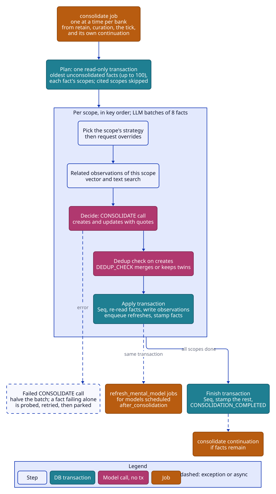

# Consolidation

Consolidation turns raw facts into observations: short statements per scope, each backed by evidence (source
facts plus exact quotes). It runs as the `consolidate` job, one at a time per bank, and decides with the
CONSOLIDATE model (and DEDUP_CHECK for near-duplicates). Observations are memories of type `observation`; they are
never curated directly and never consolidated themselves. The code is `internal/observation`
(`observation.Service`), which also serves ObservationService.

## Scopes

A scope is a set of tags. A fact is *in* scope S when its tags contain every tag of S, so the shared scope (no
tags) holds every fact. Each observation belongs to exactly one scope (its `scope_key`).

- **Scope key encoding** (`domain.ScopeKey`). Tags only, each written as `<byte length>:<tag>`, joined by `,`
  (`["foo","bar,b"]` → `3:foo,5:bar,b`); the shared scope is `""`. The length prefix makes collisions
  impossible. Keys are canonical: decoding rejects unsorted, duplicate, unnormalized or empty tags. The bank is
  not part of the key (storage keys scopes by tenant, org and bank).
- **Scope modes** (`ObservationScopeModes.mode`, expanded by `domain.ExpandScopes`) decide which scopes a fact
  consolidates under, from its tags:

| Mode | Scopes |
|---|---|
| `MODE_COMBINED` (default) | one scope: the fact's full tag set |
| `MODE_SHARED` | the shared scope only |
| `MODE_PER_TAG` | one scope per tag |
| `MODE_ALL_COMBINATIONS` | every non-empty subset, by size then lexicographically; more than `max_combinations` (default 15) is rejected |
| `MODE_CUSTOM` | the given tag sets, normalized and deduplicated; an empty list means combined |

  An untagged fact has exactly one scope, the shared one, in every mode except custom. `max_combinations <= 0` is
  INVALID_ARGUMENT. Scopes are processed in key order, so every run decides them in the same order.
- **Where a fact's mode comes from**, in order: its document's item-level `observation_scope_modes`; its
  document's stored retain overrides (`retain.default_observation_scope_modes`); the run's effective
  `retain.default_observation_scope_modes` (server < tenant < org < bank < request); combined. If expansion fails at
  consolidation time (the mode or cap changed after retain), the fact uses its combined scope rather than being
  stranded.
- **Fan-out check at retain.** `MODE_ALL_COMBINATIONS` over `max_combinations` is rejected synchronously by Retain
  with INVALID_ARGUMENT (`TOO_MANY_SCOPES`), before anything is stored.

## Run shape

A run is `plan` → per scope, per LLM batch: `decide` (model calls, no transaction) → `apply` (one short
transaction) → `finish`.

1. **Disabled.** With `observations.enabled` false (effective config, request included) the run does nothing and
   stamps nothing, so enabling observations later consolidates the backlog.
2. **Plan** (one read-only transaction): up to `observations.max_units_per_run` (default 100) of the bank's oldest
   unconsolidated facts that have an embedding; each fact's scopes; and which scopes already cite it (those are
   skipped, so a replayed run is safe). A **manual run with scopes** selects only facts whose tags contain one of
   the requested scopes, but still decides each selected fact in every scope it belongs to (deciding only the
   requested scopes would stamp the fact and strand its other scopes). The run also lists, outside any
   transaction, the bank's unpaused mental models scheduled `after_consolidation`.
3. **Per scope, in batches** of `observations.llm_batch_size` (default 8) facts, with a cancel checkpoint before
   every batch:
   - **Strategy and config.** The first consolidation strategy whose pattern matches the scope supplies a config
     level between bank and request (see [Strategies](#strategies)).
   - **Capacity.** `observations.max_observations_per_scope` (when set) caps the scope's observations; the
     remaining capacity limits how many creates the model may return. The cap applies to every scope, the shared
     one included.
   - **Related observations** (below) are shown with their source facts.
   - **Decide.** One CONSOLIDATE call returns create and update actions, each citing source facts with exact
     quotes. The per-call schema restricts `source_fact_ids` to the batch's fact ids (at least one) and `creates`
     to the remaining capacity. Existing observations' source facts are shown without ids; new facts keep their
     `[id]`. A fact that no action cites is decided "none".
   - **Dedup** runs on creates (below).
   - **Apply** (one transaction): `tx.Seq` first, then re-read the batch's facts. A fact that is gone or whose
     seq or tags differ from the plan (edited, retagged) is not live. An action is skipped whole when any fact it
     cites is not live, or its update target is gone or left the scope; it is never rewritten as a create or
     trimmed to its live evidence. Then write the observations (embedding, evidence, an `observation_versions`
     row, seq), enqueue the refreshes the scope reaches, and stamp the facts whose last pending scope this is (see
     [Stamping](#stamping)).
4. **Finish** (one transaction): `tx.Seq`, stamp facts with no pending scope (every scope already cited them),
   check whether unconsolidated facts remain and if so enqueue the **continuation** (`consolidate` with the same
   scopes and overrides; pending dedupe for the automatic job, none for a manual one), then append
   CONSOLIDATION_COMPLETED. The job handler never re-enqueues; the run's final transaction owns the continuation,
   so a crash can't lose it.

The result reports processed facts, changed scopes and whether more remain; its usage is per slot and model.

## Related observations and dedup

- **Related observations.** For each fact, the store's vector search (the fact's embedding) and text search (its
  text) look for observations of exactly this scope; the two lists are interleaved round robin and 10 are taken
  per fact, then the batch's union is pooled in first-seen order. There is no reranker (rerank buried
  near-identical twins). Each shown observation carries up to 20 source facts, cut to
  `observations.source_facts_max_tokens_per_observation` (default 256) and the call's
  `observations.source_facts_max_tokens` (unset = no cap).
- **Exact duplicates.** A create whose text equals a shown observation's becomes an update of it.
- **Dedup check** (decide phase, no transaction): probe the scope's nearest observations by cosine (top 5, floor =
  `observations.dedup_threshold`, default 0.97; a threshold ≥ 1 disables dedup). When one is at or above the
  threshold, DEDUP_CHECK decides:
  - *merge*: the create becomes an update of the twin with the merged text (re-embedded); the twin gains the new
    fact's evidence and a version;
  - *keep*: the create stands.

  A failed DEDUP_CHECK keeps the create, so nothing is lost. Only creates are checked.
- Only the first update of each observation in a batch is kept; if a second one was dropped, the batch is applied
  but not stamped.

## Stamping

`consolidated_at` marks a fact as fully consolidated. These rules guarantee a fact is never stamped while one of
its scopes is missing the observation that should derive from it:

- A fact is stamped in the apply transaction of its **last pending scope**, or in the finish transaction when it
  had none.
- When any action of a batch was skipped (or decide dropped a second update of one observation), **no** fact of
  that batch is stamped, and those facts are left out of the rest of the run; the next run re-decides them.
- A non-live fact is never stamped.
- **Cited-scope re-check.** Before stamping, the transaction (already holding the bank lock) checks that every
  scope that cites the fact still cites it: both the scopes skipped at plan time and the scopes this run wrote. A
  concurrent clear, an invalidate of a co-source or a retag of a co-source's document can delete such an
  observation and reset the fact without changing its seq; the fact is then left unstamped, `finish` reports more
  work, and the continuation re-decides only the cleared scope.
- A "none" decision stamps the fact with no evidence, so a replay decides it again in that scope (harmless).
- Writes that change a fact (curation edit, rederive embedding, retag) clear its stamps; clears reset the stamps
  of the cited co-sources.

## Failure handling

The gateway reports "invalid output after retries" and "gateway down" with the same class, so consolidation tells
a poison fact from an outage itself:

- **Halving.** A failed CONSOLIDATE call halves the batch and decides each half. Only CONSOLIDATE call errors
  halve; read, write, embedding and routing errors, and cancellation, stop the run and the job retries.
- **Deferral.** A fact that fails alone is deferred: left out of the rest of its top-level batch. When the batch
  is done, `settle` handles the deferred facts with the **failing scope's binding** (strategy < request), so a
  healthy default model never vouches for a broken strategy model:
  1. **Health probe:** one CONSOLIDATE call with no facts and no observations (its schema allows no action). If it
     fails, the run fails UNAVAILABLE and nothing is parked; committed work stays and the job retries with
     backoff.
  2. **Retry alone:** each deferred fact is retried once by itself. Success applies normally.
  3. **Park:** only a fact that fails again is parked: `consolidation_failed_at` is set in a transaction that
     takes `tx.Seq` and re-reads the facts (an edited, retagged or removed fact is not parked). A parked fact
     leaves the unconsolidated set until an edit or retag clears the marker.
- **Circuit breaker.** If two top-level batches in a row fail on every call with no successful CONSOLIDATE call
  between them (probes don't count; successful retries do), the run fails UNAVAILABLE instead of probing and
  parking again.
- **Outcomes.** A poison fact alone in its scope is parked on the first run and the other scopes proceed; a poison
  fact that is the bank's only unconsolidated fact is parked, so the job terminates; an outage parks nothing,
  whether it starts at the first call or mid-run and whichever model it hits.
- **Job retries.** `consolidate` retries without an attempt cap (backoff 60 s × 2^attempt, capped at 30 min). A
  failing automatic run skips its retry when another automatic consolidate is pending and due.

## Strategies

`observations.strategies` is an ordered list of `ConsolidationStrategy`: a name (unique in the list), scope
patterns (each a `TagFilter`), an observations mission, caps, and `consolidate_model` / `dedup_check_model`
bindings (no other slots).

- A pattern matches a scope by tag matching of the scope's tags against the pattern under the pattern's mode;
  unset mode means all_strict (the scope holds every pattern tag, others allowed; the shared scope never matches).
  A pattern with no tags and no groups matches only under exact, and then only the shared scope, so an empty
  pattern never claims everything. Patterns are plain tags (no globs); groups are allowed.
- The first strategy in list order with a matching pattern wins whole (`config.MatchStrategy`). It is a config
  level between bank and request, so a request override beats the strategy. The strategy list itself is taken
  from the merged config including the request, so a Consolidate call can bring its own strategies.
- **Preview** (`PreviewConsolidationStrategies`) evaluates draft strategies against up to 1000 existing scopes:
  for each strategy, the scopes it wins and those an earlier strategy shadows; `complete = false` when the bank
  has more scopes.

## Refresh triggers

- The run lists the bank's mental models scheduled `after_consolidation` once, outside any transaction, and drops
  paused ones. Cron models are never triggered by consolidation (`RefreshSchedule.when` is a oneof, so the two
  triggers are exclusive).
- Every apply transaction that writes an observation enqueues a refresh for each listed model its scope reaches,
  in the same transaction (after `tx.Seq`), so a run that fails later has already queued its committed scopes'
  refreshes; later batches join the queued refresh.
- **Reach** (`domain.MentalModelSpec.ScopeFilter`). By the scope's tag groups when set; otherwise by the model's
  tags under the scope's match mode, default all_strict for a tagged model and any for an untagged one. The shared
  scope never reaches a tagged model.
- **Job.** `refresh_mental_model`, serial key `mm:{id}`, payload `{"mental_model_id": ...}` with no flags or
  overrides, pending dedupe (a queued refresh is joined, not upgraded), `run_at` = `domain.RefreshDueAt`: the
  later of now + `mental_models.refresh_debounce_seconds` (default 30) and the end of the model's interval floor.
  Staleness isn't checked separately: a changed scope carries a seq above the model's watermark, and a refresh
  that finds nothing new completes without a model call.

## Enqueue sources

| Source | Job | Dedupe |
|---|---|---|
| retain completion (unless `skip_consolidation`, or `observations.enabled` / `auto_consolidation` off) | automatic `{}` | pending |
| rederive, the retag job, invalidate, ClearObservations with `reconsolidate` and `memory_id` or `all` | automatic `{}` | pending |
| Consolidate with no scopes or overrides | automatic `{}` | pending |
| Consolidate with scopes or overrides, ClearObservations with `reconsolidate` and `scopes` | `{"scopes": [{"tags": [...]}]}` and/or overrides | none (never merged; runs as its own pass after the running one) |
| maintenance tick | automatic `{}` | pending or running |
| the run's own continuation | same payload and overrides | pending (automatic) / none (manual) |

An automatic job (`{}`) means every scope with the bank's settings. Retain's overrides never reach consolidation:
a bank's consolidation mixes facts from many requests. Use `skip_consolidation` plus a manual Consolidate when a
batch needs its own settings.

**Maintenance tick filter.** The tick consolidates a bank only when its effective config has
`observations.auto_consolidation` and `observations.enabled` on, and only once an unconsolidated fact is older
than the bank's `observations.reconcile_grace_seconds` (default 600). Facts reset by retag, clears or invalidate
keep their original `created_at`, so the tick reconciles them at once (those paths also enqueue directly). With
`auto_consolidation` off, a bank is consolidated only by explicit Consolidate calls and the curation paths that
enqueue directly.

## Clearing observations

Deleting observations always goes with resetting their sources: `consolidated_at` (and the park marker) is
cleared on the facts they cited, so those facts re-derive. Every path takes `tx.Seq` first and deletes in the
caller's transaction; deletion locks the observations `FOR UPDATE` in id order before reading their sources.
"Other sources" means the cited facts except the ones the caller named.

| Path | Deletes | Resets | Enqueues |
|---|---|---|---|
| Curation edit | observations citing the memory | their other sources; the edited memory's own stamps are handled by curation ([curation-and-operations.md](curation-and-operations.md#edit)) | `graph_maintenance`, refreshes of models citing a deleted observation; consolidation waits for the rederive |
| InvalidateMemory | observations citing the memory | their other sources | automatic consolidate, `graph_maintenance`, refreshes of models citing the memory or a deleted observation |
| Document replacement (retain) | observations citing the document's old units | their other sources | `graph_maintenance` (consolidation follows the retain) |
| Retag job | observations citing the document's units | their other sources, and the units' own stamps | automatic consolidate; `graph_maintenance` when it deleted anything |
| ClearObservations `memory_id` | observations citing the memory | their other sources and the memory itself (unless it awaits a rederive) | `graph_maintenance`; the automatic consolidate only with `reconsolidate` |
| ClearObservations `scopes` | every observation of exactly those scopes | all their sources | `graph_maintenance`; a scoped consolidate only with `reconsolidate` |
| ClearObservations `all` | every observation of the bank | all their sources | `graph_maintenance`; the automatic consolidate only with `reconsolidate` |

ClearObservations takes exactly one target: no target, an empty scope list or `all = false` is INVALID_ARGUMENT,
so a destructive clear never defaults to everything. `observation_scopes` rows are kept. The returned `deleted`
counts are exact. Clears queue no mental-model refreshes; affected models go stale through the change sequence.

## Defaults

| Knob | Default |
|---|---|
| `observations.enabled` | true |
| `observations.auto_consolidation` | true |
| `observations.reconcile_grace_seconds` | 600 |
| `observations.max_units_per_run` | 100 |
| `observations.llm_batch_size` | 8 |
| `observations.source_facts_max_tokens_per_observation` | 256 |
| `observations.source_facts_max_tokens` | unset (no cap) |
| `observations.max_observations_per_scope` | unset (no cap); 0 = no creates |
| `observations.dedup_threshold` | 0.97 (≥ 1 disables) |
| `retain.default_observation_scope_modes` | combined, `max_combinations` 15 |
| Related observations per fact / source facts shown | 10 / 20 (not configurable) |
| Dedup probe | top 5 (not configurable) |
| Strategy preview | 1000 scopes (not configurable) |
