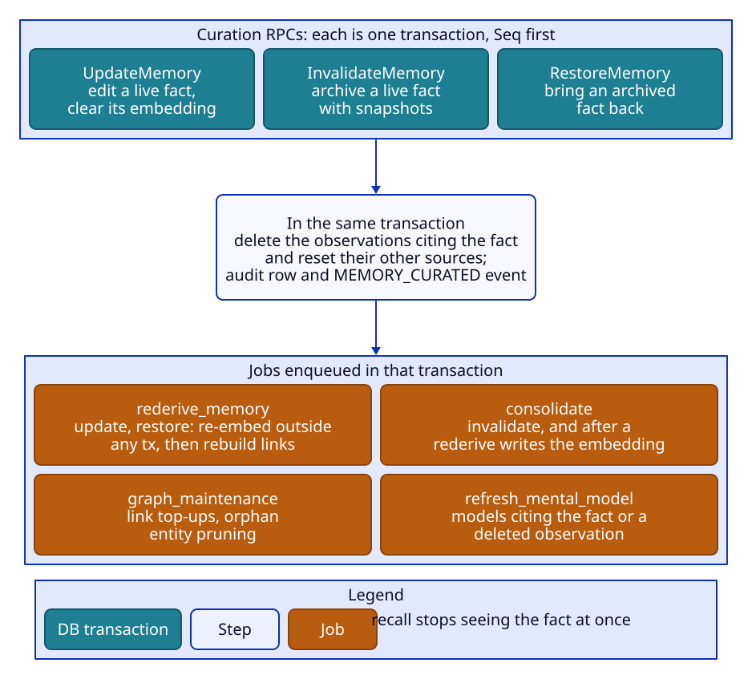

# Curation and operations

This document covers the administrative surface: memory listing and curation, observation admin, documents,
banks, the config levels, directives, the prompt preview, operations and events, and how requests and errors are
handled. The API conventions are stated once in the header of `api/memory/v1/memory.proto`; this document
explains the behaviour behind them.

| Service | Package | RPCs |
|---|---|---|
| MemoryService | `memory` | Retain, Recall, Reflect, ListRecallArms, ListMemories, GetMemory, UpdateMemory, InvalidateMemory, RestoreMemory |
| DocumentService | `document` | ListDocuments, GetDocument, RetagDocument, ReprocessDocument |
| ObservationService | `observation` | Consolidate, ListObservationScopes, ListObservationHistory, ClearObservations, PreviewConsolidationStrategies |
| MentalModelService | `mentalmodel` | CreateMentalModel, GetMentalModel, ListMentalModels, UpdateMentalModel, RefreshMentalModel, PreviewMentalModelRefresh, ListMentalModelHistory, DeleteMentalModel, DeleteMentalModelFolder, SearchMentalModels |
| OrgService | `org` | CreateOrg, GetOrg, ListOrgs, DeleteOrg, GetDeletionReceipt |
| BankService | `bank` | CreateBank, GetBank, ListBanks, DeleteBank, GetBankStats, ListTags, ExportBankTemplate |
| ConfigService | `configsvc` | GetTenantConfig, UpdateTenantConfig, ResetTenantConfig, GetOrgConfig, UpdateOrgConfig, ResetOrgConfig, GetBankConfig, UpdateBankConfig, ResetBankConfig, PreviewPrompt, CreateDirective, UpdateDirective, ListDirectives, DeleteDirective |
| OperationService | `operation` | GetOperation, ListOperations, CancelOperation, RetryOperation, ListEvents |

## Common rules

- **Orgs must exist.** Every bank-scoped request names `org_id` and `bank_id`. An org is created only by
  CreateOrg; any request under an unknown org is NOT_FOUND (`ORG_NOT_FOUND`), so a typo'd org id never creates
  anything.
- **Unknown and deleting banks.** A write to an unknown bank of an existing org creates it with no config of its
  own (Retain, Consolidate, CreateMentalModel, UpdateBankConfig, ResetBankConfig, CreateDirective). Every read of an unknown bank is
  NOT_FOUND (`BANK_NOT_FOUND`), never an empty result. Once a bank is tombstoned, writes are FAILED_PRECONDITION
  (`BANK_DELETING`) and reads are NOT_FOUND, operations and events included. The one exception is GetOperation of
  the bank's `delete_bank` operations, which answers until the delete removes the bank (the completion signal).
  UpdateDirective and DeleteDirective never create a bank: an unknown one is NOT_FOUND.
- **No hard delete of a single memory.** InvalidateMemory archives a memory (reversibly), retain and reprocess
  replace a document's memories, DeleteBank removes everything.
- **Counts** (stats, tag counts, scope counts) are indexed COUNT queries; there are no counter tables, and
  listings return no totals.
- **Paging** is keyset-based with opaque tokens (`domain.EncodePageToken`: base64url JSON of the last position).
  Every List RPC applies `domain.ListPage`: `page_size` 0 = 100, larger than 1000 = 1000, negative =
  INVALID_ARGUMENT (the paging interceptor also checks every `page_size` and `max_results` field by name). A
  malformed token is INVALID_ARGUMENT. A page asks the store for one extra row to decide whether a next-page
  token exists.

| Listing | Order |
|---|---|
| ListMemories | `(created_at, id)` descending |
| ListDocuments | `(created_at, id)` descending |
| ListObservationScopes | scope key, bytewise; the shared scope first |
| ListObservationHistory | version descending (newest first) |
| ListTags | tag, bytewise |
| ListOrgs | id, bytewise |
| ListBanks | id, bytewise |
| ListMentalModels | id |
| ListMentalModelHistory | newest first |
| ListDirectives | `(created_at, id)` ascending (oldest first) |
| ListOperations | `(created_at, id)` descending |
| ListEvents | seq ascending; `page_size` is soft (a page never splits a seq group) and the cursor is `after_seq` / `next_after_seq` |
| SearchMentalModels | score; `max_results` 0 = 10, at most 100 (`domain.SearchResults`) |

## Memories

- **ListMemories** reads live and archived memories. `state` unset reads both; `MEMORY_STATE_VALID` only live;
  `MEMORY_STATE_INVALIDATED` only archived. Filters: `fact_types`; `text_contains` (case-insensitive substring of
  the text, `% _ \` literal); `document_id`; `entity_id` (live memories only; a malformed id matches nothing); a
  time range on `time_field` (`created_at` default, `updated_at`, `mentioned_at`, `occurred_start`,
  `occurred_end`), start-inclusive and end-exclusive (a NULL field never matches a set bound); and a flat tag
  filter (default match any).
- **GetMemory** returns a live memory (state valid, entities, source fact ids, `stale` for observations) or an
  archived one (state invalidated, snapshot entity names); otherwise NOT_FOUND. An observation is stale when an
  unconsolidated fact is in its scope.

## Curation

Curation fixes or retires one raw fact. Observations are never curated (INVALID_ARGUMENT,
`MEMORY_IS_OBSERVATION`); they re-derive from their sources. Everything that would leave recall inconsistent
commits in the RPC's own transaction; only re-embedding and re-linking wait for a `rederive_memory` job. Every
curation takes `tx.Seq`, so models in scope go stale through the normal check, and appends a MEMORY_CURATED event
and an audit row (`memory_audit`) with the request's reason.

| RPC | Target | Result |
|---|---|---|
| UpdateMemory | a live raw fact (invalidated or unknown = NOT_FOUND) | Edit; returns the memory and the rederive operation |
| InvalidateMemory | a live raw fact | Invalidate; returns the memory with state invalidated, no operation |
| RestoreMemory | an invalidated raw fact; a live one is left unchanged | Restore; returns the memory and the rederive operation (none for a live memory) |

### Edit

`UpdateMemoryRequest.memory` holds the new values and `update_mask` names the fields to apply: `text`,
`context`, `occurred_start`, `occurred_end`, `fact_type`, `entities`. An empty mask means the populated fields; a
named field left unset clears it (so clearing the entities, or both occurrence bounds, needs it named). Another
path, nothing to apply, an empty text, or a fact type other than world or experience is INVALID_ARGUMENT.
`resolve_entities = false` takes the new entity names literally. `RederiveOverrides` (entity match threshold,
EXTRACT and TIME_PARSE models) ride on the rederive operation.

In one transaction: `tx.Seq`; write the new values, `edited_at`, the seq and a cleared embedding (the memory
leaves vector search until the rederive); setting an occurrence date clears `timeless`; stamp the memory
consolidated (so consolidation never decides on a NULL embedding); delete the observations citing it and reset
their other sources; enqueue `graph_maintenance` and one refresh per mental model whose sources cite a deleted
observation; apply entity changes (detach, then resolve and attach the new names with `linking.Resolver`, which
makes no model call); write the audit row with before and after snapshots; append MEMORY_CURATED; enqueue
`rederive_memory`.

### Invalidate

In one transaction: `tx.Seq`; read the live fact; delete the observations citing it and reset their other sources
(before the archive, which would otherwise drop the evidence rows and leave the citing observations alive);
archive the memory with its entity and causal-link snapshots ([storage.md](storage.md#archive-and-restore)); the
audit row; enqueue the automatic consolidate and `graph_maintenance`; enqueue one refresh
(`jobs.QueueModelRefresh`, so paused models are skipped) per mental model whose sources include the memory or an
observation deleted above; MEMORY_CURATED. Recall and consolidation stop seeing the memory at once.

### Restore

In one transaction: `tx.Seq`; move the memory back (entities and causal links reattached where they still exist);
stamp it consolidated; re-resolve its snapshot entity names (read before the transaction, so entities that graph
maintenance pruned while it was archived are re-created; `resolve_entities = false` takes them literally); the
audit row; enqueue `rederive_memory`. Restoring a live memory writes nothing and returns no operation.

### Rederive job

`rederive_memory` (serial key `doc:{memory's document}`, or `unit:{id}` without one; payload `{"unit_id"}`; no
dedupe; the request's overrides on the job): read the memory and embed its text outside any transaction; then in
one transaction: `tx.Seq` (a gone or tombstoned bank stops it), re-read the memory, and **do nothing** if it is
gone (archived or replaced) or its text differs from the embedded text (a newer edit's rederive is queued behind
it). Otherwise write the embedding (which clears the consolidation stamps, so the memory is consolidated again only
now), delete and rebuild its temporal and semantic links, and enqueue `graph_maintenance` and the automatic
consolidate. Entity attachments stay exactly as the RPC committed them, so an older rederive retried after a newer
edit can never re-apply stale names. Re-running it only redoes the same writes.

If a rederive fails for good, the memory is stranded (NULL embedding, stamped); the maintenance tick re-enqueues
its rederive 10 minutes after the failure ([architecture.md](architecture.md#maintenance-tick)).

### Reprocess and curation

Reprocessing a document re-extracts from the original text, so it replaces curated memories too. Fix systematic
problems through missions and reprocess; curate the residue. Audit and archive rows of replaced memories are kept.

## Observation admin

- **Consolidate** enqueues a consolidate job and returns it. Without scopes or overrides it is the automatic job
  (pending dedupe, may join a queued one); with scopes or `ConsolidateOverrides` it never merges and runs as its
  own pass. See [consolidation.md](consolidation.md#enqueue-sources).
- **ListObservationScopes** lists every scope that ever held an observation, with its live observation count and
  the number of unconsolidated memories in scope. The shared scope (key `""`) comes first; after a page that ends
  at the shared scope the next cursor is `"0"`, which sorts after `""` and before every tagged key.
- **ListObservationHistory** pages an observation's versions newest first (text, source fact ids, time); an id
  with no versions (unknown, or not an observation) is NOT_FOUND. Versions outlive the observation.
- **ClearObservations** takes exactly one target (`scopes`, `memory_id` or `all`; none is INVALID_ARGUMENT) and
  optionally `reconsolidate`; see [consolidation.md](consolidation.md#clearing-observations). `deleted` is exact.
- **PreviewConsolidationStrategies** evaluates draft strategies without saving them
  ([consolidation.md](consolidation.md#strategies)).

## Documents

- **ListDocuments**: filters `document_id_contains` (case-insensitive id substring), a flat tag filter (default
  match any_strict), and a created or updated time range. Each document carries its live memory counts, in total
  and per fact type.
- **GetDocument** reads the row; with `include_text` it reads the original from the blob store (a missing blob
  gives empty text, not NOT_FOUND; a read failure is UNAVAILABLE). `extracted_at` is unset while a retain is in
  flight or failed. `retain_overrides` are the stored retain overrides that reprocessing replays.
- **RetagDocument** replaces the tag set ([retain.md](retain.md#retag-retagdocument)). The response's operation is
  unset for a set-equal no-op.
- **ReprocessDocument** re-runs retain over the stored text ([retain.md](retain.md#reprocess)); new overrides
  replace the stored ones.

## Orgs

- **CreateOrg** creates an org of the tenant, optionally with its own config level (`config`, validated as a whole
  level). An existing org is ALREADY_EXISTS; one being deleted FAILED_PRECONDITION (`ORG_DELETING`).
- **GetOrg** returns a live org; unknown or deleting = NOT_FOUND (`ORG_NOT_FOUND`).
- **ListOrgs** pages the tenant's live orgs by id, optionally under an `id_prefix`; orgs being deleted are left out.
- **DeleteOrg** tombstones the org and its banks, cancels their pending jobs, starts a deletion receipt and
  enqueues the org-scoped `delete_org`, in one transaction, and returns the operation and the receipt. The delete
  removes every bank, row and blob of the org, verifies none is left and deletes the org
  ([storage.md](storage.md#deleting-an-org)). Writes under the org are then FAILED_PRECONDITION (`ORG_DELETING`)
  and reads NOT_FOUND; re-issuing it joins the running delete.
- **GetDeletionReceipt** returns the receipt of the org's most recent delete (looked up by the hash of the tenant
  and org id), which outlives the org: `in_progress`, `failed_verification` (still retrying) or `completed` with the
  verification counts. An org never deleted is NOT_FOUND.
- **Org-scoped operations.** GetOperation, ListOperations, CancelOperation and RetryOperation take an empty
  `bank_id` for the org's own operations (`delete_org`); CancelOperation refuses `delete_org`.
- Orgs are never created on first use, while banks are: a write to an unknown bank of an existing org creates it.
  Bank creation share-locks the org row ([architecture.md](architecture.md#transactions-and-the-change-sequence)).

## Banks

- **CreateBank** creates the bank with a `config` (initial own overrides) or a `template` (the oneof `initial`).
  The config is validated as a whole level. An existing bank is ALREADY_EXISTS (memd's own message, never store
  text), a deleting one FAILED_PRECONDITION (`BANK_DELETING`). Without a template no change seq is taken.
- **Templates.** ExportBankTemplate returns the bank's own config, its directives (without ids) and its
  mental-model specs, with no memories. CreateBank with a template checks it first (every directive needs a name,
  unique within the template; every model needs an id), then in one transaction creates the bank with the
  template's config, takes `tx.Seq`, creates the directives with new ids and normalized tags, creates each model
  and enqueues its first build; it returns the build operations (`mental_model_operations`) in template order. Any
  failure rolls the whole bank back.
- **GetBank** returns a live bank; unknown or deleting = NOT_FOUND (`BANK_NOT_FOUND`).
- **ListBanks** pages an org's live banks by id, optionally under an `id_prefix`; banks being deleted are left
  out. An unknown org is NOT_FOUND (`ORG_NOT_FOUND`).
- **GetBankStats**: live memories per fact type, invalidated memories, documents, entities, mental models,
  pending and processing operations per kind (the eval barrier: poll until empty), unconsolidated memories,
  `last_memory_write_at` and `change_seq`. Map keys are the lowercase domain strings (`"world"`,
  `"retain_document"`).
- **ListTags** counts items carrying each tag, from memories (default; all live memories, observations
  included), mental models or documents, with a literal byte prefix (normalized like a tag).
- **DeleteBank** tombstones the bank and returns the `delete_bank` operation; a second call returns the queued or
  running one ([storage.md](storage.md#bank-deletion)).

## Configuration levels

ConfigService reads and writes the tenant, org and bank levels of the config hierarchy
([configuration.md](configuration.md)). Every config RPC returns a `ConfigView`: `own` (what the level itself
stores) and `effective` (the level merged over the less specific ones, read in the same transaction).

- **GetTenantConfig / GetOrgConfig / GetBankConfig** read a level. GetOrgConfig of an unknown or deleting org,
  and GetBankConfig of an unknown or deleting org or bank, are NOT_FOUND.
- **UpdateTenantConfig / UpdateOrgConfig / UpdateBankConfig** patch a level with a FieldMask
  ([configuration.md](configuration.md#writing-a-level-fieldmask)). The patch is a pure function applied inside
  the write transaction, so read-modify-writes serialize and concurrent patches of different fields both land:
  the bank level after `Banks().Ensure`, `tx.Seq` (the bank row lock) and a re-read; the tenant level under a
  per-tenant advisory lock (a row lock would serialize every request of the tenant, and locks nothing before the
  first write); the org level under a per-org advisory lock and a plain update of the org row, which never blocks
  bank creation in the org. UpdateOrgConfig never creates an org: an unknown one is NOT_FOUND (`ORG_NOT_FOUND`). A bank config write therefore bumps `change_seq` and `last_memory_write_at` but stales no model.
  The patched level is validated.
- **ResetTenantConfig / ResetOrgConfig / ResetBankConfig** unset the paths of a required `reset_mask`, so they inherit again; the
  single path `"*"` resets the whole level, and an empty mask is INVALID_ARGUMENT. A reset is not validated, so it
  can always repair a stored level that no longer validates.

## Directives

Directives are standing instructions injected into reflect prompts (and the single-shot mental-model synthesize
prompt).

- **CreateDirective** stores a directive under a server-assigned id (a set id is ignored); its name is required
  and unique in the bank (taken = ALREADY_EXISTS, enforced by a unique index); tags are normalized. An unknown bank
  is created.
- **UpdateDirective** patches `name`, `rules`, `tags` and `active` by `update_mask` (empty = the populated fields;
  a masked field left unset clears it, so `active = false` needs an explicit mask); the id can't change and the
  name must stay set and unique.
- **ListDirectives** pages oldest first, filtered by a flat tag filter (default any_strict: directives sharing a
  tag; untagged ones are left out) and optionally `active_only`.
- **DeleteDirective** deletes one directive (a write: FAILED_PRECONDITION on a deleting bank).
- Which directives apply to a request is `domain.SelectDirectives`
  ([reflect-and-mental-models.md](reflect-and-mental-models.md#directives)).

## Prompt preview

**PreviewPrompt** renders exactly what an operation would send, with no model call: retain extraction (the
extraction mode's template and schema; chunks mode returns only a `skipped_reason`), consolidation, reflect, the
mental-model delta and the single-shot synthesis. Request-time content appears as placeholders (`{chunk text}`,
`{query}`, `{fact id}`, `{now}`, ...). Each message is a builtin block followed (system messages only) by config
blocks naming the `BankConfig` path that fed them (`retain.mission`, `retain.custom_extraction_prompt`,
`retain.entity_labels`, `observations.mission`, `reflect.mission`, `reflect.disposition`) and the directives
section, each active when set. The preview carries the response schema. Reflect is previewed with the global
(untagged) directives, budget low and every tool offered. The `overrides` oneof must match the operation (retain,
consolidation, reflect, mental_model for delta and synthesize); a mismatch is INVALID_ARGUMENT.

## Operations and events

- **GetOperation / ListOperations** read through the queue in short transactions; an unknown or deleting bank is
  NOT_FOUND (except GetOperation of a deleting bank's `delete_bank` operations). ListOperations filters by status
  and kind and can exclude `retain_batch` parents. An operation shows its bank, kind, status, error,
  `debug_summary` (a kind-specific JSON summary for people, not a stable contract), per-slot usage, effective
  overrides, parent, progress, created and updated times, next run time (parked by backoff, debounce or interval
  floor), attempts and heartbeat.
- **CancelOperation** and **RetryOperation** follow [architecture.md](architecture.md#cancel-and-retry): cancel
  works on pending and processing rows (cooperative; `OPERATION_NOT_CANCELLABLE` on terminal rows and on
  `delete_bank`); retry works on failed and cancelled rows (`OPERATION_NOT_RETRYABLE` on any other status;
  `BANK_DELETING` on a deleting bank except for `delete_bank`).
- **ListEvents** (`after_seq`, `page_size`, `types`): `page_size` 0 = 100, capped at 1000, negative =
  INVALID_ARGUMENT. Pages never split a seq group; `next_after_seq` is the value to pass as `after_seq` next and
  advances past filtered-out events ([architecture.md](architecture.md#lifecycle-events)).
- **Eval barrier.** Use sync Retain (no batch parents) and poll GetBankStats until `pending_operations_by_kind` is
  empty on two consecutive polls. A `retain_batch` parent settles within one tick after its last child.

## Request handling

- **Tenant header** and id rules: [architecture.md](architecture.md#tenancy-and-ids). Every handler validates the
  bank id.
- **Deadlines.** A call without a deadline gets the server default (`api.rpc_deadline` in the server config file,
  120 s; `0s` = none); a client deadline, shorter or longer, is kept (sync Retain and Reflect can legitimately run
  long).
- **Overrides.** Each RPC that does work takes its own overrides message, so the schema states what it can change
  ([configuration.md](configuration.md#per-request-overrides)). Every config the server is given passes
  `config.Validate` before a service sees it.
- **Conversion** between proto and domain (`internal/grpcapi/convert_*.go`) is structural only (no defaults or
  business validation): an undefined enum number or an invalid timestamp is INVALID_ARGUMENT. Unset enums mean:
  time field → created at; tag source → memories; tag-leaf resolve → exact names; history kind → both; memory
  state → no state filter; mental-model view → the RPC's default; prompt operation → INVALID_ARGUMENT; operation
  status and kind → no filter. Time ranges are start-inclusive, end-exclusive. Map keys named by fact type or kind
  use the lowercase domain strings; scope strings use the scope-key encoding.
- **Tag filters.** Every request that filters by tag takes one `TagFilter`; setting both the flat form and groups
  is INVALID_ARGUMENT, and List RPCs accept only the flat form.
- An unwired service answers UNIMPLEMENTED.

## Error mapping

Every handler maps its error with `toStatus`, checked in order; the first match wins. An error that already
carries a gRPC status passes through; the message is the error text.

| Error class | gRPC code | ErrorInfo reasons |
|---|---|---|
| deadline exceeded (context) | DEADLINE_EXCEEDED | `DEADLINE_EXCEEDED` |
| canceled (context) | CANCELLED | `CANCELLED` |
| not found | NOT_FOUND | `NOT_FOUND`, `BANK_NOT_FOUND` |
| already exists | ALREADY_EXISTS | `ALREADY_EXISTS` |
| invalid argument | INVALID_ARGUMENT | `INVALID_ARGUMENT`, `TOO_MANY_SCOPES`, `MEMORY_IS_OBSERVATION` |
| failed precondition | FAILED_PRECONDITION | `FAILED_PRECONDITION`, `BANK_DELETING`, `MODEL_UNBOUND`, `OPERATION_NOT_CANCELLABLE`, `OPERATION_NOT_RETRYABLE` |
| unavailable | UNAVAILABLE | `UNAVAILABLE`, `RETRIEVAL_UNAVAILABLE`, `CONTEXT_OVERFLOW` |
| resource exhausted | RESOURCE_EXHAUSTED | `RESOURCE_EXHAUSTED`, `MAX_TOTAL_TOKENS_EXCEEDED`, `INGEST_BACKLOG` |
| cancelled operation | ABORTED | `OPERATION_CANCELLED` |
| conflict (superseded sync retain, lost race) | ABORTED | `CONFLICT` |
| anything else | INTERNAL | `INTERNAL` |

- Every status carries a `google.rpc.ErrorInfo` with domain `memd` and the reason of the most specific domain
  error class in the chain (`domain.ReasonOf`). Clients branch on the code, then the reason; the message is for
  humans.
- An error built with `domain.InvalidField` (request ids, paging, tag filters, config validation paths, update
  masks) also carries a `google.rpc.BadRequest` with one field violation per named field, for example `page_size`
  or `reflect.disposition.empathy`.
- An error built with `domain.WithRetryDelay` (RetainBatch's backlog gate, `INGEST_BACKLOG`) also carries a
  `google.rpc.RetryInfo` with the delay to wait before retrying.
- Context errors come first, so a timeout wrapped as unavailable still reports DEADLINE_EXCEEDED. ABORTED (not
  CANCELLED) is used for an operation cancelled through the API or a bank deleted under a sync call: in gRPC,
  CANCELLED means the caller cancelled.
- A new reason is a new refined class in `internal/domain/errors.go` plus a row in the proto header's error
  table.
