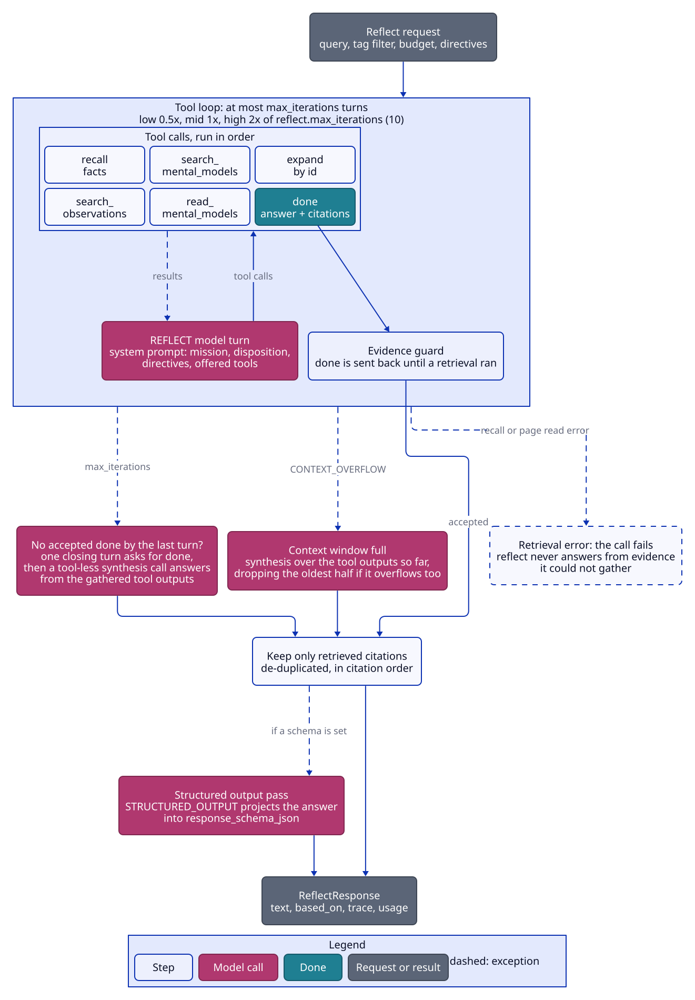
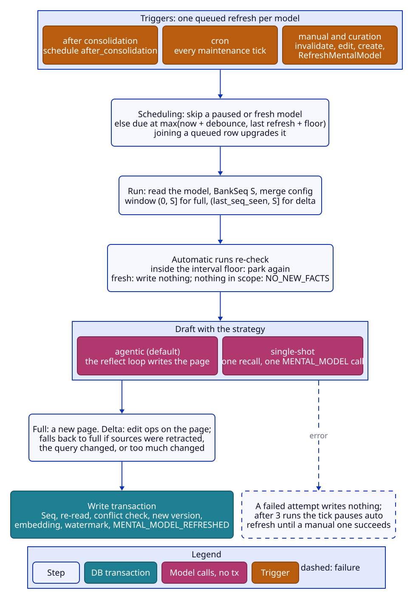

# Reflect and mental models

Reflect is an agentic loop: the REFLECT model calls retrieval tools over the bank and finishes with a `done` call
carrying its answer and citations. Mental models are maintained pages (Markdown documents) built from a source
query over a scope, refreshed by the same loop (agentic strategy) or by one recall plus one synthesis call
(single-shot strategy). `reflect.Agent` (`internal/reflect`) is a library; `mentalmodel.Service`
(`internal/mentalmodel`) serves MentalModelService and runs the refresh job.

## Reflect

### Loop

- **Iterations.** `max_iterations = max(1, base × {low 0.5, mid 1, high 2})`, base = `reflect.max_iterations`
  (default 10); an unset request budget means **low**. The loop makes at most that many tool-calling turns
  (`tool_choice = required` until the model's first tool call, then `auto`).
- **Closing.** If no turn ends in an accepted `done`, one closing turn asks for `done` explicitly; if the model
  doesn't comply (or the closing turn fails for any reason other than the caller's cancellation or the token
  budget), a tool-less synthesis call answers from the gathered tool outputs. `iterations` in the trace is the
  last loop turn reached.
- **Prose replies.** Before the first tool call, a prose reply is retried once per run without spending an
  iteration; a second prose reply fails the call (UNAVAILABLE: a model that cannot drive tools). After at least
  one tool call, prose ends the loop and the closing turn or synthesis produces the answer.
- **Several calls in one turn** run sequentially in the model's order; blank or repeated call ids get unique
  replacements. A `done` in a turn wins and the turn's other calls are dropped.
- **Prompt.** The system prompt renders `reflect.mission`, the disposition (`reflect.disposition`: skepticism,
  literalism, empathy, each 1–5, default 3) as instructions, the applied directives, the offered tools only, the
  bank's name and a "current date and time" equal to the request's `query_time` (else now). The answer length
  target is the request's `max_tokens`, else `reflect.max_answer_tokens` (default 4096): a soft target in the
  prompt, not a hard cap.
- Reflect runs on the api path and calls the recall engine; it is read-only and never called inside a
  transaction.

### Tools

`reflect.enabled_tools` (empty = all) filters the retrieval tools; `done` is always offered. Prompts and tool
error messages mention only the offered tools.

| Tool | Behaviour |
|---|---|
| `recall` | Recall over world and experience facts (or the request's types minus observations). Its `max_tokens` argument is clamped to [1000, 16000], else `reflect.recall_max_tokens`, else 2048; budget `reflect.recall_budget`, else mid. The request's tags, query time, seq window, includes, arms and overrides pass through. A query over 500 tokens is returned to the model as an error. |
| `search_observations` | Recall over observations only; `max_tokens` clamped as above, else `reflect.search_observations_max_tokens` (default 5000); entity state when `reflect.search_observations_include_entities` (default true). Each observation carries `is_stale`; the top-level `is_stale` is true when any is. |
| `search_mental_models` | Mental-model search (below), default 5 results, filtered by the request's tag filter and exclusions. The best visible page comes in full when it is at most about 4000 tokens; the rest as snippets (the hit's, else the first 280 characters) with their length. |
| `read_mental_models` | Reads pages by id in request order within `max_tokens` (default 6000, clamped as above); the first page is always read; later pages that would cross the budget, missing pages and pages outside the tag filter are listed as not read. |
| `expand` | Memories by id and, for observations, their source facts, filtered by the request's types, tags and seq window, plus their chunks; unknown ids get a per-item error. |
| `done` | The answer (or the document, for mental models) plus `memory_ids`, `observation_ids` and `mental_model_ids`; a directive-aware variant (with `directive_compliance`) is offered when an applied directive has rules. |

- Internal callers may narrow types: `search_observations` is offered only when observations are in scope,
  `recall` only when a non-observation type is. Page tools are not offered when mental models are excluded.
- With `require_evidence` on and no search tool left, reflect fails FAILED_PRECONDITION before any model call.
- `ReflectRequest.arms` picks the recall arms of the recall and search_observations tools (empty = the effective
  `recall.arms`); an unknown or repeated name is INVALID_ARGUMENT before the loop starts.
- Page budgets use an estimate of one token per four bytes.

### Evidence and citations

- **Evidence guard.** With `reflect.require_evidence` (default true), `done` is rejected back to the model (costing
  an iteration) until a retrieval tool has run successfully. A retrieval that found nothing counts (an empty bank
  must not burn every iteration). `expand` does not count; `read_mental_models` counts only when it read a page.
  The closing turn is guarded too: with no retrieval yet, one more turn is forced to call a search tool (recall,
  else search_observations, else search_mental_models); if that retrieves nothing, the answer is synthesized from
  the (empty) results.
- **Retrievable ids.** recall and search_observations register the memories they return; search_mental_models
  (snippet hits included) and read_mental_models register pages. `expand` registers nothing, so its output can
  only be cited if a search returned the memory.
- **Citations** in `done` are kept only when retrieved, in citation order, de-duplicated. `based_on` holds the
  cited memories (facts and observations) and pages. An answer produced without `done` (synthesis after max
  iterations, overflow, or an ignored closing turn) cites everything retrieved, sorted by id.
  `include.based_on = false` empties the memories and pages but keeps the directive ids.

### Directives

- The bank's directives are read in a short read-only transaction. `domain.SelectDirectives` is the one rule for
  which apply, shared by reflect, the single-shot synthesize prompt and the prompt preview: inactive directives
  never apply; `apply_all_directives` applies every active one; otherwise untagged directives always apply and a
  tagged directive applies only when the request has a tag filter and the directive's tags satisfy it. An
  untagged request gets only untagged directives.
- `extra_directives` are appended after the stored ones and applied whatever their `active` flag; they never
  replace or filter stored directives. A request can never remove the bank's directives.
- `based_on.directive_ids` and the trace list only the applied stored directives, never extras.
- `directive_compliance` is not checked.

### Failure classes

| Situation | Outcome |
|---|---|
| Unknown or disabled tool, non-JSON arguments, missing query or ids, query over 500 tokens, malformed `done`, `done` before any retrieval | Error returned to the model; the loop continues |
| Any error from recall, page reads or memory and chunk reads | The call fails. Already-classified errors keep their class (cancellation, INVALID_ARGUMENT, FAILED_PRECONDITION, NOT_FOUND); everything else is UNAVAILABLE (`RETRIEVAL_UNAVAILABLE`). Reflect never answers from evidence it could not gather. |
| REFLECT chat error in a loop turn (other than overflow) | UNAVAILABLE (the gateway already retried) |
| Model never calls a tool; empty final answer | UNAVAILABLE |
| Input + output tokens of all LLM calls so far (failed calls included when usage is reported) above `reflect.max_total_tokens` | RESOURCE_EXHAUSTED (`MAX_TOTAL_TOKENS_EXCEEDED`; unset or ≤ 0 = unlimited) |
| Caller cancellation | returned as is |
| **Context-window overflow** (`CONTEXT_OVERFLOW` from the gateway) in a loop or closing turn | Not a failure: one tool-less synthesis call over every successful tool output so far (stop reason `context_full`). If that overflows too, the older half of the outputs is dropped (with an "omitted" note) and it retries, until nothing is left; then it fails. |

### Structured output

When `response_schema_json` is set, a second STRUCTURED_OUTPUT call (`reflect.Agent.Project`) projects the final
prose into the schema. A schema that isn't a JSON object or doesn't compile (`internal/jsonschema`) is
INVALID_ARGUMENT before any model call. A schema the model can't satisfy, or output that doesn't match, sets
`structured_output_error` and keeps the answer. Its usage is reported with the rest.

### Response

`text`, optional structured output, `based_on`, a trace when `include.trace` (tool calls with arguments, outputs
unless `include.tool_outputs` is false, errors and durations; iterations; stop reason `answered | max_iterations |
context_full`; directive ids; duration), and per-slot usage.

## Mental models

### Data

A model is a spec (`MentalModelSpec`) plus state. The spec has an id, name, source query, folder path and tags,
and three groups:

- **schedule** (`RefreshSchedule`): `when` is a oneof, `after_consolidation` or `cron`, so the two automatic
  triggers are exclusive; unset = manual refreshes only. `min_interval_seconds` is the interval floor (unset =
  `mental_models.min_refresh_interval_seconds`).
- **scope** (`MentalModelScope`): a tag filter whose match mode applies to the model's own tags (default
  all_strict for a tagged model, any for an untagged one) or whose groups replace them, and the fact types (empty
  = all). The flat tags always come from the spec's tags, so `scope.tags.tags` must stay empty.
- **run settings**: mode (full or delta; unset = `mental_models.default_mode`), strategy (agentic or
  single-shot; unset = `mental_models.default_strategy`), budget (default mid), max tokens, include chunks, recall
  chunk budget, page exclusions (the model itself is always excluded), `response_schema_json`, `keep_trace`, and
  the stored `overrides` (`RefreshOverrides`).

State: `content_md`, `structured_output_json`, `version`, `last_refreshed_at`, `last_seq_seen` (the watermark),
`last_refresh_failed_at`, `auto_refresh_paused`, `source_memory_ids` (cumulative citations), `last_trace` (when
`keep_trace`), and the page embedding (`name + content`, written on every version).

### Configuration merge

A refresh's effective config is server < tenant < org < bank < the model's stored overrides < the call's overrides
(`RefreshMentalModelRequest.overrides`). The spec's own run settings and interval floor are read from the spec
directly; the call's `strategy` and `force_full` win for one refresh. Refreshes enqueued inside another
transaction (invalidate, edit, templates) compute debounce and floor from the bank's own config, then defaults,
without the tenant level (see
[known-limitations.md](known-limitations.md#in-transaction-refresh-scheduling-ignores-tenant-level-knobs)).

### Staleness

A model is stale when a memory or observation with seq above `last_seq_seen` matches its scope (tags or tag
groups, fact types), or when one of its `source_memory_ids` is no longer live (invalidated, or replaced by a
reprocess or upsert).

- For staleness, a scoped model's predicate is AND-ed with "has at least one tag", so **untagged writes never make
  a tagged model stale**, even when its refresh reads untagged memories. An untagged model with an exact-empty
  scope keeps the untagged scope.
- Fuzzy tag-group leaves are resolved against the bank's tags with recall's resolution
  (`recall.Engine.CompileTags`), at the model's effective `recall.fuzzy_tag_min_similarity`, so staleness sees
  the memories recall would retrieve.
- `stale` is computed on read in `MENTAL_MODEL_VIEW_FULL` only (GetMentalModel defaults to full;
  ListMentalModels to basic), so listing runs no per-model scope queries.

### Refresh pipeline

One pipeline serves RefreshMentalModel, triggered refreshes and PreviewMentalModelRefresh.

1. **Read** the model, then `BankSeq` = S, then merge the config. The window is `(0, S]` for full and
   `(last_seq_seen, S]` for delta. Any writer that commits after S carries a seq above S, so the next refresh
   picks it up.
2. **Automatic runs re-check** (not manual, not forced, not a preview): inside the interval floor (from
   `last_refreshed_at`, with more than 5 s left) the run re-parks itself (a refresh enqueued at
   `max(last_refreshed_at + floor, now + 5 s)`, pending dedupe) and reports NO_NEW_FACTS without writing the
   model, so the floor doesn't slide. When the change detector finds the model fresh (a duplicate or racing
   trigger), it writes nothing at all. Neither path makes a model or retrieval call.
3. **Mode fallback to full** (`mode_fallback_reason`): `force_full`; `no_baseline_content` (empty content);
   `source_query_changed` (an update reset the watermark because the source query or read scope changed);
   `sources_retracted` (a cited source is no longer live); `max_delta_ratio_exceeded` (after a delta, the share of
   the old document's blocks that are gone exceeds `mental_models.max_delta_ratio`; the full synthesis then runs).
4. **Nothing in scope.** The newest seq in the window over the model's read scope (untagged memories included
   where the scope reads them) is 0: outcome NO_NEW_FACTS with no model call; only `last_refreshed_at` advances
   (content, sources and `last_seq_seen` stay).
5. **Draft** with the strategy (below).
6. **Structured output.** With a spec schema and changed content, the page is projected through
   STRUCTURED_OUTPUT; a failed projection fails the refresh.
7. **Write** (one short transaction, no model call): `tx.Seq` first (always, NO_NEW_FACTS included, so the bank
   lock serializes it with the failure reconcile and UpdateMentalModel), re-read the model, and fail with a
   conflict (the job retries) if its version, content or watermark moved, or its source query, read scope (tags
   and fact types as sets, tag groups by value) or response schema changed since the run read it. Then:
   - every success sets `last_refreshed_at`, clears `auto_refresh_paused` on a manual run, and stores
     `last_trace` when `keep_trace`;
   - on changed content: a `KIND_VERSION` history entry with the replaced content (none when there was no
     content), `version + 1`, new content, structured output, page embedding (kept from before if embedding
     failed: a warning, not a failure), a MENTAL_MODEL_REFRESHED event, and the watermark advanced to S;
   - sources: a full refresh replaces them with the draft's; a delta merges (accumulates). A full run whose
     retrieval came back empty while the scope wasn't keeps its content and keeps only the sources that are still
     live;
   - a delta with no ops (or ops that change nothing): content unchanged, no version, NO_NEW_FACTS, watermark
     advanced.

A model whose every source was retracted keeps the dead ids, so it stays stale and re-runs (cheaply, with no model
call) at each interval floor until new in-scope facts arrive or a manual full refresh runs.

### Strategies

| Strategy | Full | Delta |
|---|---|---|
| agentic (default) | The reflect loop answering as a document: query = source query, the model's scope and fact types, the spec's budget (default mid), the seq window, page exclusions (always excluding itself), the merged config as overrides, and a refresh context naming the page. Uses REFLECT. | The reflect loop over the delta window; the memories it cites go to the same delta call single-shot uses (the loop's own draft is not shown). |
| single-shot | One recall over the scope and window (observations first, `prefer_observations`), then one tool-less MENTAL_MODEL call that renders the page with the bank's directives (`SelectDirectives` over the model's scope filter). | The same recall, then one MENTAL_MODEL call returning edit ops. |

- **Delta ops**: add, remove or rename a section, replace a section's blocks, append, insert, replace or remove a
  block, addressed by section and block ids derived from content. Each block is one Markdown fragment: no ATX
  heading or blank line outside a code fence and no unclosed fence (CommonMark fence rules); otherwise the op is
  skipped.
- **Retry once.** When every op was rejected, or some applied but an op referenced an unknown section or block id
  (or a block of another section), the model is asked once more with the rejected ops and the valid ids. The
  retry's reply replaces the first when any of its ops applies. After a partially applied first reply, an empty
  or fully rejected retry keeps the first reply's applied ops. After a fully rejected first reply, an empty or
  fully rejected retry fails the refresh (`delta_ops_all_skipped`) and the document stays: a delta never replaces
  the document with a partial one. An empty first reply is a success with no retry.
- A retrieval that finds nothing stops with NO_NEW_FACTS before any model call.

### Queue semantics

- **One queued refresh per model** (serial key `mm:{id}`, always pending dedupe). Payload
  `{mental_model_id, force_full?, strategy?, manual?}`; optional keys are omitted when unset, so a join keeps the
  queued row's values. A joiner that carries `force_full`, `manual`, a strategy or overrides upgrades the queued
  row (`force_full` OR-ed, strategy and overrides replaced) and the caller gets `joined_queued = true`. A
  **manual** joiner also reschedules the row to now (releasing a parked one); an automatic joiner keeps the queued
  `run_at`, so bursts join one refresh. A refresh requested while one runs queues one behind it; refreshes of a
  model never overlap.
- **Automatic scheduling** (`domain.RefreshDueAt`). Skip when paused or not stale; otherwise due at
  `max(now + refresh_debounce_seconds, last_refreshed_at + interval floor)` (debounce default 30 s, floor default
  0). Due now runs; later parks the row.
- **Triggers:** after consolidation (models scheduled `after_consolidation`, see
  [consolidation.md](consolidation.md#refresh-triggers)); cron; curation (InvalidateMemory refreshes models whose
  sources include the memory or an observation it deleted; UpdateMemory refreshes models citing an observation it
  deleted); creation (a manual, forced first build in the create transaction); templates (a first build per model
  through `jobs.QueueModelRefresh`). A never-built model is due now and runs in full. Automatic triggers skip
  paused models.
- **Cron.** Exactly 5 fields (minute hour dom month dow), UTC, validated on create and update; `@` descriptors,
  `TZ=` / `CRON_TZ=` prefixes and a seconds field are rejected. On each maintenance tick, let F be the latest fire
  time in `(now − 5 min, now]`; a model is due iff F exists, its newest refresh operation was created before F
  (none counts), and F is not before the model's creation. Due models still go through the scheduling decision. A
  fire time missed by more than 5 minutes is skipped until the next one, so a cron refresh never runs off
  schedule. Two concurrent ticks join one pending row; one already claimed in between can be enqueued once more,
  costing at most one no-call NO_NEW_FACTS run.
- A refresh whose model or bank is gone completes as a no-op.

### Failures and pause

- A failed refresh attempt writes nothing to the model: content, version and watermark stay. Job retries apply
  (3 runs).
- The **refresh-failure reconcile** (maintenance tick) finds, per model on a live bank, the latest *terminal*
  refresh operation (COMPLETED or FAILED, ordered by finished time; CANCELLED ones are ignored, so a cancel can't
  hide a failure) and acts when it is FAILED. It skips the failure when it predates the model's creation (an
  earlier model with the same id), when a later refresh completed (`last_refreshed_at ≥ failed_at`) or when it is
  already recorded (`last_refresh_failed_at ≥ failed_at`). The check runs once without the lock (a skip takes no
  seq) and again after `tx.Seq`. Otherwise it sets `auto_refresh_paused` and `last_refresh_failed_at = failed_at`
  (the idempotence key), appends one `KIND_REFRESH_FAILED` history entry (capped separately from versions by
  `history_max_entries`), and a MENTAL_MODEL_REFRESH_FAILED event.
- `failure_reason` is classified from the operation's error: `delta_ops_all_skipped`, `empty_candidate`,
  `structured_output_failed`, `retrieval_failed` (anything unavailable), else `unexpected_error`.
- A paused model is skipped by every automatic trigger until a **manual** refresh succeeds (a manual NO_NEW_FACTS
  run counts). There is no automatic resume.

### Admin

- **Create.** Ids are lowercase alphanumerics and hyphens, unique per bank. The cron must parse; tags are
  normalized; the folder path is trimmed of spaces and slashes. The bank is created if unknown. The create
  transaction enqueues the first build (manual, forced full) and returns its operation.
- **Update** applies a FieldMask patch to the spec in a write transaction after `tx.Seq` (so it serializes with
  the runner's write and the failure reconcile); the id can't change. Setting either member of `schedule.when`
  clears the other. A changed source query or read scope (sets compared as sets, nil equal to empty) resets
  `last_seq_seen` to 0, so the next refresh is full.
- **Delete / DeleteMentalModelFolder** only delete (history goes by cascade). Folders are the `folder_path`
  prefix tree: a folder matches its own path and everything under `path/`. An empty folder path is
  INVALID_ARGUMENT.
- **History** (`ListMentalModelHistory`) lists entries newest first, optionally of one kind, paged (100 per page
  by default, at most 1000).
- **Views.** `MENTAL_MODEL_VIEW_BASIC` = spec and status; `CONTENT` adds content and structured output; `FULL` adds
  `stale`, `source_memory_ids` and `last_trace`. Defaults: FULL for Get; BASIC for List; Create and Update return
  FULL.
- **List** pages by id (100 per page by default, at most 1000), filtered by folder prefix and a flat tag filter
  on the models' own tags.

### Page search

`SearchMentalModels` (`recall.Engine.SearchMentalModels`, also reflect's search_mental_models tool) lists the
folder's pages and scores them in process: term overlap (name hits doubled, damped by page length) and cosine
similarity of the stored page embedding to the query embedding, fused with RRF (k = 60); no rerank.
`max_results` 0 = 10, at most 100. A bank holds tens to hundreds of pages, so no page index is needed.

### Preview

`PreviewMentalModelRefresh` runs the same pipeline synchronously within the RPC deadline and writes nothing, not
even usage. It returns the requested mode, the trace (with the effective mode, strategy and outcome), the
resolved scope, the seq window, the facts retrieved and used, a unified diff against the stored content, and
whether a real refresh would write a new version.

### Defaults

| Knob | Default |
|---|---|
| `mental_models.default_mode` | full |
| `mental_models.default_strategy` | agentic |
| `mental_models.refresh_debounce_seconds` | 30 |
| `mental_models.min_refresh_interval_seconds` | 0 (no floor) |
| `mental_models.history_max_entries` | 50 per kind |
| `mental_models.max_delta_ratio` | unset (no limit) |
| `mental_models.max_content_tokens` | unset |
| Spec budget | mid |
| Cron grace | 5 min (not configurable) |
| Floor clock-skew tolerance | 5 s (not configurable) |
| `reflect.max_iterations` | 10 at mid (low halves, high doubles) |
| `reflect.require_evidence` | true |
| `reflect.max_answer_tokens` | 4096 |
| `reflect.recall_max_tokens` | 2048 |
| `reflect.search_observations_max_tokens` | 5000 |
| `reflect.search_observations_include_entities` | true |
| `reflect.max_total_tokens` | unset (unlimited) |
| Reflect request budget | low |
