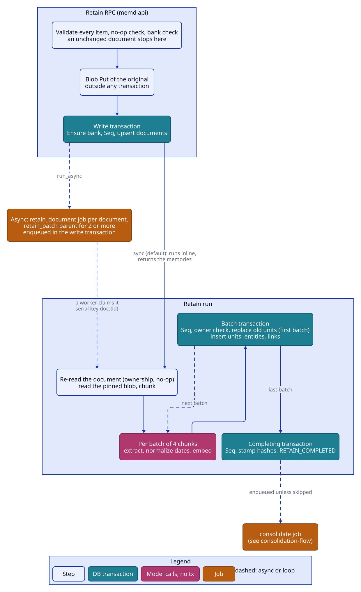
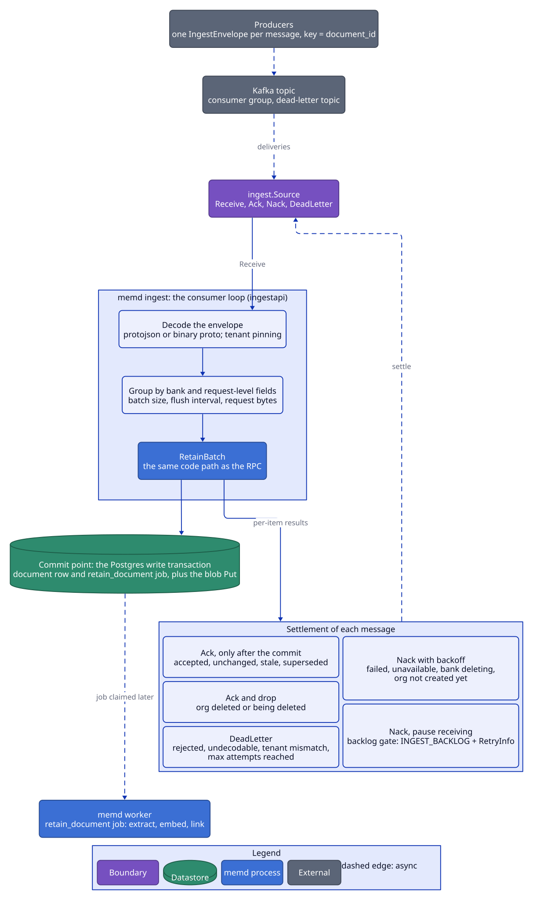

# Retain

Retain turns text into memories: it stores the original text, chunks it, extracts facts with an LLM, normalizes
their dates, embeds them, resolves their entities, links them, and commits them in short transactions. Documents
are the upsert unit: re-retaining a document id replaces its memories. Two RPCs write documents: Retain, for
interactive calls, and [RetainBatch](#retainbatch), for bulk producers. The code is `internal/memory` (the
ingestor and the retainer), with `internal/timex` and `internal/linking` as libraries; ReprocessDocument and
RetagDocument are `internal/document`.

## Flow

## Ingest

1. **Validate every item first.** More than `ingest.max_retain_items` items (100; RetainBatch takes bulk), an
   item's content over `ingest.max_document_bytes` (2 MiB, field `items[k].content`; it keeps every stored text
   within one GetDocument response), a document id that appears twice in one request, custom extraction mode
   without a `custom_extraction_prompt`, and an `ALL_COMBINATIONS` scope fan-out over `max_combinations` (see
   [consolidation.md](consolidation.md#scopes); reason `TOO_MANY_SCOPES`) are INVALID_ARGUMENT, and nothing is
   stored. For an unknown bank, validation uses the tenant level merged with the overrides, so a rejected retain
   leaves no bank behind.
2. **Overrides** merge request < item (`RetainOverrides` on both), and the item's tags are added to the request's
   `document_tags`. An empty `document_id` gets a generated UUID; an unset timestamp is "now" at ingest;
   `timeless` wins over the timestamp.
3. **No-op and revision check, before any write.** A document whose content hash and no-op hash both match its
   last *completed* retain (`extracted_at` set) is unchanged, unless `force_reextract` is set. An item whose
   `revision` is lower than the document's stored revision is stale (this check comes first, and
   `force_reextract` does not override it). An unchanged or stale item writes nothing (no blob, no upsert, no job,
   no seq bump, no model call) and is reported `unchanged` or `stale` with no operation.
   - Content hash: hex SHA-256 of the original text.
   - No-op hash: SHA-256 of the JSON of the merged request < item overrides (`""` when none), extended with the
     item's `observation_scope_modes` when set. Tags, context, timestamp and metadata are part of neither hash,
     so a tag-only change on unchanged content is a no-op (RetagDocument changes tags).
   - Revision: a client-chosen version per document (an event time, a source row version, a broker offset).
     Equal or higher proceeds to the no-op check; either side unset means unversioned and always proceeds. The
     upsert stores the item's revision; an item without one, and ReprocessDocument, leave the stored revision as
     it is.
4. **Bank check.** The pre-write read rejects a tombstoned bank (FAILED_PRECONDITION, `BANK_DELETING`) before the
   blob is written. An unknown bank is fine; the write creates it.
5. **Blob Put** at `blob.Key(...)` = `{tenant}/{org}/{bank}/docs/{document}/{content_hash}`, outside any transaction
   (a repeated Put of the same key is harmless).
6. **Write transaction.** `Banks().Ensure`, `tx.Seq`, then, per changed item, the no-op and revision check
   again on the document as read under the Seq lock, and the upsert of each item still changed, with its stored
   overrides, tags, blob key, item observation scopes and revision. Upsert clears `extracted_at`, so the document
   is "in flight". The re-check closes a race: a retain that completes between step 3 and this transaction would
   otherwise have its fresh `extracted_at` cleared by the upsert, forcing a second, paid extraction of the same
   content; a newer revision stored meanwhile would be overwritten. An item it turns unchanged or stale keeps its
   blob (the key is content-addressed and already the document's). When nothing is left to write, the transaction
   rolls back, so the call bumps no seq and creates no bank.
7. **Sync** (default): run each changed document inline, in item order, and return the memories created and the
   summed per-slot usage of the extraction calls. No operation rows are created. **Async** (`run_async`): the
   write transaction also enqueues one `retain_document` per changed document (serial key `doc:{id}`, no dedupe,
   with the merged overrides), under a `retain_batch` parent when two or more are enqueued, and the response
   carries those operations.

The `retain_document` payload (`jobs.RetainPayload`) pins everything the run needs, because the document row
doesn't store it: content hash and blob key; tags, context, timestamp or timeless, metadata, entity hints,
`resolve_entities`, observation scopes, `force_reextract`, `skip_consolidation`; and the chunking knobs
(`chunk_max_tokens`, `chunk_overlap_tokens`, `structured_chunk_max_tokens`) as resolved at ingest, so a config
change between attempts can't move chunk boundaries under a resuming job. The run always reads the blob at the
pinned key, never at the document's current key.

## RetainBatch

RetainBatch is bulk ingestion for producers with at-least-once delivery: queue consumers, sync jobs, backfills. It
is always asynchronous, every item needs a `document_id`, and it returns one result per item, so one bad item never
fails the call. `memory.Service.RetainBatch` is the one path: the RPC calls it, and so does the queue consumer.

| Status | Meaning | Written |
|---|---|---|
| `ACCEPTED` | the document's `retain_document` is queued; `operation` is it, or the identical one already in flight | the document row and the job, or nothing when joined |
| `UNCHANGED` | same content and no-op hash as the last completed retain | nothing |
| `STALE` | `revision` lower than the document's stored one, or than another item of the call for the same document | nothing |
| `SUPERSEDED` | a later item of the call has the same `document_id` and wins | nothing |
| `REJECTED` | permanent: the item is invalid; `error` has the code, reason, message and fields (`items[k].document_id`) | nothing |
| `FAILED` | transient: a dependency failed (blob store, database); retry the item with backoff | nothing |

There is no `retain_batch` parent operation: the per-item operations are the tracking. A parent spanning several
write transactions could be settled by the tick before the later ones commit, and a joined operation can't be
re-parented.

1. **Call checks.** 1 to `ingest.max_batch_items` (500) items and at most `ingest.max_request_bytes` (16 MiB) of
   content, else INVALID_ARGUMENT for the call. `max_request_bytes` is also the gRPC server's receive limit.
2. **Backlog gate.** The bank's and the org's pending `retain_document` rows are counted, each count stopping one
   past its limit (`ingest.max_pending_per_bank`, 5000; `ingest.max_pending_per_org`, 50000). Over either limit
   the whole call fails with RESOURCE_EXHAUSTED, reason `INGEST_BACKLOG`, and a `google.rpc.RetryInfo` of
   `ingest.retry_after` (10 s), before anything is written. The gate never rejects single items, so a consumer can
   pause and redeliver the whole poll.
3. **Bank config** as for Retain (an unknown org is NOT_FOUND for the call).
4. **Per item.** A decode error, a missing `document_id`, content over `ingest.max_document_bytes` (2 MiB),
   invalid item overrides, and what Retain's validation rejects (custom mode without a prompt, too many scopes)
   make the item REJECTED; a transient error while planning makes it FAILED.
5. **Same document twice.** The item with the highest `revision` wins, the last one among equals (or when
   revisions are unset). An earlier item it replaces is SUPERSEDED; a later item with a lower revision is STALE.
6. **Pre-read** as Retain's step 3 and 4: a bank being deleted fails the call (nothing was written); items are
   settled UNCHANGED or STALE.
7. **Blob Put** of the remaining items, eight at a time, outside any transaction. A failed Put fails its item.
8. **Write transactions of up to 100 items.** Each takes `Banks().Ensure` and `tx.Seq` (so a 500-item batch holds
   the bank's lock five times, briefly), then per item re-reads the document under the lock: UNCHANGED or STALE as
   in Retain's step 6; else it **joins** the retain in flight when the document is in flight with exactly what the
   item would write (blob key, tags, no-op hash, and a revision the item would not raise) and the newest active
   `retain_document` on `doc:{id}` (pending or processing, no cancel requested) carries the same blob key and no-op
   hash; else it upserts the document (storing its revision) and enqueues a `retain_document` (no parent). A
   document in flight because its last run FAILED has no active job, so the item enqueues a new one. A transaction
   that fails with INVALID_ARGUMENT is replayed one item per transaction, so only the bad item is REJECTED; any
   other failure FAILS its items, which committed nothing.
9. **Compensation.** When an item's write failed because its org is unknown or being deleted or its bank is being
   deleted, the blob the call stored for it is deleted, so nothing is left under a deleted prefix. Other failures
   keep the blob: its content-addressed key may belong to a retain in flight.

Under at-least-once delivery the commit point is the write transaction: a redelivered item is UNCHANGED (completed),
ACCEPTED joining the identical operation (in flight) or STALE (an older revision), so it never queues a second paid
extraction. Ordering per document comes from the `doc:{id}` serial key (one run at a time, oldest first) and
`revision`; there is no ordering across documents.

### Queue ingestion

`memd ingest` (and `memd all` when `MEMD_INGEST_PROVIDER` is set) consumes a message queue and retains every message
through RetainBatch's path. Queue sources sit behind `internal/ingest`
([architecture.md](architecture.md#ingest-boundary)); Kafka is the provider (`MEMD_INGEST_PROVIDER=kafka`), and the
consumer loop is `internal/ingestapi`.

**The message.** One `IngestEnvelope` (defined in the proto, so producers can use the generated code) per message:
`tenant_id`, `org_id`, `bank_id`, one `RetainItem` (`document_id` required, `revision` recommended), and optional
`document_tags`, `overrides` and `skip_consolidation`, as RetainBatch takes them. The body is protojson, or binary
protobuf with the message attribute (Kafka header) `content-type: application/x-protobuf`; unknown JSON fields are
errors. Producers set the message key to the document id, so the versions of one document arrive in order.

**Tenant pinning.** `MEMD_INGEST_TENANT` pins the source to one tenant: an envelope without `tenant_id` is that
tenant's, and one naming another tenant is dead-lettered (`TENANT_MISMATCH`). `MEMD_INGEST_ORG` pins the org the same
way (`ORG_MISMATCH`). An unpinned source requires `tenant_id` and trusts it, which is only safe when the broker's
publish permissions are the tenant boundary (a topic per tenant, or ACLs).

**The loop.**

1. **Receive** up to `ingest.consumer.batch_size` (100) messages, polling again while messages keep arriving until
   the batch is full or `flush_interval` (500 ms) has passed; an idle poll flushes at once.
2. **Decode** each message. An undecodable body (`UNDECODABLE`), a pinning mismatch, or an envelope the RetainBatch
   RPC would refuse (an invalid tenant, org or bank id, no item, an item that does not decode, invalid request
   overrides: `INVALID_ARGUMENT`) is dead-lettered at once.
3. **Group** the rest into RetainBatch calls by bank and request-level fields (document tags, overrides,
   skip_consolidation, which a call applies to all its items), each of at most `batch_size` items and
   `ingest.max_request_bytes` of content, and run up to `concurrency` (4) calls at once.
4. **Settle** each message from its item's result. The error class decides before the status, because an org or bank
   deletion error reaches a write as a REJECTED item too:

| Outcome | Settlement |
|---|---|
| ACCEPTED, UNCHANGED, STALE, SUPERSEDED | Ack, after the write transaction committed |
| REJECTED, or a permanent call error (invalid argument, failed precondition, not found) | DeadLetter, with the error's reason |
| `ORG_DELETING`, or `ORG_NOT_FOUND` for an org that is not live and has a deletion receipt | Ack and drop (`ingest.dropped`): a deleted org's content must not come back, so it is neither retained nor copied to the dead-letter topic |
| `INGEST_BACKLOG` (RESOURCE_EXHAUSTED) | Nack after its RetryInfo delay and pause receiving for that long; it never counts towards the attempts |
| FAILED, a transient call error (UNAVAILABLE, a conflict, a deadline), `BANK_DELETING` (the bank may be re-created, as over the API), `ORG_NOT_FOUND` without a receipt (the org is not created yet) | Nack after `backoff_initial` (1 s) doubled per delivery up to `backoff_max` (5 m); DeadLetter (`MAX_ATTEMPTS`) once the delivery count reaches `max_attempts` (10) |

A dead letter that fails (the dead-letter topic is unreachable) is nacked instead, so no message is held in flight.
A live org wins over a receipt: receipts outlive the re-creation of their org id, so the consumer looks the org up
first and drops only when it is still missing or deleting.

**Delivery.** At-least-once end to end. The commit point is RetainBatch's write transaction (the document row and its
`retain_document` job); nothing is acked before it. A crash, a rebalance or a lost Ack between the commit and the Ack
redelivers a message that RetainBatch then finds UNCHANGED, joins in flight (ACCEPTED, the same operation) or finds
STALE, so a redelivery never queues a second extraction. From the commit on, the durable job queue carries the work
exactly as for an async Retain.

**Shutdown.** On SIGTERM the consumer stops receiving, retains and settles the messages it already holds within
`ingest.consumer.shutdown_grace` (20 s), then closes the source (the Kafka source commits its offsets and leaves the
group). Whatever is still unsettled is redelivered to the next consumer.

**Observability.** `memd.ingest.received`, `.acked`, `.nacked`, `.dead_lettered` and `.dropped` (tag `reason`) and
`memd.ingest.batch.latency`, and one `memd.ingest.batch` span per RetainBatch call carrying the tenant, org and bank
([architecture.md](architecture.md#observability)).

## The retain run

The same run serves sync Retain (inline, through `jobs.Inline`), async jobs and ReprocessDocument.

1. **Re-read the document** and check ownership (below). The no-op check repeats here, so a replayed job is a
   no-op too.
2. **Read the pinned blob.** Its content hash must match the payload, else FAILED_PRECONDITION.
3. **Chunk** the text (budgets in tokens):
   - a JSON array of objects is cut between elements (turns) and JSONL between lines; a turn or line stays whole
     up to `structured_chunk_max_tokens`;
   - anything else is split at the most preferred separator present (paragraph, line, sentence, clause, word,
     character) and packed greedily up to `chunk_max_tokens`; overlap applies to plain text only.
4. **Batches of 4 chunks.** Within a batch, chunks are extracted one by one, dates normalized and the batch's
   facts embedded in one call, all outside any transaction. Then one batch transaction: `tx.Seq`, the ownership
   re-check, the replacement (first batch only), chunk and unit inserts stamped with the seq, label resolution,
   entity resolution and attachment, and linking. Before every batch the run reports progress (stage
   `retain_chunks`), which is also its cancel checkpoint.
5. **Completing transaction:** `tx.Seq`, the ownership re-check, the replacement if no batch did it (content with
   no chunks), stamp the document's hashes and `extracted_at`, append RETAIN_COMPLETED, and enqueue the bank's
   automatic consolidate (pending dedupe) unless `skip_consolidation` is set or the effective config has
   `observations.enabled` or `observations.auto_consolidation` off.

The job's result (`Operation.debug_summary`) reports the document id, memories created, unchanged, superseded,
chunks total and chunks skipped; its usage is the EXTRACT usage.

### Replacement

The first transaction that writes units for a run replaces the document's old units:

1. **Reopen:** if `extracted_at` is set (another run of the same content completed meanwhile), re-upsert the
   document as read in this transaction, which clears only `extracted_at`. A document whose units are being
   replaced is in flight, so a run that fails after this point can never leave it stamped complete with missing
   facts.
2. List the document's live unit ids; delete the observations citing them and reset their other sources (before
   the units go, since evidence rows cascade).
3. Delete the units: link neighbours go to `graph_dirty`, entities to `entity_maintenance`.
4. Enqueue `graph_maintenance` (pending-or-running dedupe).

Old chunk rows are not deleted; they are overwritten by index or ignored (see resume).

## Ownership and resume

Several retains of one document can overlap: a sync retain (no serial key) next to an async job, a FAILED job
retried after a newer retain completed, a reclaimed job resuming after a newer one started. These rules make the
latest retain win without losing facts.

- **Salted chunk hashes.** A chunk's stored hash is `sha256(runKey || 0x00 || sha256(text))`, where `runKey` is
  the job id for a `retain_document` job (stable across reclaims and RetryOperation) and a fresh UUID for an
  inline run. A chunk is skipped on resume only when the stored hash at its index equals *this run's* salted
  hash, so leftovers of an earlier retain are never trusted.
- **Trusting committed chunks** requires both: index 0 carries this run's salted hash, and the document is still
  in flight (`extracted_at` unset). Otherwise the run starts over with a full replacement. Rows at indexes past
  the content's chunk count are ignored. If any chunk of the run is committed, an earlier attempt already
  replaced the old units and no batch replaces them again.
- **Ownership is the blob key and the stored overrides.** Before any model call, and inside every write
  transaction right after `tx.Seq` (which serializes against other retains of the bank), the run checks that the
  document still has its blob key and overrides, and that every chunk it committed still carries its salted hash
  (a newer run's first batch always rewrites chunk 0). If not, the transaction aborts having written nothing and
  the run is **superseded**:
  - async: the job completes with a "superseded" result and is not retried; it never stamps the document;
  - sync: the RPC fails with ABORTED (`CONFLICT`) and the client may retry.
- **Tags are adopted, not ownership.** When only the document's tags changed (RetagDocument, or a newer retain of
  the same content and overrides), the run keeps going under the document's current tags, read under the Seq
  lock, and stamps every unit it writes from then on with them. The retag already rewrote the units of earlier
  batches in its own transaction, and its `retag_document` job runs behind the retain on the same `doc:` serial
  key, so no unit keeps stale document tags.
- **Inline runs never resume.** A failed sync Retain is retried by the client as a new run, which replaces
  whatever the failed run wrote. A document whose extraction takes longer than the call deadline can therefore
  never complete synchronously; use `run_async` or a longer client deadline (see
  [known-limitations.md](known-limitations.md#sync-retains-longer-than-the-call-deadline-never-complete)).

## Extraction

One EXTRACT call per chunk, with the retain mission, the item context (naming the speaker) and the narrator rule.
`retain.extraction_mode` picks the prompt:

| Mode | Behaviour |
|---|---|
| concise (default) | Compact facts. |
| verbose | Detailed facts with every dimension. |
| verbatim | One fact per chunk whose text is the chunk; the call adds only dates (from the first entry), entities and labels (merged across entries). |
| chunks | One `world` fact per chunk, no LLM call. |
| custom | `retain.custom_extraction_prompt` supplies the guidelines; required at ingest. |

- **Fact text.** The model returns `what / when / where / who / why`; the fact text is `what | When: when |
  Involving: who | why` (`where` is dropped; empty, null and `N/A` dimensions are omitted). A fact without
  `what` is dropped.
- **Fact type.** The model labels each fact `world` or `assistant`; `assistant` maps to `experience`. Anything
  else falls back to the fact kind, then `world`.
- **Dates.** Only `event` facts take `occurred_start/end` and a time expression; a missing end equals the start.
  Dates parse as RFC 3339, `YYYY-MM-DDThh:mm[:ss]` or `YYYY-MM-DD` (UTC when no zone); anything else is unset. A
  time expression with no absolute start is resolved by time normalization against the item's mention time. A
  timeless item drops every date.
- **Causes.** `caused_by` keeps at most two indexes of earlier, kept facts of the same chunk, remapped past
  dropped facts; ignored when `retain.extract_causal_links` is false (default true).
- **Entities.** Mentions plus the item's entity hints. With `retain.entities_allow_free_form` false, extracted
  mentions are dropped; hints and labels are kept.
- The `when/where/who/why` fields are typed as strings with `N/A` as the empty marker; null and `N/A` are treated
  alike.

## Time normalization

`timex.Normalizer` serves retain (a fact's time expression) and recall (a query's time window). Rules run first;
the TIME_PARSE model runs only when a temporal cue is found and no rule matched. No cue means no window and no
model call. Both sides take the caller's effective config, so a per-request TIME_PARSE binding applies.

- **Frame.** Arithmetic uses the reference time in its own location; weeks start on Monday; every window is
  half-open `[start, end)`. At retain, `occurred_start` / `occurred_end` take the window bounds (so "yesterday"
  is `[Fri 00:00, Sat 00:00)`); an unbounded side stays unset.
- **Relative.** "last/past/previous N days|weeks|months|years" runs from midnight N units back through the end
  of today ("next N" mirrors it); "last/this/next week|month|year|quarter|decade|weekend" is the calendar period;
  "N units ago" is that whole unit; couple = 2, few/several = 3, widened to N−1..N+1; "recently"/"lately" = the
  last 30 days; "earlier/later this year" splits the year at the reference. Weekdays: "last X" strictly before
  today, "this X" in the current week, "next X" strictly after, "on X" includes today.
- **Named periods without a year** resolve to the most recent occurrence starting no later than the reference.
  Seasons are northern meteorological (winter Y = Dec Y – Feb Y+1). Month and year shifts clamp to month end.
- **Absolute.** ISO, "March 5, 2024", "5 March 2024", "the 4th of July", day ranges "March 3-5, 2024". Slash
  dates are US m/d, swapped when the first number is over 12. Two-digit years fall in the reference's century,
  minus 100 when more than 20 years ahead. A bare 4-digit year counts only within ref−120..ref+20 years and never
  next to `$ # / : -` or after an identifier word (port, ticket, version, page, ...). ISO timestamps keep only the
  date, as a day in the reference's location.
- **Ranges.** "between X and Y" / "from X to Y" = [X.start, Y.end) (an endpoint may borrow the other's year);
  "since X" = [X.start, ref); "until X" = (−∞, X.end); "before X" = (−∞, X.start); "after X" = [X.end, ∞).
  "now"/"present" as a range end is the instant ref; "today" the whole day.
- **Cues** are words that can only be about time, parseable dates, or qualified periods. Months count only next
  to a day, year, preposition or determiner ("may I" is not a cue); seasons and weekdays need a qualifier; bare
  "weekend", "overnight", "now", "date", "second" are not cues; before/after/until before a bare pronoun ("after
  my workout") are not cues. Vague phrases ("the day before my birthday", "since then") go to the model.
- **Model fallback** returns `{start, end}`; both null, start ≥ end, or an unparseable bound give no window; a
  one-sided answer is kept. Any bound outside years 1..9999 means no window.
- **Degradation.** Retain never fails on dates: any fallback error (unbound slot, invalid output, timeout) is
  logged and the fact keeps no dates. Recall's query window degrades the same way (recall runs without a time
  constraint). Only the caller's own cancellation is returned.

## Entity resolution

A fact's names are its mentions plus the item's hints (whitespace collapsed, blank names and names over 512
characters dropped, case-insensitive duplicates merged). `linking.Resolver` runs inside the batch transaction,
after `tx.Seq`, with no model call.

- **Candidates** come from the trigram index (pg_trgm similarity ≥ 0.3); label entities are skipped.
- **Gates**, in order; a candidate that fails one is never scored:
  1. An identical name (case-insensitive, or identical trigram sets) passes every gate whatever its kind.
  2. For a non-identical name, when both kinds are set they must be equal.
  3. Trigram similarity ≥ 0.3.
  4. Word compatibility: when each name has a number the other lacks they differ ("Room 101" vs "Room 102";
     numbers normalized: leading zeros and all-zero fractions dropped). Single-word names pass. Otherwise every
     word of the shorter name must match a word of the longer one: equal, a prefix (corp / corporation), or a
     SequenceMatcher ratio ≥ 0.6 ("John Smith" and "Jane Smith" stay apart).
- **Score.** Identical name = 1. Otherwise `0.5 × trigram + 0.3 × co-occurrence share + 0.2 × recency`, where the
  co-occurrence share counts the fact's other names whose identical-name entity co-occurs with the candidate, and
  recency is `1 − days/7` when the candidate was last seen within 7 days of the fact's time (occurred start, else
  mention time).
- **Merge or create.** The best candidate merges when its score (rounded to 6 places) is at least
  `retain.entity_match_threshold` (default 0.6), widening `first_seen` / `last_seen`. Otherwise a new entity is
  created with the mention's kind.
- **Literal names.** `resolve_entities = false` applies to the caller's hints only: they match an existing entity
  by exact case-insensitive name or create one. Extracted mentions always resolve.
- **Labels** (`retain.entity_labels`, through `linking.LabelResolver`) resolve by exact match to label entities
  unique per (kind, value). A value or multi-value label is kept only with a declared value, stored in the
  declared spelling; map fields are `key:field`. `write_to_tags` adds `key:value` to the unit's tags. Unit tags
  are therefore `normalize(document tags ∪ label tags)`.
- If graph maintenance prunes a resolved entity before it is attached, the transaction re-runs and resolves again
  (see [storage.md](storage.md#postgres-adapter-behaviour)).

## Links

`linking.Linker` writes links through the graph boundary (`tx.Graph()`), in the transaction that inserted the
units.

- **Temporal:** facts whose time (occurred start, else mention time) is within `retain.temporal_link_window_hours`
  (default 24), nearest first, up to `retain.temporal_link_cap` (default 20); weight `max(0.3, 1 − gap/window)`.
  Timeless units get none.
- **Semantic:** nearest facts by cosine at or above `retain.semantic_link_min_similarity` (default 0.7), up to
  `retain.semantic_link_k` (default 50); weight = similarity.
- **Causal:** from the batch's `caused_by`, cause → effect, one row each, uncapped.
- Temporal and semantic links are written in both directions so the forward-only graph arm reaches a neighbour
  from either end. A cap bounds only the linked unit's own pass: a neighbour already at its cap still takes the
  pair, so later units in a dense cluster are never starved, and old units can exceed the cap. Observations are
  never linked.
- Retain and rederive link with their effective config; graph maintenance relinks with the bank's stored tuning
  (tenant < org < bank), read inside its transaction.

## Graph maintenance

Removing units (document replacement, invalidate, edits, clears, the retag job) leaves their neighbours short of
links and their entities possibly orphaned. Removal records neighbours in `graph_dirty` and entities in
`entity_maintenance` in the removing transaction, and the remover enqueues `graph_maintenance` (serial key
`graph`, pending-or-running dedupe). The job is `maintenance.Service.RunGraphJob`.

- **Batches.** One transaction per batch: up to 100 dirty units are re-read and the live ones passed to the
  linker, which tops up temporal and semantic links to their caps and keeps existing edges; every taken id is then
  cleared from the queue, whether or not anything was added. Up to 500 queued entities are examined in the same
  batch, and those no live unit references are deleted with their co-occurrences (every examined entity leaves
  the queue). Every step is idempotent.
- **No change seq.** Links and entity rows are not memory content, so maintenance never makes mental models
  stale. Each batch instead reads the bank row and stops (as cancelled) when the bank is gone or tombstoned. The
  job never creates a bank.
- **Budget and termination.** The run checks a 240 s budget between batches (never cutting one in half). It is
  done when a batch consumes nothing from either queue. Out of budget with work left, it enqueues a continuation.
  When it is done it re-checks both queues once more and re-enqueues if either has rows; any work that still
  slips past (committed between that check and completion) is picked up by the maintenance tick's graph
  reconcile.
- Because pruning takes no bank lock, it can delete an entity that a concurrent retain or curation has just
  resolved; the attach then conflicts and that transaction re-runs its resolution.

## Reprocess

ReprocessDocument re-runs retain over the stored original text, with no model call in the RPC. One transaction:
`tx.Seq` (unknown bank NOT_FOUND, tombstoned FAILED_PRECONDITION); read the document (unknown NOT_FOUND); replace
its stored overrides when new ones are given (`RetainOverrides`); rebuild the `retain_document` payload from the
stored document and re-upsert it; enqueue `retain_document` with `force_reextract` and the document's overrides.
The RPC returns that operation.

- The content hash comes from the stored blob key (the document's `content_hash` is empty until a retain
  completes); a document without stored text is FAILED_PRECONDITION. The run re-hashes the blob and fails loudly
  on a mismatch.
- Context, metadata, mention time and timeless flag are taken from the newest unit of the document that no curator
  edited (else the newest unit), because reprocessing resets curation and a curated value must not spread to
  every re-extracted unit. A document with no units reprocesses without them (mention time = now). Entity hints
  and `resolve_entities` are not stored, so a reprocess runs without them.
- Reprocess jobs never dedupe: joining a pending one could leave the job carrying old overrides that the document
  no longer has, and it would supersede itself.

## Retag (RetagDocument)

RetagDocument replaces a document's tag set.

- **No-op.** A set-equal retag (same tags, any order) reads only, writes nothing and takes no seq, unless the
  document's newest `retag_document` operation ended FAILED or CANCELLED, in which case the job is enqueued again
  (tags unchanged) to finish clearing observations. The response then carries no operation.
- **Change.** In one transaction: `tx.Seq`, re-read the document under that lock (if a concurrent retag already
  set the same tags, stop), store the new tags on the document, rewrite its units' tags (live and archived) as
  `(unit tags − old document tags) ∪ new document tags` so label tags survive, and enqueue `retag_document`
  (serial key `doc:{id}`, pending dedupe). The memories carry the new tags when the RPC returns.
- **The job** (`document.Service.RunRetagJob`) re-reads the document, re-asserts its current tags on the units (a
  no-op rewrite that stamps them with the seq and resets their consolidation stamps), deletes the observations
  citing them and resets their co-sources, enqueues the automatic consolidate, and enqueues `graph_maintenance`
  when it deleted observations. A gone document is a no-op; a gone or tombstoned bank stops it. Running it twice
  is harmless. The tags are never in the payload: a retag that joins a pending job is applied with the latest
  tags.
- Until the job runs, observations derived under the old tags still exist.

## Defaults

| Knob | Default |
|---|---|
| `retain.chunk_max_tokens` | 750 |
| `retain.chunk_overlap_tokens` | 0 |
| `retain.structured_chunk_max_tokens` | `chunk_max_tokens` |
| `retain.entity_match_threshold` | 0.6 (inclusive, score rounded to 6 places) |
| `retain.temporal_link_window_hours` | 24 |
| `retain.temporal_link_cap` | 20 |
| `retain.semantic_link_k` | 50 |
| `retain.semantic_link_min_similarity` | 0.7 |
| `retain.extract_causal_links` | true |
| `retain.extraction_mode` | concise |
| `retain.entities_allow_free_form` | true |
| `retain.default_observation_scope_modes` | combined, `max_combinations` 15 |
| Chunks per transaction | 4 (not configurable) |
| Entity candidate trigram floor | 0.3 (not configurable) |
