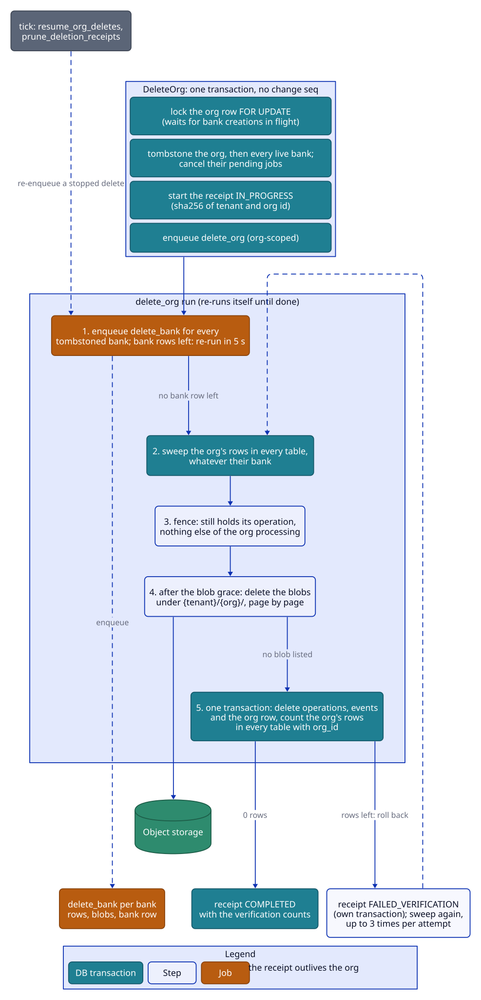

# Storage

memd keeps everything in one Postgres database (with pgvector, ParadeDB pg_search and pg_trgm) and one object
store for the original document texts. Alembic owns the schema; Go code never runs DDL and reads the schema
through sqlc. `internal/store` declares the boundary and `internal/store/postgres` implements it; `internal/blob`
declares the blob boundary and `internal/blob/s3` implements it.

## Runtime requirements

- Postgres 17 with `vector` (pgvector >= 0.8, for HNSW iterative scans), `pg_search` (BM25) and `pg_trgm`. The
  development and test image is `paradedb/paradedb:0.26.1-pg17`, pinned (never `latest`): it ships all three
  extensions. Its bootstrap script, which installs unrelated extensions, is hidden (an empty
  `/docker-entrypoint-initdb.d`), so the baseline migration creates exactly the three extensions memd uses and
  the schema dump stays clean. The test harness (`pgtest`) uses the same tag and hides the script the same way;
  change both together.
- Any S3-compatible object store (MinIO for development; the compose file uses the community build
  `pgsty/minio`) with static credentials and an existing bucket.

## Conventions

- Every table has `tenant_id text NOT NULL` except `tenants`, whose `id` is the tenant, and every table but
  `tenants` and `orgs` has `org_id text NOT NULL` right after it (a schema test checks it, so a new table can't
  escape the org). Orgs and banks have no foreign key to `tenants`, so no tenant row is needed. Banks reference
  `orgs (tenant_id, id) ON DELETE RESTRICT`: an org row can only go once none of its banks is left. Orgs are
  created explicitly (CreateOrg), never by a write; a write to an unknown bank of an existing org creates the bank.
- Client-chosen ids (org, bank, document, mental model) are `text` with composite keys `(tenant_id, org_id,
  bank_id, id)` (banks: `(tenant_id, org_id, id)`; orgs: `(tenant_id, id)`). Server ids (units, chunks, entities, operations) are global `uuid` keys: BM25 needs
  one unique key column, which a composite key can't provide. Directive ids are server-generated UUIDs stored as
  text under the bank's composite key; a directive's name is unique per bank.
- Bank-owned tables reference `banks (tenant_id, org_id, id) ON DELETE CASCADE`. Tables keyed by a uuid parent
  reference that parent and carry `tenant_id, org_id, bank_id` denormalized. Every index on bank-keyed rows starts
  with `(tenant_id, org_id, bank_id)`, so org-wide scans use the same indexes as a prefix, and every statement that
  names a bank names its org (a store test scans the queries and the dynamic builders). Every foreign key states its ON DELETE action.
- Timestamps are `timestamptz`; a NULL timestamp means "has not happened" (`extracted_at`, `consolidated_at`,
  ...). Strings are `text NOT NULL DEFAULT ''` unless NULL carries meaning.
- Tags are normalized `text[]` with GIN indexes. Normalization (`domain.NormalizeTags`): Unicode NFC, trim,
  lowercase, drop empties, dedupe, sort. Writers must store normalized tags; the store rejects unnormalized ones.
- Config, overrides, refresh settings, progress, usage and snapshots are `jsonb` using the proto field names
  (the JSON tags of the domain structs).
- Enum-like columns are `text` with a CHECK listing lowercase values; adding a value needs a schema change.
  `lifecycle_events.type` deliberately has no CHECK.
- History tables (`mental_model_history`, `lifecycle_events`, `memory_audit`, `observation_versions`) use
  `bigserial` ids that order rows with equal timestamps or seqs.
- Text orderings and keyset cursors compare bytes (`COLLATE "C"`), never the database locale.

## Tables

### Tenants, orgs and banks

| Table | Key columns | Notes |
|---|---|---|
| `tenants` | `id`, `config` | The tenant config level. |
| `orgs` | `(tenant_id, id)`, `name`, `config`, `deleting_at` | `config` is the org config level. `deleting_at` is the org delete tombstone: bank creation in the org then fails with `ORG_DELETING`. |
| `deletion_receipts` | `(tenant_id, id)`, `org_id_sha256`, `status`, `requested_at`, `completed_at`, `banks`, `verification` | The record of an org delete ([Deleting an org](#deleting-an-org)). It names the org only by hash and has no `org_id`, so it outlives the org; retention prunes it. |
| `banks` | `(tenant_id, org_id, id)`, `name`, `config`, `change_seq`, `deleting_at`, `last_memory_write_at` | `config` is the bank's own overrides. `change_seq` is the change sequence. `deleting_at` is the tombstone. `last_memory_write_at` is stamped by every `tx.Seq` (so config writes move it too); it is only displayed. |

### Documents and chunks

| Table | Key columns | Notes |
|---|---|---|
| `documents` | `(tenant_id, bank_id, id)`, `content_hash`, `overrides_hash`, `overrides`, `tags`, `blob_key`, `extracted_at`, `observation_scope_modes` | `content_hash` and `overrides_hash` belong to the last *completed* retain; `extracted_at` is NULL while a retain is in flight or failed. `overrides` are the stored retain overrides. `observation_scope_modes` is the item-level scope mode (NULL = none). |
| `chunks` | `id`, unique `(tenant, bank, document_id, chunk_index)`, `text`, `content_hash`, `token_count`, `truncated` | `content_hash` is salted with the retain run (see [retain.md](retain.md#ownership-and-resume)). Inserting a chunk at an existing index deletes the old row first; re-inserting the same chunk id rewrites it in place. |

### Memory units

`memory_units` holds the facts (`world`, `experience`) and observations (`observation`) of every bank. The API
calls a unit a *memory*.

| Column | Meaning |
|---|---|
| `id`, `document_id`, `chunk_id` | `document_id` is NULL for observations and cascades from the document. `chunk_id` is provenance only (`ON DELETE SET NULL`). |
| `fact_type`, `text`, `context`, `metadata`, `tags` | Content. |
| `embedding vector(768)` | NULL while a curated unit waits for its rederive. |
| `occurred_start`, `occurred_end`, `mentioned_at`, `timeless` | Time. `occurred_end` is an exclusive bound. |
| `proof_count`, `scope_key`, `version` | Observations only (`scope_key` is CHECK-constrained to observations). |
| `seq` | The change seq of the transaction that last wrote the unit. |
| `consolidated_at`, `consolidation_failed_at` | Consolidation stamp and park marker (facts only). |
| `edited_at` | Set by curation edits. |

### Graph

| Table | Notes |
|---|---|
| `memory_links` | `(from_unit_id, to_unit_id, kind)`, `weight`; kinds `temporal`, `semantic`, `causal`; no self-links (CHECK). Temporal and semantic links are written in both directions; causal links run cause → effect. Cascade from both units. Written only through the graph boundary (`store.Tx.Graph()`), except the cascades and the archive/restore paths. |
| `entities` | `canonical_name`, `kind`, `label_value`, `mention_count`, `first_seen`, `last_seen`. Names are not unique (resolution may keep two entities with one name). Label entities are unique on `(tenant, bank, kind, label_value)`. The store maintains `mention_count` (+1 per new `unit_entities` row on attach or restore, −1 per removed row). |
| `unit_entities` | `(unit_id, entity_id)`; cascades from both sides. |
| `entity_cooccurrences` | `(entity_a, entity_b)` with `entity_a < entity_b`, `count`; bumped on attach, never decremented. |
| `graph_dirty` | `(tenant, bank, unit_id)`: live neighbours of removed units, waiting for link top-ups. A unit's own rows go when the unit is deleted. |
| `entity_maintenance` | `(tenant, bank, entity_id)`: entities of removed units, waiting for orphan pruning. |

### Observations

| Table | Notes |
|---|---|
| `observation_evidence` | `(observation_id, unit_id)`, `quote`. Cascades from both the observation and the source unit. |
| `observation_scopes` | `(tenant, bank, scope_key)`, `tags`. One row per scope that ever held an observation; rows are kept when observations are cleared and go only with the bank. |
| `observation_versions` | `(observation_id, version)` unique, `text`, `source_ids`, `at`. Written on every create and update; outlives the observation. |

### Curation

| Table | Notes |
|---|---|
| `memory_units_archive` | Invalidated units: the unit's columns (no embedding), the `seq` of the archiving transaction, `entities_snapshot` (`[{id, name}]`), `links_snapshot` (causal links), `reason`, `operation_id`, `archived_at`. No foreign keys. |
| `memory_audit` | `unit_id`, `action` (`edit`, `invalidate`, `restore`), `reason`, `before`, `after`, `operation_id`, `at`. No foreign keys, so the rows outlive the unit. |

### Mental models and directives

| Table | Notes |
|---|---|
| `mental_models` | `(tenant, bank, id)`; spec columns (`name`, `source_query`, `folder_path`, `tags`, `max_tokens`, `refresh_settings` (schedule, scope and run settings as JSON), `overrides`), state (`content_md`, `structured_output_json`, `version`, `last_refreshed_at`, `last_seq_seen`, `last_refresh_failed_at`, `auto_refresh_paused`, `source_ids`, `last_trace`, `embedding`). `refresh_cron` duplicates the schedule's cron for a partial index; writers keep them in sync. Staleness is computed on read, never stored. `folder_path` has no table of its own (`''` is the root; folders are the path prefix tree). |
| `mental_model_history` | `kind` (`version`, `refresh_failed`), `version`, `previous_content`, `outcome`, `failure_reason`, `error_message`, `changed_at`. Cascades from the model. Trimmed per kind to `mental_models.history_max_entries`, newest first. |
| `directives` | `(tenant, bank, id)`, unique `name`, `rules`, `tags`, `active`, `created_at`, `updated_at`. Listings page by `(created_at, id)`, so an updated directive keeps its place. |

### Operations and events

| Table | Notes |
|---|---|
| `operations` | `id` (UUIDv7), `kind`, `status`, `serial_key` (NULL = no key), `payload`, `overrides`, `joinable`, `parent_id` (no FK, so pruning never cascades), `attempts`, `run_at`, `worker_id`, `heartbeat_at`, `progress`, `usage` (default `[]`), `result`, `error`, `created_at` / `updated_at` (`clock_timestamp()`), `finished_at`, `cancel_requested_at`. CHECKs: `finished_at` only on terminal rows; `cancel_requested_at` only on processing or cancelled rows. Not foreign-keyed to banks. |
| `lifecycle_events` | `seq` (the bank change seq; not unique), `type`, `at`, `operation_id`, `subject_id` (document, memory or model id; empty for operation failures). Not foreign-keyed to banks. |

## Indexes that matter

| Index | Purpose |
|---|---|
| `memory_units_embedding_hnsw` (HNSW, `vector_cosine_ops`, default m / ef_construction) | One shared index for all banks: the vector arm, semantic links, consolidation's related observations and dedup probe. |
| `memory_units_bm25` (`USING bm25 (id, text, context, tenant_id::literal, org_id::literal, bank_id::literal, fact_type::literal)`) | The text arm. The literal-tokenized filter columns push tenant, org, bank and type equality into the BM25 scan. Only one BM25 index per table is allowed. |
| `entities_name_trgm` (GIN trigram on `lower(canonical_name)`) and `entities_name_idx` | Entity resolution candidates. |
| `memory_units_unconsolidated_idx (tenant, org, bank, created_at) WHERE consolidated_at IS NULL AND consolidation_failed_at IS NULL AND fact_type <> 'observation'` | Consolidation planning and the tick's candidate banks. |
| `memory_units_seq_idx`, `memory_units_observation_scope_idx`, `memory_units_tags_gin`, `memory_units_document_idx`, `memory_units_created_at_idx`, `memory_units_occurred_start_idx` | Staleness and watermark reads, per-scope observation counts, tag filters, document replacement, listings, temporal reads. |
| `operations_processing_serial_key_uniq (tenant, org, bank, serial_key) WHERE status = 'processing'` | At most one running job per serial key. |
| `operations_active_serial_key_idx (tenant, org, bank, serial_key, kind) WHERE status IN ('pending','processing')` | The claim's NOT EXISTS (first four columns), the dedupe lookup (all five) and the queue metrics. |
| `operations_pending_run_at_idx`, `operations_processing_heartbeat_idx`, `operations_terminal_finished_idx`, `operations_parent_idx`, `operations_bank_created_idx` | Claim, reclaim, prune, batch settlement, listing. |
| `mental_models_embedding_hnsw`, `mental_models_refresh_cron_idx` (partial), `mental_models_tags_gin` | Mental-model search, the cron sweep, tag filters. Mental models have no BM25 index. |
| `lifecycle_events_seq_idx`, `lifecycle_events_at_idx` | Event polling and pruning. |

## Search query shapes

The recall arms build their SQL at run time, because the tag filter is a variable tree (`domain.TagPredicate`)
that sqlc can't express; every value is a bind parameter and only fixed SQL text is concatenated. Each search
filters by bank, fact types, tag predicate and seq range, reads only live units, and breaks score ties by id.

- **Vector** (`SearchVector`). Each vector search runs in a short transaction that sets, transaction-locally,
  `hnsw.ef_search = 200`, `hnsw.iterative_scan = strict_order` and `hnsw.max_scan_tuples = 100000`, so a small
  bank on the shared index still gets its hits. The inner query orders by `embedding <=> q` with the filters in
  its WHERE; the similarity floor is applied in the outer query. The score is cosine similarity. Units with a
  NULL embedding never match. A query vector of the wrong dimension is INVALID_ARGUMENT.
- **Text** (`SearchText`). BM25 with the `|||` (match disjunction) operator on `text` and `context`, the raw query
  as a bind parameter, so punctuation in user text is never parsed as query syntax. The score is
  `paradedb.score(id)`; the floor is applied after the limit. A blank query returns no hits.
- **Temporal** (`SearchTemporal`). A unit's span is `[coalesce(occurred_start, occurred_end, mentioned_at),
  coalesce(occurred_end, occurred_start, mentioned_at)]`; units with no time never match. A hit overlaps the
  half-open window `[start, end)` (a zero bound is open). The score is `1 / (1 + |span midpoint clamped to the
  window − window anchor| in days)`. With buckets > 1 and both bounds set, the window is cut into equal
  sub-windows and hits are taken round robin, best first in each. An optional relevance filter keeps only units
  whose embedding has cosine ≥ a floor with a query vector (units without an embedding are dropped).
- **Graph** (`graph.Reader.Expand`). A recursive CTE follows links forward (from → to) from the seeds, up to 2
  hops, restricted to the requested link kinds and to the bank. A reached unit scores the best product of link
  weights over its paths; seeds are never hits; reached units must be live and pass the type, tag and seq
  filters (intermediate units are not filtered), applied before the limit.
- **Trigram candidates.** Entity candidates use pg_trgm `similarity()` with its default 0.3 threshold.
- **Tag predicates** render one WHERE fragment from the predicate tree, shared by every search.

## Blob storage

- **Boundary.** `blob.Store` has exactly the four operations memd needs: Put an original under a key, Get it,
  List a prefix page by page, and DeletePrefix when a bank is deleted. It uses no provider types or terms.
  Errors are domain classes: a missing key is NOT_FOUND, a bad argument INVALID_ARGUMENT, any provider or
  transport failure UNAVAILABLE. `MEMD_BLOB_PROVIDER` picks the adapter; `s3` (AWS S3 and any S3-compatible
  store) is the only one today, and `internal/blob/doc.go` lists the steps to add GCS or Azure. Every adapter
  runs the shared contract suite `internal/blob/blobtest`.
- **Layout.** `blob.Key` builds `{tenant}/{org}/{bank}/docs/{document_id}/{content_hash}`, which holds a
  document's original text; `blob.BankPrefix` is `{tenant}/{org}/{bank}/` and `blob.OrgPrefix` is `{tenant}/{org}/`.
  Blobs stored under an older layout are not migrated: before the first release, recreate the bucket with the
  database. Because the key includes the content hash, every
  distinct content of a document is its own object, and a job always reads the exact content it was enqueued
  with.
- **S3 adapter.** The client signs with static credentials only (no AWS default chain), uses path-style
  addressing when `MEMD_S3_PATH_STYLE` is set (MinIO), defaults the region to `us-east-1`, and computes checksums
  only where S3 requires them. It does not contact the server at construction, so a missing bucket shows up as
  UNAVAILABLE on first use. `Put` buffers a non-seekable body in memory (document texts are bounded) and rejects a
  size mismatch.
- `DeletePrefix("")` is rejected: it would empty every tenant's data. Prefix deletion lists and deletes one page
  (up to 1000 keys) at a time; a failed key stops it with UNAVAILABLE, and a re-run finishes the rest.

## Migrations

- There is one Alembic revision until the first release, `migrations/versions/0001_baseline.py`, written as raw
  SQL with an exact `downgrade()`. A schema change edits it in place (`migrations/README.md` has the steps);
  after the first release every change is a new revision.
- `make migrate` upgrades and regenerates `schema/schema.sql` (a deterministic `pg_dump --schema-only`), which
  sqlc reads. `make migrate-check` fails when the dump is stale. A change must survive
  `make downgrade && make migrate`, put `tenant_id` on every new table, and follow the conventions above.
- The migration step runs before memd (a Job or pre-upgrade hook on Kubernetes, a make target locally). A stored
  config whose shape changed is not migrated: recreate the database.

## Bank deletion

DeleteBank is the only bulk hard delete. It runs in phases:

1. **Tombstone** (one transaction, no change seq): set `deleting_at` (the bank row is locked first), cancel every
   pending job of the bank except `delete_bank`, and enqueue `delete_bank` (serial key `bank`, pending-or-running
   dedupe, so a second DeleteBank joins the queued or running one). From then on writes are FAILED_PRECONDITION
   (`BANK_DELETING`), reads are NOT_FOUND (`BANK_NOT_FOUND`), claims skip the bank's other jobs, and running jobs
   stop at their next checkpoint (`Alive` is false) or fail at `tx.Seq`.
2. **Row batches.** Each transaction deletes up to 1000 rows across every bank-keyed table, children first
   (unit_entities, entity_cooccurrences, memory_links, observation_evidence, graph_dirty, entity_maintenance,
   observation_versions, memory_audit, memory_units_archive, memory_units, chunks, documents, entities,
   observation_scopes, mental_model_history, mental_models, directives). A table is reached only when every
   earlier one is empty for the bank, so cascades fire only into empty tables and the count is exact; 0 means
   only the bank row, its events and its operations are left. A run commits at most 100 batches, then continues
   in a new job.
3. **Fence.** Before touching blobs: `Alive` on the job, then a fresh read confirming the bank still exists and
   is still tombstoned (otherwise the run ends as done, deleting no blobs). While any other job of the bank is
   still PROCESSING (winding down to its checkpoint), the delete waits: it re-enqueues itself 5 s later and
   deletes nothing, so a lingering job can't write into a bank recreated after the delete.
4. **Blobs.** Listed and deleted page by page (1000 keys), re-checking the fence before every page after the
   first.
5. **Bank row.** One transaction re-checks that no other job is processing, deletes the bank row (only if still
   tombstoned), then the bank's lifecycle events and operations, the running `delete_bank` row included. A
   concurrent enqueue holding `FOR KEY SHARE` on the bank row makes this wait, so its row is deleted too; a later
   enqueue finds no bank. The runner treats NOT_FOUND from its final Complete as done.

After that, a write to the same bank id creates a new, empty bank.

- **Completion signal.** While the delete runs, every read of the bank is NOT_FOUND except
  `OperationService.GetOperation` of the bank's `delete_bank` operations. That operation turns NOT_FOUND when the
  last step removes the bank with all its operations, which is the completion signal. The operation can reach
  COMPLETED while a continuation still runs, so clients poll until NOT_FOUND, not until COMPLETED. The bank
  drops out of ListBanks at once.
- **Recovery.** `delete_bank` effectively retries without an attempt cap (see
  [architecture.md](architecture.md#retries)). If its row still ends FAILED (reclaimed past the cap, shutdown
  releases, a permanent error), the maintenance tick re-enqueues `delete_bank` for any tombstoned bank with none
  pending or processing; re-issuing DeleteBank or retrying the FAILED operation does the same. Every run resumes
  from whatever rows are left.
- `delete_bank` cannot be cancelled.

## Deleting an org

DeleteOrg (`internal/org`) deletes an org with every bank, row and stored blob in it, verifies that none is left,
and leaves a deletion receipt that outlives the org.

1. **Request** (one transaction, no change seq). Lock the org row `FOR UPDATE`: bank creation share-locks the same
   row, so the lock waits for creations in flight and makes new ones wait and then fail `ORG_DELETING`. Then, in
   later statements (so READ COMMITTED sees every bank committed while the lock waited), tombstone the org and every
   live bank of it, cancel every pending job of the org except `delete_bank` and `delete_org`, insert the receipt
   (`in_progress`, the number of banks tombstoned) and enqueue `delete_org`. From then on writes under the org are
   FAILED_PRECONDITION (`ORG_DELETING`, or `BANK_DELETING` once a bank is named), reads are NOT_FOUND (GetOrg
   included), and claims skip every job of the org except `delete_bank` and `delete_org`. Re-issuing DeleteOrg
   returns the same receipt and joins the running delete.
2. **Org-scoped operation.** `delete_org` belongs to the org, not to a bank: its row has `bank_id = ''` and serial
   key `org`. An org job is claimed and stays `Alive` while its org row exists, tombstoned or not; enqueuing one
   share-locks the org row (an unknown org is `ORG_NOT_FOUND`, a tombstoned one refuses every kind but
   `delete_org`). A reclaim or terminal failure writes no `OPERATION_FAILED` event (events are per bank).
   GetOperation and ListOperations with an empty `bank_id` read it, CancelOperation refuses it
   (`OPERATION_NOT_CANCELLABLE`), and RetryOperation of a FAILED one is the manual recovery path.
3. **Fan out.** Each run enqueues `delete_bank` for every tombstoned bank of the org without a pending or
   processing one (500 per transaction): the bank deletes do the per-bank work, with their own batching, fencing
   and resume. While any bank row of the org is left, the run re-enqueues itself 5 s later (a wait spends no
   attempt).
4. **Sweep.** With no bank left, it deletes the org's rows in every content table by `(tenant_id, org_id)`,
   whatever their bank, in the bank delete's order, 1000 rows per transaction: rows a straggler wrote, or rows a
   crash left behind a bank already deleted.
5. **Fence.** `Alive` on the job, and no other operation of the org PROCESSING (else it re-enqueues itself 5 s
   later).
6. **Blobs.** No earlier than `deletion.blob_grace` after the request (default: `api.rpc_deadline`, at least
   10 min), so a request that passed its org check before the tombstone has written its blob by then, it lists and
   deletes the keys under `{tenant}/{org}/` page by page, re-checking the fence between pages, then checks that a
   listing of the prefix is empty. A retain whose write is refused because its org or bank is being deleted (or is
   gone) deletes the blobs it stored itself.
7. **Finish and verify** (one transaction). Lock the org row, re-check that nothing else of the org is processing,
   delete the org's operations (the running `delete_org` included) and lifecycle events and the org row (the
   banks foreign key, RESTRICT, proves no bank is left), then count the org's rows in every table that has an
   `org_id` column, as `information_schema` lists them at run time (`orgs` excluded; `tenants` and
   `deletion_receipts` have none). Any row left rolls the whole transaction back; the receipt is then stamped
   `failed_verification` with the counts in its own transaction, and the run sweeps and verifies again, up to 3
   times, before it fails and is retried. Otherwise the receipt becomes `completed` with `completed_at` and the
   verification (`tables_checked`, `rows_remaining` 0, `blobs_remaining` 0, `verified_at`, the server version),
   and the job logs one line carrying only the receipt id. The runner treats NOT_FOUND from its final Complete as
   done.

- **Recovery.** `delete_org` retries without an attempt cap, like `delete_bank`; the tick's `resume_org_deletes`
  step re-enqueues it for any tombstoned org with none pending or processing, and every run resumes from what is
  left.
- **Completion signal.** Poll `OrgService.GetDeletionReceipt` until `STATE_COMPLETED`. It looks the org up by
  `sha256(tenant_id || 0x00 || org_id)` and returns its most recent receipt, so it answers after the org is gone
  and tells a deleted org from one never created (an org never deleted is NOT_FOUND). Receipt states:
  `in_progress`, `failed_verification` (the delete is still retrying), `completed`. The lookup and these states are
  a stable contract (the queue consumer relies on them). A receipt outlives the reuse of its org id: an org created
  again after a completed delete is live while its old receipt still answers, so a caller deciding whether an org
  is gone checks GetOrg first, and a live org wins.
- **Receipt.** `deletion_receipts` stores the receipt id, the tenant, the org id hash, the request and completion
  times, the bank count, the last verification and the server version: no bank ids, document ids, names or
  content. The hash of a short client-chosen id can be reversed by guessing, so the receipt is pseudonymous, not
  anonymous. No delete path touches the table; the tick's `prune_deletion_receipts` step drops receipts completed
  more than `retention.deletion_receipts` ago (default 3 years).
- **Restore runbook.** After restoring a database backup, re-run DeleteOrg for every org of the restored database
  whose hash matches a receipt completed after the backup was taken. Export the receipts table with, or keep it
  outside, the backup set.
- After the delete, the org id is free: CreateOrg makes a new, empty org.

### What an org delete removes, and what it can't

Removed: the org row and its config level, every bank of it (rows of every table carrying `org_id`: memories,
archive and audit, documents and chunks, entities and links, observations and their history, mental models and
history, directives, graph queues), the org's operations and lifecycle events, and every blob under
`{tenant}/{org}/`. Kept: the deletion receipt, and the tenant and its config.

Outside memd's reach (also in [known-limitations.md](known-limitations.md#org-deletion)):

| Where | What lingers | Operator action |
|---|---|---|
| Postgres physical storage | dead tuples and index entries (HNSW, BM25 segments, GIN) until VACUUM; WAL | autovacuum normally clears them within hours; run `VACUUM` on the large tables for strict deadlines |
| Postgres backups, PITR, WAL archives, replicas, snapshots | everything, until backup retention expires | backup retention within the legal deadline, plus the restore runbook above |
| Object storage with versioning or replication | noncurrent versions survive the delete, and the listing that verifies the prefix can't see them | run the bucket without versioning, or with a noncurrent-version expiry rule within the deadline (a deployment requirement) |
| Ingest broker | message content in topics until broker retention, and dead-letter copies | broker retention within the deadline; purge dead-letter topics |
| AI gateway and model providers | prompts holding memory content in gateway logs and provider retention | gateway content logging off; provider zero-retention agreements |
| Datadog | span tags `memd.tenant`, `memd.org`, `memd.bank`, operation ids, error messages (never content); JSON logs with error text | Datadog retention; ids must not be personal data |
| Container stdout and stderr logs | error text with ids | log retention |
| Clients | recall and reflect results cached by agents, eval reports | out of scope |

## Archive and restore

Invalidation moves a unit out of `memory_units`, so recall and consolidation never need a state filter.

- **Archive** (inside the caller's transaction, after `tx.Seq` and after the caller deleted the citing
  observations): lock the live unit, copy it into `memory_units_archive` stamped with the transaction's seq (no
  embedding), with `entities_snapshot` = its entities `[{id, name}]` and `links_snapshot` = its causal links,
  then remove the live row exactly as a document replacement does: link neighbours go to `graph_dirty`, its
  entities to `entity_maintenance` (mention counts decremented), and links, entity rows and evidence go by
  cascade.
- **Restore** (after `tx.Seq`): delete the archive row and insert the unit back with the transaction's seq, no
  embedding and no consolidation stamps (rederive and consolidation redo them). Reattach snapshot entities that
  still exist and causal links whose partner is live; a causal link whose partner is itself archived is appended
  to the partner's snapshot, so restoring the partner later brings it back. A vanished chunk is dropped; a
  vanished document is FAILED_PRECONDITION; an id not archived in the bank is NOT_FOUND. Temporal and semantic
  links are not snapshotted: rederive rebuilds them.
- An archived unit reads back with state `invalidated`, its snapshot entity names (sorted), and no sources, proof
  count, version, embedding or consolidation stamp; its `updated_at` is `archived_at`.

## Postgres adapter behaviour

- **Error mapping:** no rows and foreign-key violations (23503) → NOT_FOUND; unique violations (23505) →
  ALREADY_EXISTS; CHECK and NOT NULL violations, SQLSTATE class 22 (bad text, NUL bytes, out of range) and 54000
  → INVALID_ARGUMENT (so a job fails at once instead of retrying); 40001, 40P01 and 55P03 → CONFLICT; anything
  else (connection loss, timeouts) → UNAVAILABLE. Context errors and already-classified errors pass through.
- A malformed server id in a lookup matches nothing; in an insert it is INVALID_ARGUMENT; an empty id on insert
  gets a fresh UUID. Repeated ids in a batch lookup come back once, in first-occurrence order.
- Writes never create a missing parent: a write whose bank, document or model doesn't exist fails its foreign key
  (NOT_FOUND). Creating a bank on write is the caller's job (`Banks().Ensure`).
- `Attach` of an entity that a concurrent graph-maintenance prune deleted attaches nothing and returns a
  conflict; the transaction re-runs, and its entity resolution then sees the pruned entity is gone and creates or
  merges into a live one.
- Unknown enum values in reads and a malformed cursor are INVALID_ARGUMENT; the API layer maps enums, so only a
  programming error or a tampered token reaches them.
- Listing reads return NOT_FOUND for an unknown or tombstoned bank. Id-keyed lookups never check the bank:
  callers already hold ids read from a live bank.
- The maintenance tick's cross-bank scans (candidate banks for consolidation, stalled deletes, banks with graph
  work, stranded facts, retain-batch settlement, cron models, failed refreshes) and the queue metrics read are
  `store.Maintenance`, which `postgres.DB` implements beside `store.DB` and `jobs.Claimer`.
- The pool needs at least two connections (`DB.Read` never waits on an open transaction); `cmd/memd` sizes it
  with `MEMD_DB_MAX_CONNS` (0 = `max(2 × worker slots + 16, 32)`).
